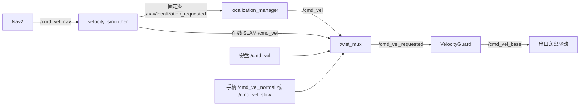

# Duojin02 真机开发接口

平台为 Jetson Orin Nano、Ubuntu 22.04、ROS 2 Humble；统一硬件为麦克纳姆底盘、IMU、N10Plus 串口雷达。本文描述当前开发工作树的模块和接口；构建、设备命名、启动见 [主 README](README.MD)，版本及证据状态见 [文档索引](docs/README.md)。ROS 名称保留 `duojin01_*`。

## 模块

| 包（共 7 个） | 职责 |
| --- | --- |
| `duojin01_base_driver` | 底盘串口、速度命令、里程计 / IMU / 电池反馈 |
| `lslidar_driver` | N10Plus 串口采集、540 格扫描和点云 |
| `duojin01_description` | 底盘、雷达、IMU 的 URDF、网格和 TF |
| `duojin01_bringup` | 启动、EKF、速度仲裁、定位管理、建图与 Nav2 |
| `duojin01_slam_tools` | 地图快照、位姿图保存、离线建图和 TF 过滤 |
| `duojin01_teleop` | 键盘遥控；手柄使用 bringup 的 Joy 配置 |
| `duojin01_navigation` | PreciseLattice、PreciseMPPI、持续停稳判据和 VelocityGuard |

相机、机械臂、AprilTag、任务包装及相关自定义消息已移除。导航使用标准 Nav2 Action；外部 ROS 依赖由 rosdep 安装，SLAM Toolbox 使用固定源码和项目补丁覆盖层。

## 指令所有权与接口

当前 Nav2 栈包含规划、控制、BackUp/Wait 行为、BT 导航和速度平滑 **5 个服务节点**；这不是整个 ROS 图的节点数或进程数。固定图另外有 map server、AMCL 和统一 `localization_manager`；在线 SLAM 路线由 SLAM Toolbox 提供地图与定位，不启动固定图定位管理器。

两条 smoother 输出按启动模式选择，不能同时启动两个导航栈。定位管理器负责固定图的健康、恢复与导航许可；VelocityGuard 验证仲裁后的全部请求。旧的独立健康闸门、重复 Collision Monitor、未使用的路径平滑服务及航点执行器已从当前架构移除。`/cmd_vel_guarded` 是历史链路名称，不能接入当前链路；`/cmd_vel_base` 的发布者应是 VelocityGuard。

| 接口 | 类型 | 用途 |
| --- | --- | --- |
| `/cmd_vel_nav` | `geometry_msgs/msg/Twist` | Nav2 原始请求，进入速度平滑器 |
| `/nav/localization_requested` | `geometry_msgs/msg/Twist` | 固定图平滑请求，进入定位管理器 |
| `/cmd_vel` | `geometry_msgs/msg/Twist` | 获准的导航或键盘输入，进入 mux |
| `/cmd_vel_normal`、`/cmd_vel_slow` | `geometry_msgs/msg/Twist` | 手柄两档输入 |
| `/cmd_vel_requested` | `geometry_msgs/msg/Twist` | mux 仲裁结果，进入保护 |
| `/cmd_vel_base` | `geometry_msgs/msg/Twist` | 保护后的底盘请求 |
| `/odom`、`/odometry/filtered` | `nav_msgs/msg/Odometry` | 原始 / EKF 里程计 |
| `/imu` | `sensor_msgs/msg/Imu` | IMU 反馈 |
| `/battery_voltage` | `std_msgs/msg/Float32` | 电池电压；有话题不等于可读取供电瞬态 |
| `/scan` | `sensor_msgs/msg/LaserScan` | laser 坐标系的 540 格扫描 |
| `/lslidar_point_cloud` | `sensor_msgs/msg/PointCloud2` | 同帧雷达点云 |
| `/motor_control` | `std_msgs/msg/Int8` | 雷达停转 `0` / 旋转 `1` |
| `/navigate_to_pose`、`/navigate_through_poses` | `nav2_msgs/action/NavigateToPose` / `NavigateThroughPoses` | map 坐标系目标与结果 |
| `/initialpose` | `geometry_msgs/msg/PoseWithCovarianceStamped` | 人工指定固定图真实初值 |
| `/localization/status`、`/localization/healthy` | `std_msgs/msg/String`（JSON）/ `Bool` | 固定图状态证据 / 观察标志 |
| `/localization/recover` | `std_srvs/srv/Trigger` | 受理恢复请求；成功响应不等于健康 |

固定图需要真实初值、新鲜扫描、map TF 和扫描地图一致性，再激活导航。失配、缺测、恢复窗口与遥控接管只在 [定位健康与恢复](docs/localization-health.md) 定义，避免各文档维护不同阈值。真机用系统时钟；只有独立离线回放消费者用 `/clock`。

速度源断流 0.25 s 后，平滑器开始按配置减速度制动，完全停车另需制动时间。底盘速度流超过 0.25 s 未更新会发送实际串口零速度帧；这不能替代下位机独立通信超时。导航闲置时定位管理器停止续租，恢复后只接受新请求，不能重放闭锁期间的旧请求。

## 配置与模型边界

| 内容 | 维护位置 / 边界 |
| --- | --- |
| 串口路径、波特率 | 启动参数 `base_serial_port`、`base_serial_baudrate`、`lidar_serial_port`；各完整入口提供的范围见 [启动参数表](README.MD#真机启动) |
| 里程计尺度、IMU 偏置、协方差 | [base_driver.yaml](src/duojin01_bringup/config/base_driver.yaml)，需要实物标定 |
| CAD 安装几何、坐标基准 | [chassis_geometry.xacro](src/duojin01_description/urdf/chassis_geometry.xacro)、[测量报告](docs/chassis/README.md) |
| 当前足迹、padding、控制与规划参数 | [nav2.yaml](src/duojin01_bringup/config/nav2.yaml)，历史报告数值不覆盖它 |
| 固定图健康参数与地图语义 | [localization_health.yaml](src/duojin01_bringup/config/localization_health.yaml)、[健康契约](docs/localization-health.md) |
| 保护参数 | [velocity_guard.yaml](src/duojin01_bringup/config/velocity_guard.yaml)，不为显示性能削弱安全检查 |

导航范围按底盘含四轮的投影维护。CAD 的轮轴和滚子包络不是已标定有效轮径；底层控制器处理轮速换算，主机驱动没有轮径、轴距、轮距参数。雷达零度标记朝车头，光学高度仍用明确标记的壳体中面代理，IMU 零外参仍待实测。硬件 URDF 没有未经测量的质量和惯量，不能当作接触动力学模型。

雷达固定为 460800 波特率、108 字节双回波、540 格输出，只保留串口、话题、坐标系和距离过滤配置。不提供其他型号、UDP/PCAP、多回波输出或旧协议猜测。数据按角度格重排且 `time_increment=0`，不能据此生成人造逐束时间戳；`+Inf` 的缺测语义见健康契约。原始包在 C++ 内部使用固定长度数组，不发布自定义 ROS 包消息。雷达子 launch 独立作用域，避免其 `params_file` 覆盖 Nav2 配置。

## 构建与数据

在仓库根目录使用项目构建脚本与 `source.sh`，原生覆盖层是 `install/slam_backend` 和 `install/hardware`；Docker 根目录才是 `/ws`。跨架构不复用构建产物。从已删包的旧安装升级时，清理对应生成目录后重建，避免残留包；不删除源码、地图或录包。

地图保存、续建和离线回放见 [SLAM 工作流](docs/slam-workflow.md)；算法契约见 [导航修复](docs/navigation-repairs.md)，测试构建、隔离和计时方法见 [导航验证](docs/navigation-validation.md)。旧报告中的“最新完整验证”只对其冻结版本成立；候选改动与未完成的 Jetson 长路线性能对照见 [优化状态](docs/navigation-optimization.md)。

观看机只运行 RViz，不重复发布机器人模型 / TF 或启动硬件；显示话题、坐标系和模板差异见 [RViz 观察](docs/remote-rviz.md)。
