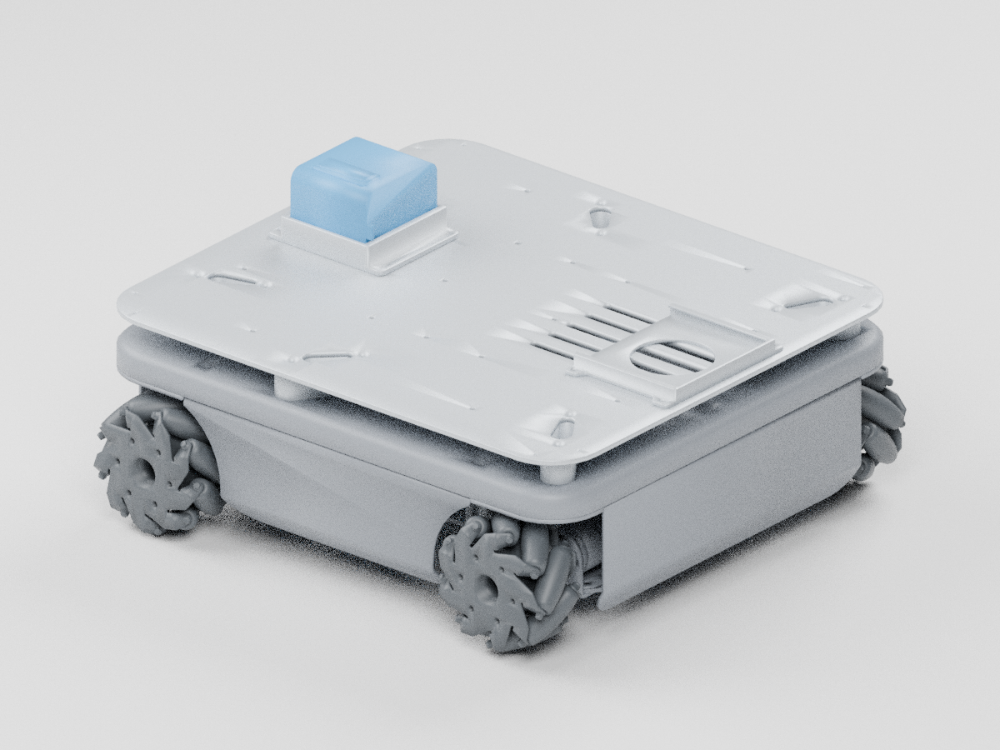
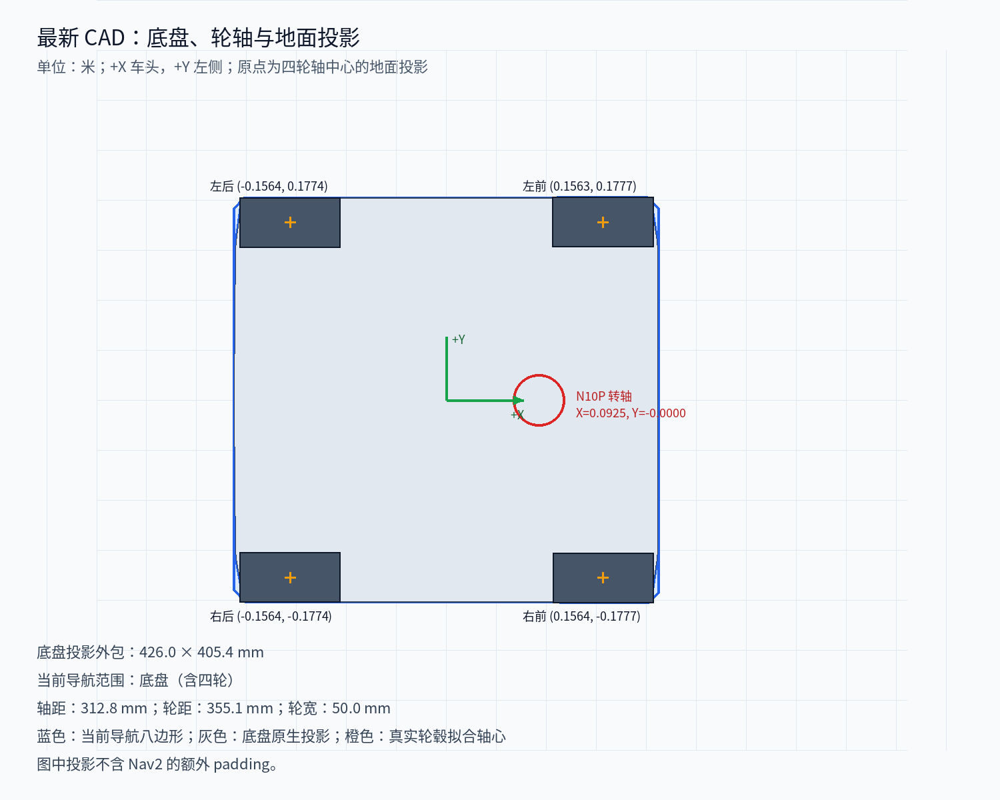

# 最新底盘几何与导航投影

2026-10-06 更新，来源为 `PackAndGo 0000 双臂移动机器人-2026-09-21.zip` 的有效装配实例及原生缓存三角网格。本次替换旧底盘、通用轮子、假轮轴和旧雷达安装位置；`main` 继续用于真机，未引入仿真插件或运行依赖。

原始归档 SHA-256：`d93e6bb2a731cceba861199dc13b86d40e639ec015137fd93c8b11a8519c5d6b`。完整来源哈希、实例路径、剔除清单、轮毂拟合记录、投影及资产哈希见 [measurements.json](measurements.json)。这份数据来自 CAD 保存姿态，不替代实物安装或里程计标定。



## 坐标基准

单位为米，`+X` 朝车头、`+Y` 朝车体左侧、`+Z` 向上。`base_footprint` 原点是四个拟合轮轴中心的平均位置在 CAD 地面的投影；`base_link` 与它重合。地面由原生轮子网格的最低点确定，CAD 到 ROS 的旋转与平移保存在测量清单中。

不使用滚子外包框中心作为轮轴：麦克纳姆轮的滚子相位会使外包框偏心。本次分别拟合原生轮毂中央面的同心圆，再将四个轮子网格平移到各自轴心。拟合残差仅说明缓存几何的内部一致性，不表示实物加工精度。

保留既有轮子、轮轴、`base_footprint`、`base_link`、`laser`、`imu_link` 名称。所有轮子旋转轴为车体 `+Y`；零角度时呈现 CAD 保存姿态。新增加的 `lidar_mount` 表示雷达物理安装基准，`laser` 的标定偏移独立设置。

## 麦克纳姆轮与底盘尺寸

以下坐标相对 `base_footprint`，数值单位为 **mm**。

| 轮子 | 既有名称前缀 | X | Y | Z | 轴向厚度 |
| --- | --- | ---: | ---: | ---: | ---: |
| 左前 | `upper_left` | 156.322 | 177.691 | 51.308 | 50.000 |
| 右前 | `upper_right` | 156.434 | -177.691 | 54.250 | 50.000 |
| 左后 | `lower_left` | -156.378 | 177.391 | 50.308 | 50.000 |
| 右后 | `lower_right` | -156.378 | -177.391 | 50.308 | 50.000 |

| 尺寸 | CAD 测量值 |
| --- | ---: |
| 平均前后轴距 | 312.756 mm |
| 平均左右轮距 | 355.082 mm |
| 前轴轮距 / 后轴轮距 | 355.382 / 354.782 mm |
| 每轮轴向厚度 | 50.000 mm |
| 滚子最大旋转包络直径 | 约 100.734 mm |
| 底盘地面投影外包尺寸，含车轮 | 426.021 × 405.382 mm |
| 底盘最高点，含电池，离 CAD 地面 | 217.308 mm |

滚子最大包络半径约为 50.367 mm，用于轮子碰撞圆柱；它不是经实测标定的有效滚动半径。主机底盘驱动收发车体速度与里程计，由底层控制器处理轮速换算，没有可直接修改的轮径、轴距、轮距参数。本次不据 CAD 尺寸修改里程计比例。

原生 CAD 保存了摆式悬挂的不同高度：两后轮最低点接近地面，左前轮与右前轮分别约有 1.048、3.932 mm 间隙。模型保留这一姿态，没有强行把四个轮轴压成同一个高度。这是硬件几何描述，不是四轮着地的接触动力学验证。

## 雷达与 IMU

雷达型号来自 CAD 名称 `激光雷达_雷神N10P`。其壳体轴线与零部件原点吻合，外伸接头使外包框水平中心偏离转轴约 9.25 mm，因此不用外包框中心定义雷达坐标系。

| 项目 | 相对 `base_footprint` 的测量 / 配置 |
| --- | --- |
| `lidar_mount` 转轴安装基准 | X = 92.472 mm，Y = -0.009 mm，Z = 114.808 mm |
| 壳体底部 / 顶部高度 | 112.208 / 148.258 mm |
| 零度三角标记 | 用户确认朝车头，`laser` yaw = 0 |
| 当前 `laser` 光学中心代理 | X = 92.472 mm，Y = -0.009 mm，Z = 130.233 mm |
| 光学高度标定状态 | **未标定**；上述 Z 取壳体竖直中面，CAD 未标明真实扫描平面 |
| `imu_link` | 保留 xyz / rpy 全零；**未标定**，CAD 未识别出 IMU 安装基准 |

CAD 雷达壳体约为直径 52 mm、高 36.05 mm，与厂商公开外形尺寸接近；厂商外形规格不能证明光学扫描平面就在壳体中面。[厂商 N10 外形资料](https://www.lslidar.com/wp-content/uploads/2024/09/N10.pdf)

测得实际扫描平面离地高度后，用生成脚本的 `--lidar-scan-height` 参数（单位米）更新。`laser` 的高度 / 朝向与壳体网格分开，标定不会移动或旋转物理壳体。

## 导航地面投影



目前 Nav2 的局部、全局 costmap 均采用 **底盘（含四轮）** 的保守八边形。导航范围按用户要求只考虑底盘投影，地面投影外包尺寸为 **426.021 × 405.382 mm**。测量清单的 `selected_navigation_projection` 为 `chassis`，整机保存姿态数据仅作为来源记录保留。

计算方法为：将有效底盘实例的全部原始顶点（含车轮）投影到 XY 平面，求凸包，按八个方向的支撑线向外取整到 1 mm，再求交得到有序八边形。未因剔除视觉小零件而缩小导航投影；测试验证八边形覆盖原生底盘凸包，并检查两个 costmap 都选用底盘范围。

```text
[[0.213, 0.191465], [0.201465, 0.203], [-0.202879, 0.203],
 [-0.214, 0.191879], [-0.214, -0.190465], [-0.201465, -0.203],
 [0.202879, -0.203], [0.213, -0.192879]]
```

图中与上述多边形尚未包含额外 padding。沿用原配置的局部 80 mm / 全局 40 mm padding；膨胀半径从 100 mm 调整为 350 mm，使其大于加 padding 后的内切半径，代价衰减系数仍为 3.0。导航的通道通过性需要实机验证。

足迹范围与 Nav2 的配置关系见 [Nav2 足迹说明](https://docs.nav2.org/rolling/configuration_and_development/first_time_robot_setup_guide/footprint/setup_footprint/)，膨胀参数说明见 [膨胀层说明](https://docs.nav2.org/jazzy/configuration_and_development/configuration_guide/core_servers/costmap_2d/costmap_plugins/inflation/)。

## 网格质量与碰撞几何

保留 **363,807 个三角形、8 个 DAE 文件**：壳体、金属结构、电池、四个独立轮子和雷达。移除不影响主要外形的螺钉、螺柱、PCB 等小件，轮子滚子与壳体开口保留原生缓存网格，**未再次减面**。颜色按零件功能重新设置，不宣称是原 CAD 材料。

轮子分别使用按真实轴心测得的圆柱包络，主体使用包含所保留主体顶点的向外取整包围盒。碰撞形状用于简单几何包络；Nav2 使用上面单独计算的二维足迹。没有经过测量的质量 / 惯量已从硬件描述移除，不能用于负载或稳定性结论。

旧底盘和旧通用轮子的六个 STL 已移除，避免安装包中出现两套相互矛盾的模型。原模型仍可从 Git 历史恢复。

## 本地生成与验证

尺寸集中在 `src/duojin01_description/urdf/chassis_geometry.xacro`，由 `scripts/update_chassis_model.py` 生成。原始 CAD 分析目录与 Python 环境不打包到运行包内。离线生成环境需要 numpy、scipy、trimesh、Pillow 和 CJK 字体；预览使用本地 Blender 5.0.1。

在仓库根目录执行，`--cad-analysis` 指向已验证的原生缓存目录，包含 `native_meshes`、变换和零件清单，其父目录包含 `assembly_summary.json`：

```bash
python scripts/update_chassis_model.py \
  --cad-analysis /path/to/analysis/conversion \
  --footprint chassis \
  --lidar-zero-heading forward
blender -b --factory-startup -t 4 --python scripts/render_chassis_preview.py
```

默认 `--footprint chassis`，投影图随当前选定范围生成。可选 `--lidar-scan-height 0.XXX` 用于实测光学高度。重跑默认生成不会保留先前提供的光学高度，须同时再次传入实测值。

在既有 ROS 2 Humble 硬件镜像内、断网且源目录只读的隔离容器中完成：

- 描述包与 bringup 包构建成功，安装目录的 8 个网格哈希、所有 URDF 网格 URI 和 Nav2 配置检查通过。
- Assimp 5 成功导入全部 8 个 Collada 网格，确认资产可被实际网格解析器读取。
- `check_urdf` 成功解析完整硬件模型。
- 16 项既有硬件边界测试与 4 项新几何回归测试通过，共 **20 项**。
- 独立 ROS 域内运行 `robot_state_publisher` 并发布四轮零角度，实时查询四轮与 `laser` 的 TF，结果与测量记录一致。

导航范围修订为仅底盘后，重新运行 4 项几何回归测试并构建 bringup 包，安装后的两个 costmap 均验证为底盘八边形。

验证未连接或驱动实物底盘。底层里程计参考点、有效轮径、光学扫描高度和 IMU 外参仍须实物确认。
