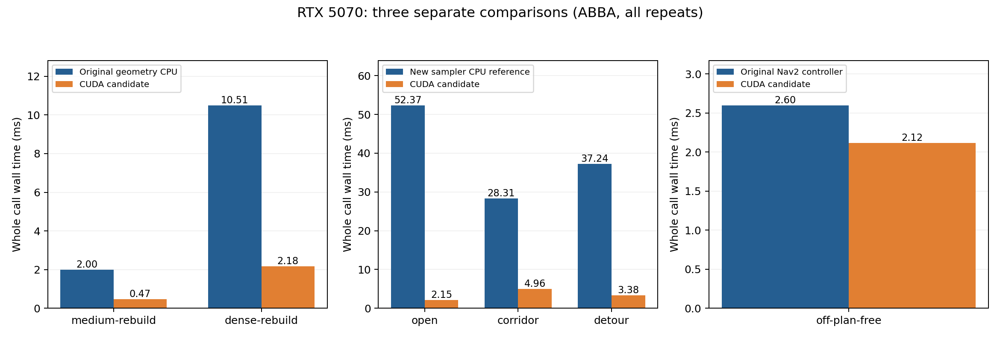
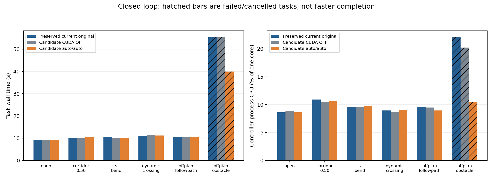

# duojin02 GPU 可选版本性能报告

2026-10-10；测试设备 RTX 5070。独立版本位于 `/home/th1rt3en/dev/forge/duojin02-gpu`，分支 `codex/cuda-optional-20261010`。

## 结论

可选 CUDA 后端已经实现并完成本机验证，默认构建和默认运行均保留 CPU。较大批量的碰撞查询获得约 **4.2～5.2 倍**加速；新采样算法对其 CPU 数学参考获得 **5.7～24.3 倍**计算加速。与当前原版控制器的真实调用比较，均值从 **2.600 ms 降至 2.118 ms**，约 **1.23 倍**，耗时减少 **18.6%**。这些倍率对应不同基线。

完整导航没有显示稳定的任务级提速。30 个基础配对任务全部通过到达检查；额外 6 个固定穿障路径的局部控制用例全部失败，没有发生碰撞。新采样器不能据此宣称比原版更强，保留为实验选项。GPU 控制进程的峰值 RSS 增加约 **100 MiB**。RTX 结果不代表 Jetson Orin Nano 的速度、内存或能耗。

## 原版保留与版本范围

原始工作区 `/home/th1rt3en/dev/forge/duojin02` 没有修改。对原有 **492 个文件**逐一校验 SHA256，内容、Git HEAD 和 `git status --short` 均与开始时一致；复制文件没有共享 inode。原版基线是当前工作区，包括尚未提交的改动，不是旧的干净 HEAD。复制范围为源码、配置、模型和文档；构建、安装、日志及 Python 缓存没有迁移。

- 原始 HEAD：`6a20e6da3bafe6705a243b1298fcfa6de68a6ad6`。
- 在副本保存的源文件基线：`aba954e931d7e2da83c024b91af6f2cfe0a55b22`。
- 冻结的 GPU 实现提交：`cc5475fe6ee3ba2e702540332d789fda9ff3ca94`。后续文档和结果归档不改变导航实现。
- 36 个试验的源码/二进制清单完成 **3900 次摘要核对**，全部匹配。记录见 [build-manifest-validation.json](evidence/gpu-performance-2026-10-10/build-manifest-validation.json)、[final-integrity.json](evidence/gpu-performance-2026-10-10/final-integrity.json)。

本版实现大批量姿态碰撞查询和自定义 CUDA MPPI。后者采用时间支撑点的线性扰动插值、对偶扰动、全向速度/加速度约束、完整栅格足迹扫掠及预测序列复核。未接入外部 MPPI-Generic、SVG-MPPI 等库，也不是 Nav2 critic 的逐项 CUDA 移植。

代价与 Nav2 原 critic 组合不同。GPU 采样器使用自己的路径/目标/栅格代价；原 critic 权重不会控制它。批量、预测步数、步长、温度、gamma 和噪声尺度在 configure 时读取，修改这些参数需重新配置；全轴有效速度限制仍在每次计算中读取原限制对象。候选终点 clearance 排序、最终实测速度制动检查、指令转换检查、速度守卫、定位门控、AMCL、SMAC 和 SLAM 继续使用 CPU。

## 环境与方法

本机 CPU 为 Intel Core Ultra 7 270K Plus（24 线程），GPU 为 RTX 5070 12227 MiB、计算能力 12.0，驱动 580.178.04。构建使用 CUDA Toolkit **12.8.93**、GCC **11.4**、CMake **3.22.1**、Ubuntu **22.04** / ROS **Humble** / Nav2 **1.1.20**；宿主机为 Ubuntu 26.04。CUDA fatbinary 包含 `sm_87` 和 `sm_120`，后者实际运行，前者仅证明编译成功。

本机 ROS/Gazebo 使用 `duojin02:sim-humble-harmonic` 容器隔离。工程本身仍支持 Jetson 上的原生构建运行。比较使用相同的当前补丁 SLAM Toolbox 2.6.10（补丁 SHA256 `c2233b30c6aed3d966cf2fa8bc04a9a877b43caa002337c60b42b81563c676fb`）；没有沿用镜像内旧补丁，也没有连接 Jetson 或真实底盘。

组件按 ABBA 顺序连续运行，每种 CPU / CUDA 各 2 个独立进程，几何每进程 100 次、采样每进程 40 次、真实控制器每进程 100 次。额外测 `auto` 的小查询和首姿态碰撞拒绝。构造地图与初始 CUDA 上下文在计时之外，首次计算单独记录；常态计时包含准备、所需上传、内核、等待、读回和 CPU 结果复核。重建场景包含 `setScene` 和该轮上传。组件耗时使用单调墙钟和当前线程 CPU 时钟，CPU 指标不含原 Nav2 噪声工作线程；完整图的 `/proc` 指标包含控制进程所有线程。

所有逐调用时间、冷启动、指令、输入哈希和返回码均保留在 [components/ledger.json](evidence/gpu-performance-2026-10-10/components/ledger.json)。同算法输入哈希、碰撞校验和、可行候选数、指令误差检查全部通过。各表 P95 汇总全部调用。只有 2 次进程重复，未据此计算统计显著性或置信区间。

没有锁 GPU 时钟、固定 CPU 核或停止其他桌面应用；保留背景负载记录。200 ms 间隔的 NVIDIA 遥测在各组使用相同观察方式，原始温度/功率/频率可查。实验不是独占设备测试。

## 等价几何查询

几何组件保留原版完整凸足迹、障碍点半径和 10 mm 边距，碰撞返回与原 CPU helper 一致；接触附近的不确定行重新调用 CPU。小场景为 721 点 × 9 姿态，中场景 20000 点 × 121 姿态，密集场景 104637 点 × 121 姿态。它们是可重复的合成计算负载，不代表真实雷达频率或实际局部地图的点数。

| 工作负载 | 原 CPU 均值 ms | 强制 CUDA 均值 ms | CPU / CUDA | CUDA P95 ms | CUDA 控制线程 CPU ms |
| --- | --- | --- | --- | --- | --- |
| tiny-reuse | 0.008 | 0.086 | 0.09× | 0.087 | 0.010 |
| tiny-rebuild | 0.007 | 0.087 | 0.08× | 0.091 | 0.014 |
| medium-reuse | 2.033 | 0.464 | 4.38× | 0.472 | 0.017 |
| medium-rebuild | 2.001 | 0.474 | 4.22× | 0.489 | 0.034 |
| dense-reuse | 10.621 | 2.037 | 5.21× | 2.083 | 0.036 |
| dense-rebuild | 10.505 | 2.176 | 4.83× | 2.191 | 0.145 |
| blocked-reuse | 0.000 | 2.038 | 0.00019× | 2.076 | 0.036 |
| blocked-rebuild | 0.000 | 2.157 | 0.00019× | 2.192 | 0.148 |

每行 CPU 和 CUDA 各 200 次计时。密集重建查询 **10.505 → 2.176 ms**，包括逐轮场景更新；复用查询 **10.621 → 2.037 ms**。CUDA 小查询约 0.086 ms，CPU 约 0.008 ms，因此强制上 GPU 会变慢。首姿态碰撞时原版约 0.00038 ms 即可拒绝，强制 CUDA 仍做整批工作，约 2.038 ms；该不利结果也完整保留。

默认 `auto` 的小查询约 **0.006 ms**、碰撞前缀约 **0.00029 ms**，两者没有提交 GPU 批次。微秒级差异受计时和调度影响，不解释为 CPU 算法收益。生产控制器同样保留首姿态 CPU 快速拒绝。几何统计的 `cpu_batches` 仅包含后端批处理，小任务直接调用原 CPU helper 不在该计数中。

## 同一新采样算法的 CPU / GPU 比较

1600 候选 × 56 预测状态，步长 0.05 s，8 个扰动支撑点，400×400 / 1 cm 栅格，固定输入并逐轮重置随机状态。组件足迹为矩形参考形状；真实控制器/闭环使用主配置的实际八点足迹和 padding。`detour` 是固定快照计算用例，不是完成绕障任务。

| 新算法固定输入 | 同算法 CPU 参考 ms | CUDA ms | CPU / CUDA | CUDA P95 ms | 可行候选 / 1600 | 有效输出次数 |
| --- | --- | --- | --- | --- | --- | --- |
| open | 52.373 | 2.153 | 24.33× | 2.193 | 1600 | 80/80 |
| corridor | 28.314 | 4.958 | 5.71× | 5.098 | 3 | 80/80 |
| detour | 37.244 | 3.383 | 11.01× | 3.471 | 1 | 80/80 |
| blocked | 41.177 | 2.386 | 17.26× | 2.419 | 0 | 0/80 |

每种实现/场景各 80 次计时。开放场地同算法 CPU 参考需要 52.373 ms，CUDA 2.153 ms；这个 CPU 参考是新增完整扫掠算法的串行实现，**不是原版高效 Nav2 MPPI**。狭窄通道仅 3/1600 候选可行，柱体场景仅 1/1600 可行，说明低维扰动的覆盖能力有明显局限。起点未知格场景没有可行轨迹，80/80 次输出停止；该计算时长不算导航成功。



## 当前原版控制器与 GPU 新优化器

使用同一观察器分别编译保留的原源码和副本，调用真实 `computeVelocityCommands`。参数使用当前主 YAML，路径起点偏离机器人 0.35 m，迫使实际采样分支执行。通过链接器包装真实 Nav2 MPPI 入口计数，原版 200 次均进入原优化器；GPU 版均进入 CUDA，没有原优化器调用。

| 实现 | 均值 ms | P95 ms | 最大 ms | 当前控制线程 CPU ms | 采样调用证明 |
| --- | --- | --- | --- | --- | --- |
| 当前原版 Nav2 MPPI | 2.600 | 2.638 | 2.696 | 2.600 | 200/200 次原 MPPI |
| GPU 新采样器 | 2.118 | 2.167 | 2.177 | 0.450 | 200/200 次 CUDA，0 次原 MPPI |

GPU 控制线程 CPU 从 **2.600 → 0.450 ms**，减少约 **82.7%**；墙钟减少 18.6%。GPU 全调用包括当前地图复制、TF/路径准备、噪声生成、上传/等待/读回及原制动检查，不只计内核。最大值 2.177 ms 低于本轮设置的 40 ms 软预算。

这组固定输入的测得速度始终为零。新优化器每 50 ms 限制起步增量，第一条速度约 0.02 m/s；原版 warm start 可以输出更高速度。代价函数、轨迹与后检查工作量也因此不同，这个 1.23 倍表示实际调用差异，不能解释为原 Nav2 优化器的等价 CUDA 加速。实际运动结果见下表。

## 完整导航与局部能力

三个组均使用当前主版导航与独立守卫：原始工作区、副本 `DUOJIN_ENABLE_CUDA=OFF`、副本 CUDA ON + `auto/auto`。原版没有使用历史旧导航配置，也没有关闭安全守卫。

每个场景 2 个种子（21/22），第一个按原/CPU/GPU，第二个反向排序，每次启动新图，使用独立 Gazebo 分区和相同观察器。模拟底盘为现有 KINEMATIC 模型，雷达使用现有 GPU 最近回波模型；带相同的噪声、里程计速度偏差和陀螺偏置，算法不读取真值定位。真值用于碰撞/到达评估，以及动态障碍刺激的放置。每个动作只提交一次目标，没有补目标或人为扶正。

前四种场景使用真实 `NavigateToPose`，包含全局规划、定位、控制及守卫；偏离路径两种场景使用 `FollowPath`，专门测试局部控制器，绕过全局规划。全部关闭 RViz，没有验证远端显示、多订阅者或无线拥塞。

| 场景 | 原版 s | 副本 CUDA OFF s | 副本 auto/auto s | 严格到达 原/CPU/GPU | 完整收尾 原/CPU/GPU | GPU 采样次数 |
| --- | --- | --- | --- | --- | --- | --- |
| open | 9.263 | 9.313 | 9.263 | 2/2/2/2/2/2 | 2/2/1/2/2/2 | 0 |
| corridor_0.50 | 10.208 | 10.018 | 10.583 | 2/2/2/2/2/2 | 2/2/0/2/2/2 | 0 |
| s_bend | 10.477 | 10.248 | 10.198 | 2/2/2/2/2/2 | 2/2/2/2/2/2 | 0 |
| dynamic_crossing | 11.088 | 11.488 | 11.237 | 2/2/2/2/2/2 | 2/2/2/2/1/2 | 0 |
| offplan_followpath | 10.602 | 10.603 | 10.628 | 2/2/2/2/2/2 | 2/2/2/2/2/2 | 74 |
| offplan_obstacle | 55.559 | 55.558 | 39.980 | 0/2/0/2/0/2 | 2/2/2/2/2/2 | 1230 |

严格到达要求动作成功、零碰撞、最终位置误差 ≤20 mm、yaw 误差 ≤0.035 rad、速度 ≤0.020 m/s，并保持 ≥0.25 s。30 个基础任务全部通过，最大实际位置误差 **7.86 mm**，最大 yaw 误差 **0.00283 rad**。四种完整导航场景的副本计数均为零（原版未添加热路径计数，通过同逻辑 CPU 副本核对）；窄通道 GPU 几何批次分别 106/78，S 弯/动态场景依实际查询工作量选择。单纯开启 GPU 不能让没有进入采样分支的任务获得采样加速。

偏离路径自由场景 GPU 发生 **74 次**采样，CUDA OFF 副本发生 **36 次**原 MPPI 采样，均完成；整段时长几乎不变，新算法的加速度约束导致采样控制阶段较长。窄通道任务平均时长 GPU 10.583 s、原版 10.208 s；S 弯略快、其他场景接近。在本轮重复数量下，没有稳定的任务级提速证据。

额外的 `offplan_obstacle` 给定一条穿过静态障碍的固定路径，检验局部采样器独立绕开的能力。原/CPU/GPU 均 0/2 完成，没有碰撞。原版和 CPU 副本约 55.56 s 后被观察器取消；GPU 一次约 24.40 s 因无法取得进展中止，另一次约 55.56 s 取消，共 **1230 次 CUDA 采样**，没有 GPU 计算故障或超时。较短失败时间不算加速，也不能称为更强的避障。该用例需要重新规划或更强的局部搜索；本轮新采样器保持实验状态。



## CPU、内存、控制周期与关闭异常

| 场景 | 原控制进程 CPU % | GPU 控制进程 CPU % | 原峰值 RSS MiB | GPU 峰值 RSS MiB | 原接收周期 P95 ms | GPU 接收周期 P95 ms |
| --- | --- | --- | --- | --- | --- | --- |
| open | 8.62 | 8.63 | 36.73 | 138.20 | 50.33 | 50.17 |
| corridor_0.50 | 10.92 | 10.62 | 39.26 | 141.75 | 51.24 | 50.26 |
| offplan_followpath | 9.59 | 8.94 | 39.18 | 139.05 | 50.35 | 50.20 |
| offplan_obstacle | 22.14 | 10.48 | 43.28 | 138.88 | 51.90 | 50.43 |

CPU 百分比以一个逻辑核为 100%，由动作期间 `/proc` 采样统计，包含工作线程；RSS 是控制进程内存，不是专属显存。GPU 版即使没有采样，也会初始化 CUDA 上下文，增加约 100 MiB RSS。显卡遥测的总显存包含桌面和模拟器，不能据此精确归因算法。基础任务接收端的指令 P95 约 50～51 ms；这是订阅接收间隔，包含观察器/传输影响，不是函数计算时长。36 个试验没有 Nav2 控制周期超时告警，GPU 摘要没有计算失败或预算超限；整体 GPU 采样完成次数 1304。

到达结果与完整关闭流程分别记账。额外审计实际子进程退出发现 **32/36** 次完整流程正常：2 次 CPU 副本试验 Gazebo 收尾升级 SIGTERM；另有 CPU 窄通道及 GPU 动态障碍各 1 次公共 `parameter_bridge` 在收尾 SIGABRT（退出码 -6）。这些试验的到达记录保留。原观察器 `complete_flow` 没有覆盖所有子进程异常，报告汇总额外检查 `process has died`，原始 result.json 没有改写。详细记录见 [closure-audit.json](evidence/gpu-performance-2026-10-10/closure-audit.json) 和逐次 launch.log。没有把提前终止、收尾异常或失败用例删掉，也没有把它们认作完整流程通过。

组件期间 GPU 温度约 28～35°C、显卡功率采样约 6.7～56.7 W；完整图期间约 29～32°C。该遥测包含其他应用与模拟器，未测整机能耗、Jetson 温度/供电或电压稳定性。

## 验证与使用

原版 ROS 检查 **13/13**、CUDA OFF 副本 **15/15**、CUDA ON 副本 **20/20**、Python/启动契约检查 **102/102**。CUDA 专项实际运行，没有跳过。几何检查比较 3515 个姿态结果，含孤立内部障碍、接触邻近 ULP、场景替换和非法输入；采样检查比较 960 个 CPU/GPU 代价，最大差约 `4.996e-16`，并通过原 CPU 足迹函数的独立 1 mm 轨迹检查。生产尺寸组件的输入、有效候选与指令也逐组核对。

设备不可见时 `auto` 真实控制器 **12/12** 次返回原 MPPI 路径；强制 CUDA 拒绝无设备配置。人为设置极小 GPU 预算的真实控制器检查返回零指令。CPU OFF 库不依赖 CUDA；CUDA 运行库静态链接，安装插件通过 `$ORIGIN` 查找同目录后端库。开发中曾出现运行库/安装插件加载失败、未 source overlay 的 Python 检查失败；修复后重新检查，早期日志仍保留。

CPU 默认、几何加速和采样替换可以分别选择。使用步骤见工程 [README_GPU.md](/home/th1rt3en/dev/forge/duojin02-gpu/README_GPU.md)。先试 `compute_backend=auto` + `sampling_backend=original`，保持原 critic 行为；确有采样负载时单独评估新采样器的任务质量。一次 CUDA stream 只处理当前冻结输入，计算前释放地图锁，GPU 结果之后保留 CPU 安全判断；控制线程仍等待本次结果，没有新增 CPU 控制工作线程。40 ms 是软预算，驱动内阻塞无法被它硬中断。

本次没有验证 Orin ARM 原生运行、JetPack 对应 Toolkit、长时间热稳态、真实雷达/底盘、远端 RViz 或整机能耗。代码用双精度保持几何边界，不利用 Tensor Core；RTX 倍率不能按标称 TOPS 换算到 Orin。相关架构与 Blackwell 构建要求参考 [NVIDIA CUDA GPU 列表](https://developer.nvidia.com/cuda/gpus)、[Blackwell compatibility guide](https://docs.nvidia.com/cuda/blackwell-compatibility-guide/index.html)。

本次测试容器 `duojin02-gpu-dev-20261010` 留为停止状态，构建和原始数据保存在宿主机副本/输出目录。可在本机恢复已构建的隔离实验：

```bash
docker start duojin02-gpu-dev-20261010
docker exec -w /candidate duojin02-gpu-dev-20261010 \
  bash /candidate/tests/performance/navigation_harness/run_trial.sh \
  gpu open 21 /evidence/manual-gpu-open
# CPU 对照：将 gpu 改为 cpu；当前原版对照：改为 original。
docker stop duojin02-gpu-dev-20261010
```

这个命令启动仿真，不连接硬件。再次修改导航源码后需要重建；清单验证会拒绝与二进制不一致的来源。组件复现实现在 `tests/performance/benchmark_gpu_components.py`；完整图和额外固定障碍用例的脚本位于 `tests/performance`。本次完整数据在 [summary.json](evidence/gpu-performance-2026-10-10/summary.json)、[components-summary.csv](evidence/gpu-performance-2026-10-10/components-summary.csv)、[navigation-summary.csv](evidence/gpu-performance-2026-10-10/navigation-summary.csv)、[navigation/ledger.json](evidence/gpu-performance-2026-10-10/navigation/ledger.json)、[navigation-obstacle/ledger.json](evidence/gpu-performance-2026-10-10/navigation-obstacle/ledger.json)；所有逐次配置、轨迹、指令链、构建清单和日志均保留。

## 随版本保存的数据

[完整原始数据压缩包](evidence/gpu-performance-2026-10-10/evidence.tar.gz) 包含全部逐次输入、轨迹、构建清单、失败日志和遥测。精选汇总和两张图已经展开；需要逐次原始文件时，在工程根目录执行：

```bash
tar -xzf docs/evidence/gpu-performance-2026-10-10/evidence.tar.gz \
  -C docs/evidence/gpu-performance-2026-10-10
```
