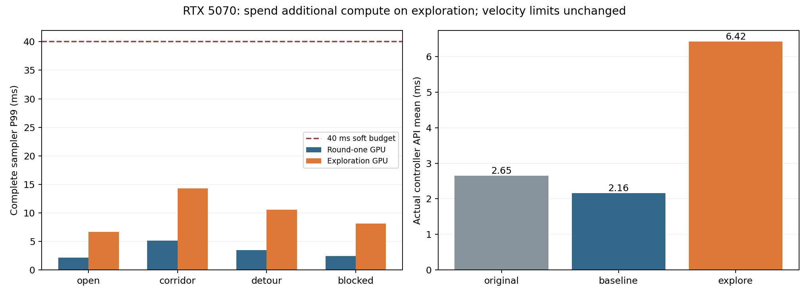
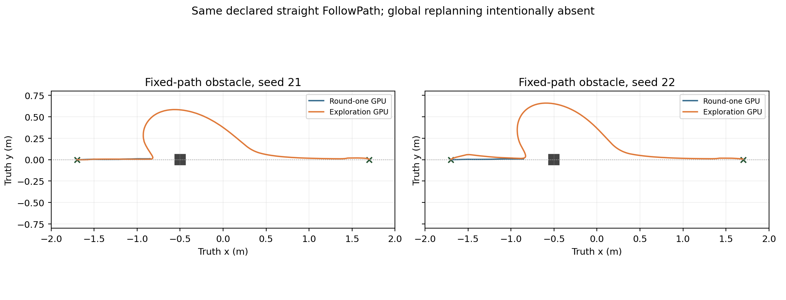

# GPU 搜索策略与参数调优：第二轮（2026-10-10）

本轮在独立 `duojin02-gpu` 副本中增加更强的搜索配置。冻结的 24 次新进程对比中，`explore` 完成 12/12 任务，首轮 GPU 参数完成 10/12；两次失败均为固定路径穿过障碍的局部控制测试。新配置没有通过提高最大速度或减小安全余量取得结果。

增加采样数量并不能单独解决问题。扩大横向探索、降低路径束缚和提高目标推进权重之后，3200 条的 `explore-lite` 在两个补充穿障用例中也到达了目标。它的验证范围小于 `explore`，作为计算预算较小的可选试验配置保留。主配置仍使用原 CPU 控制器，所有新参数只在生成独立配置时启用。

## 改进依据与实现

首轮配置的时间扰动较碎，绕障测试中 1600 条轨迹仅有 1 条不碰撞；另一个噪声种子甚至没有可行轨迹。只增加到 6400 条仍只有 2 条可行轨迹。将横向标准差扩大到 0.35、支撑点从 8 减至 4 后，扰动在时间上更连贯，适合全向底盘侧移绕障。角速度噪声从 0.18 降至 0.12，减少不必要的底盘转动。

此外，当前自定义优化器将路径偏离代价逐步累加，却只在预测末端加入目标距离代价。原始路径权重 12、目标权重 8 可以让“停在障碍前”比“离开直线路径并绕行”更便宜。本轮增加明确的 `gpu_path_weight` / `gpu_goal_weight` 等参数，保留 C++ 默认值，通过可选配置调整代价比例。它们属于自定义优化器，不等于 Nav2 的 `PathAlignCritic` / `GoalCritic` 权重。

新的 `gpu_batch_size`、`gpu_time_steps`、`gpu_vx_std`、`gpu_vy_std`、`gpu_wz_std`、`gpu_temperature` 与原生 MPPI 参数分开。默认继承主配置；显式 GPU 配置只改变这些 GPU 字段。因此设备不可用时，`auto` 仍使用原来的 1600 条原生 CPU 搜索。实测隐藏 GPU 后，30 次控制调用全部进入原生 MPPI，没有 CUDA 调用或零输出，平均 2.578 ms。

CUDA 内核、CPU 整段轨迹验证和最终制动检查沿用首轮实现。加上 `GPU_SAMPLING_CONFIG` 和 `GPU_SAMPLING_SUMMARY` 日志，以核对实际生效参数、可行轨迹数和整次采样耗时。更换这些配置需要重启或重新配置控制器生命周期。

## 可选配置

| 参数 | baseline | explore-lite | explore |
| --- | ---: | ---: | ---: |
| GPU 候选轨迹数 | 1600 | 3200 | 6400 |
| 预测步数 / 时长 | 56 / 2.8 s | 56 / 2.8 s | 56 / 2.8 s |
| 扰动支撑点 | 8 | 4 | 4 |
| vx / vy / wz 噪声标准差 | 0.15 / 0.12 / 0.18 | 0.35 / 0.35 / 0.12 | 0.35 / 0.35 / 0.12 |
| 路径权重 / 末端目标权重 | 12 / 8 | 1.5 / 24 | 1.5 / 24 |
| 温度 / gamma | 0.3 / 0.015 | 0.3 / 0.015 | 0.3 / 0.015 |
| 主对比覆盖 | 12 个任务 | 补充 2 个穿障任务 | 12 个任务 |

最大前向 / 后退 / 横向 / 角速度仍是 **0.5 / -0.2 / 0.3 m/s / 0.65 rad/s**；控制频率仍为 **20 Hz**。采样模型加速度仍为 0.4 m/s²、0.8 rad/s²；速度平滑器、制动保护、足迹 padding、定位门控和安全余量没有调小。粒子数量不改变这些硬件约束。

局部地图是 4 m × 4 m。全向最大平移模长约 0.583 m/s，预测范围还须容纳完整底盘半径和检查余量。生成器对显式延长的预测时长进行范围检查；当前速度和地图下，80 步配置会被拒绝。探索数据中的 80 步纯组件测试保留用于研究，不能直接推广到现有局部地图。生成器同时检查支撑点、总状态数、有限数值和控制周期预算。

```bash
cd /path/to/duojin02-gpu
# 已通过完整六场景矩阵的本机实验配置：
python3 scripts/gpu_profile.py --preset explore --output .cache/gpu/nav2-explore.yaml
# 更低计算量的补充候选：
python3 scripts/gpu_profile.py --preset explore-lite --output .cache/gpu/nav2-explore-lite.yaml
# 使用项目原有启动入口，配置路径按实际运行目录传入：
# ros2 launch duojin01_bringup navigation.launch.py params_file:="$PWD/.cache/gpu/nav2-explore.yaml"
```

`coverage` 是仅扩大数量的对照档，不是推荐的绕障配置。探索阶段的 `balanced`（3200 条、标准差 0.30、路径权重 3、目标权重 16）在完整穿障测试中失败，已从可选预设中移除；原 YAML、结果和启动日志仍保留。可以使用生成器的显式 GPU 字段覆盖复现它。

## RTX 5070 计算预算

平台沿用首轮：RTX 5070 12 GB、驱动 580.178.04、CUDA Toolkit 12.8.93、Ubuntu 22.04 / ROS 2 Humble / Nav2 1.1.20 容器，主机为 Ubuntu 26.04、Core Ultra 7 270K Plus。程序仍支持原生运行，容器是本机 ROS/Gazebo 验证环境，不是工程的部署要求。

冻结组件对比为 CPU / CUDA / CUDA / CPU 顺序，每个配置与输入各 80 次计时，其中每个后端 40 次，另有每进程 5 次预热。CPU 是自定义算法的数学参考，不是原生 Nav2 优化器。每次重置优化器、使用相同地图和路径，保存逐次墙钟 / 当前线程 CPU 时间，并检查 CPU/CUDA 可行数量、命令和输入哈希一致。

| 固定输入 | baseline GPU ms | lite GPU ms | explore GPU ms | 可行轨迹 baseline / lite / explore | explore P99 ms |
| --- | ---: | ---: | ---: | ---: | ---: |
| open | 2.153 | 3.508 | 6.603 | 1600 / 3200 / 6400 | 6.664 |
| corridor | 4.961 | 7.482 | 14.121 | 3 / 1 / 1 | 14.314 |
| detour | 3.395 | 5.484 | 10.443 | 1 / 566 / 1099 | 10.548 |
| blocked | 2.401 | 4.239 | 8.036 | 0 / 0 / 0 | 8.099 |

`blocked` 的起点含未知占据，所有配置均返回零指令，不能记为导航成功。狭窄通道纯采样输入中，新配置仍只有零噪声名义轨迹可行；它没有证明新的窄通道采样能力。实际 0.50 m 通道任务通过的是现有确定性跟踪分支。

在独立真实控制器 API 基准中，原版、首轮 GPU 和 `explore` 按 O / G1 / G2 / G2 / G1 / O 顺序重复两轮，每臂 4 个进程、320 次计时。调用的是实际 `computeVelocityCommands`，链接器包装确认原版的真实 MPPI 入口次数。该基准使用空代价地图和固定零实测速度，原生 critic 的 inflation 优化警告保留在日志中；它不是复杂闭环场景的完整时延分布。

| 控制器 | 平均墙钟 ms | P99 ms | 当前调用线程 CPU ms | 原 MPPI 计时调用数 |
| --- | ---: | ---: | ---: | ---: |
| original | 2.654 | 3.705 | 2.653 | 320 |
| baseline | 2.163 | 2.312 | 0.500 | 0 |
| explore | 6.421 | 6.658 | 0.889 | 0 |
| explore-lite（补充，单进程 80 次） | 3.438 | 未单列 | 0.487 | 0 |

更大的搜索会增加控制调用耗时。本次 `explore` 闭环采样器最大观察耗时 16.848 ms；主对比未出现整次控制预算超时、CUDA 故障或原生控制周期告警。40 ms 是软预算，不能中断驱动阻塞，也不代表硬实时保证。当前线程 CPU 不包括原生噪声线程等后台工作。



## 新进程闭环配对结果

每个场景使用世界噪声种子 21、22，两臂交替顺序启动，共 24 次新进程试验。算法自身 RNG 固定为 20261010，世界种子重复不等于独立算法随机种子。观察器、公共 SLAM 补丁、仿真模型、传感器、速度平滑器和独立守卫相同。每次只提交一个 Action，没有通过额外航点掩盖失败。

下表耗时是观察器开始采集至返回的窗口，含约 0.3 s 结果后尾采样。`offplan_followpath` 和 `offplan_obstacle` 使用声明的固定 FollowPath，刻意绕过全局规划器；其余四项使用完整 NavigateToPose 图。穿障失败的结束时间不能解释为更快完成。

| 场景 | baseline 到达 | explore 到达 | baseline 窗口 s | explore 窗口 s | CUDA 采样次数 baseline / explore | 正常收尾 baseline / explore |
| --- | ---: | ---: | ---: | ---: | ---: | ---: |
| open | 2/2 | 2/2 | 9.362 | 9.363 | 0 / 0 | 2/2 / 2/2 |
| corridor_0.50 | 2/2 | 2/2 | 9.718 | 10.428 | 0 / 0 | 2/2 / 2/2 |
| s_bend | 2/2 | 2/2 | 10.273 | 10.353 | 0 / 0 | 1/2 / 1/2 |
| dynamic_crossing | 2/2 | 2/2 | 11.238 | 11.038 | 0 / 0 | 2/2 / 2/2 |
| offplan_followpath | 2/2 | 2/2 | 10.628 | 10.603 | 64 / 69 | 2/2 / 1/2 |
| offplan_obstacle | 0/2 | 2/2 | 24.654 | 17.729 | 889 / 368 | 2/2 / 0/2 |

两个固定穿障用例中新配置分别耗时 **19.004 s、16.453 s**，实际轨迹绕过 0.12 m × 0.12 m 障碍；旧配置分别在 **24.804 s、24.505 s** 无进展后中止。两者碰撞事件均为 0；新配置成功推进，旧配置安全停住。新配置在这两次任务中发生 25 次整条加权轨迹验证后的最佳候选选择，CPU 最终验证继续有效。

四项完整导航场景的采样次数均为 0。开放场地耗时基本相同；窄通道、S 弯和动态障碍没有一致的整体提速，不能把这些结果归因于采样调参。AMCL、全局 SMAC 和 SLAM 仍在 CPU。

主对比 22 次到达均满足观察窗口末端的位置 ≤20 mm、yaw ≤0.035 rad、速度 ≤0.020 m/s、保持 ≥0.25 s，最大最终位置误差 **8.286 mm**。汇总器独立从原始 CSV 复算位置和保持时间，并检查尾段真值间隔；它没有保存单独的 Action 结果接收边界快照，不能据此证明该瞬间也满足相同真值条件。

碰撞计数使用 YAML 原始 8 顶点底盘轮廓的完整填充多边形，不含 costmap padding；平面 yaw 轨迹按 ≤4 mm 位移 / 角点运动插值。roll/pitch 虽被记录，没有用于三维实体碰撞评分。该结果限定于声明的二维激光和运动学仿真，不是物理底盘的碰撞或制动认证。



## 补充消融与保留失败

主对比结束后，保持 `explore` 所有代价和噪声参数，只将 GPU 候选数降到 3200。`explore-lite` 两次固定穿障任务分别在 **19.955 s、15.602 s** 到达，GPU 采样器最大耗时 **9.541 ms、8.791 ms**，故障 / 超时 / 碰撞事件均为 0，两次正常收尾。该补充不替代主矩阵，不宣称与六场景验证范围相同。

这表明本次改善与探索分布、时间连续性和代价比例有关；6400 条不是这些已测输入的必要条件。其他地图和场景可能需要不同采样量。两个新配置都不作为通用默认值；低预算试验可从 lite 开始，完整版验证覆盖更大的场景矩阵。

全部开发结果保留：72 个探索组件进程、32 个主组件进程、16 个 lite 补充组件进程；12 个主控制器 API 进程、1 个 lite API 进程和 1 个无 GPU 回退进程；24 次主导航、4 次探索导航以及 2 次 lite 导航。探索导航中的旧配置两次失败、balanced 一次失败没有被删除。

主矩阵的完整关闭流程是 **19/24**：4 次公共 `parameter_bridge` 在 SIGINT 后 SIGABRT（退出码 -6），1 次 Gazebo 关闭升级 SIGTERM。旧配置 11/12 正常收尾，新配置 8/12。到达和收尾分别计数，原始 `result.json` 不修改；汇总额外审计所有 `process has died`，没有把 launch 退出 0 当作所有子进程都正常。该公共仿真收尾问题仍未解决，不能据当前小样本判定是 GPU 参数导致。

本机关闭 CUDA 构建的 15 项 CTest、CUDA 构建的 20 项 CTest 均通过；最终 Python 检查 **114 项通过**。测试覆盖新参数下的 CPU/CUDA 对照、独立几何验证、全向限幅及实际控制器超时返回零指令。

## 冻结记录、复现与适用范围

本轮 C++ 实现冻结提交为 `15a1ffee242a8fb863ca5fe93726d8fb17ed9b9d`；后续公共预设和文档修订没有更改已编译的 C++ 来源。首轮基线为 `cbc56fed1d15e54efd8347bd043053973f2473f2`。基线源码快照逐文件匹配旧编译清单，沿用未修改的旧二进制，将来源路径重定位到 `.cache/frozen-round1`；没有用新源码给旧二进制重新认证。

原项目 `/home/th1rt3en/dev/forge/duojin02` 保留 492 文件哈希及原 HEAD / 工作区状态核对。副本所有当前编译来源和二进制与冻结清单匹配。运行环境中的 `.cache/tuned-gpu` 是本轮构建，`.cache/full-gpu` 的二进制保留为首轮基线，不能直接将它当作当前源码构建使用。

详细记录在 [summary.json](evidence/gpu-tuning-round2-2026-10-10/summary.json)、[补充消融](evidence/gpu-tuning-round2-2026-10-10/ablation-summary.json)、[冻结记录](evidence/gpu-tuning-round2-2026-10-10/freeze.json) 和 [来源核对](evidence/gpu-tuning-round2-2026-10-10/integrity.json)。完整原始日志、实际 SDF / 地图输入、逐次时间、CSV、参数、编译清单和失败结果位于同目录的 `evidence.tar.gz`，并带有 `evidence-sha256.txt`。外部完整目录为 `/home/th1rt3en/Documents/Codex/2026-10-10/outputs/duojin02-gpu-version/tuning-round2`。

复现组件使用 `tests/performance/sweep_gpu_sampling.py`；实际控制器 API 的逐进程命令在 `final/api/ledger.json`；冻结导航矩阵使用 `tests/performance/compare_gpu_tuning.py` / `run_gpu_tuning.py`。这些比较驱动使用本机隔离容器的明确挂载契约；新机器须按 [GPU 使用说明](../README_GPU.md) 原生构建，或建立对应隔离环境，重新冻结来源 / 二进制清单后再测试。测试启动入口拒绝缺失或不匹配的清单。

没有连接 Jetson，没有启动真实底盘，没有进行远程 RViz 负载对比。Orin 的原生 ARM 计算时间、温度、供电和 40 ms 预算仍需设备实测；本机 6400 条设置不能直接视为 Orin 合格配置。当前 GPU 总功率遥测包含桌面、仿真及其他客户端，不能归因于算法或作为单任务能耗对比。

后续优先测原生 Orin 上的 lite 预算和实机感知时效，再考虑按通道宽度分配低方差 / 大范围采样。当前纯采样狭窄输入仍仅 1 条可行轨迹，是混合采样分布的候选改进点。提高车速、加速度或缩小制动余量需要完整制动与感知延迟验证；当前更强配置只消费计算余量。

调参的上游依据为 [Nav2 Humble MPPI 原生说明](https://api.nav2.org/nav2-humble/html/md_nav2_mppi_controller_README.html)：优先增大 batch 而不是叠加优化次数，并结合预测时长、速度和地图范围调参。本项目的时间插值及新代价函数属于自定义实现，具体取值来自上述实验，而不是把上游参数表直接移植到 Jetson。
