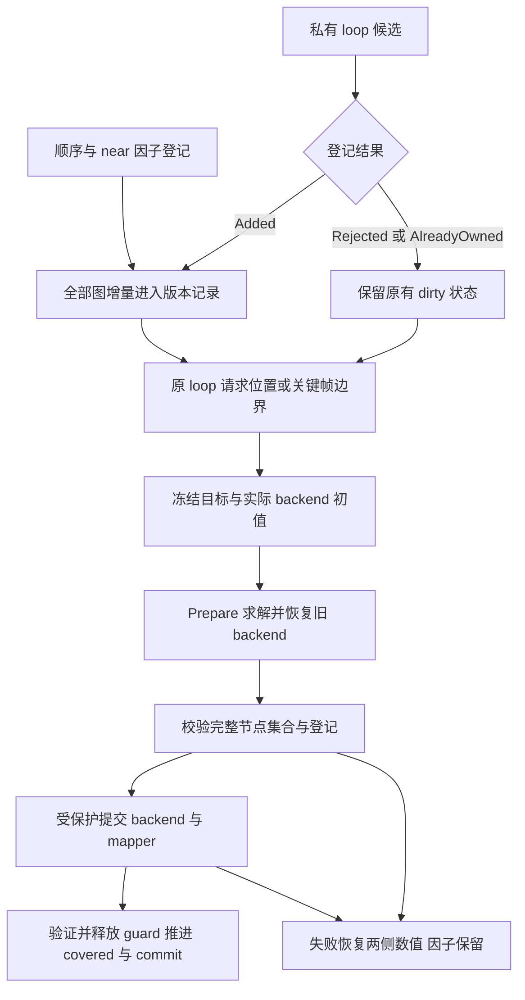

# 图更新、联合提交与快照合同

本合同适用于 GPU 工程的固定版本 slam_toolbox 依赖。持久实现由
`patches/slam_toolbox/source.json` 中的 `graph-update-transaction.patch`
维护；准备入口仍为 `scripts/prepare_slam_backend.py`。CPU 工程不参与修改。

## 状态与调用关系

Mapper 的递归所有者锁串行保护图增删、求解、提交、手动修改、Reset 和
checkpoint 操作。ROS 入口按 physical dispatch、公共 mapper mutex、Mapper
所有者、backend 的顺序取锁。第一版没有异步求解和后台续算。

前端 ReferenceState 与 BackendState 独立。CI 可以更新后续 matcher 使用的
参考位姿，但不因此重置 Ceres 的实际 warm start。求解候选只有在两侧完整
提交后才改变 commit ID。graph revision 包括节点及因子的增加、删除和重加；
reset epoch、backend pose revision 和 reference pose revision 分别记录。
`covered_graph_revision` 表示该目标得到一次接受的联合更新，不表示到达驻点。

ReferenceState 的权威数值是实际存储的 base 位姿。前端修改后，在同一所有者
范围内比较修改前后的 `GetCorrectedPose()`；数值发生变化时推进 reference
revision，并记录实际修改后的 base 增量。传感器位姿与 base 位姿的浮点变换
不保证往返逐位可逆，不能用传感器位姿相等推断 base 状态未变。此处使用精确
数值比较，与联合提交一致；不通过放宽日志审计容差吸收遗漏的状态变更。

`graph_update_policy=loop_only` 保留原来每个 Added loop 后的即时请求位置及
惰性候选顺序。显式研究政策 `keyframe` 另外在每个接纳的 mapping 关键帧末尾
检查所有增量。拒绝 loop 不会清除顺序/near 增量。普通请求对未变化图共享一次
尝试预算，成功覆盖先于新 seed 判断；失败后保持 dirty，等待新图增量或显式预算。
默认仍为 `loop_only`，实验结果通过完整验收前不自动切换部署政策。

## 数值和失败边界

Prepare 保存完整实际 backend 节点、因子、anchor、登记水位和实际求解选项。
Snapshot 持久选项包含 baseline 和 configured selector；每次 Prepared/native
记录另存解析后的实际 profile，严格 profile 不改写 baseline 默认值。
候选 ID 集合必须严格等于 live graph/backend 全部节点，且有限、唯一、anchor
不变。CommitPrepared 应用候选后仍持有回滚 guard；mapper 位姿和缓存更新及
两侧核对完成后，FinalizePrepared 才释放它。恢复在原存储内赋值，不能使
Ceres 保存的参数地址失效，也不使用具有 yaw 增量语义的 ModifyNode 做恢复。

数值拒绝或已设计并测试的提交前失败恢复两侧位姿，保留已经独立接纳的因子。恢复验证
失败则 fault，阻止继续处理及保存。mandatory 因子登记失败也明确 fault 并要求
Reset；这里没有承诺整个扫描的强异常回滚。提交已经完成后记录失败属于
已提交状态的 fail-stop，不应伪称已成功回滚。任意 OOM、进程崩溃及未测试的
第三方异常不在可恢复保证内。

backend 显式维护实际受约束 anchor：保留仍存活且受约束的 anchor，迁移时选
最小存活受约束 ID。政策名为
`first_constrained_registration_survivor_min_id_on_migration.v1`。一般图中它
不保证等价于历史延迟首次求解时选 anchor 的行为；LILocBench 正常兼容性必须
通过完整新回放验证。无残差跳过求解；多个不连通的受约束分量明确拒绝求解，
不会被添加虚构先验掩盖。

旧 solver 插件能力默认 Unknown。参与此合同的插件必须实现准备、提交、
终结、撤销、staging 工厂与激活、精确状态恢复、诊断 flush 及登记确认；
ROS 配置对不支持者明确失败。

## 观测、输出和离线流控

扫描进入处理队列前冻结一个不可变观测包：原始消息、原始/参考时间、
odom Pose2 投影、同一次查询得到的完整 odom-from-base 变换、已接纳的激光
设备身份/反转标志，以及可选的 prepared rays。队列和处理入口共享该包，
处理完成后的 map-to-odom 发布不再
查询可能已经过期的历史 TF。旧扫描路径使用完整三维变换；prepared 路径保留
其已声明的 SE(2) 合同，不把二维投影冒充旧路径的完整变换。

成功处理时，修正变换和对应的已处理消息头在同一锁内更新。栅格和 TF 发布
读取同一输出边界。纯 Load 恢复图状态，但不恢复未保存的 ROS 输出缓存；
在新的观测成功处理前停止旧输出的发布。

新 bundle 使用 `slam_toolbox.SaveSnapshot.v2` producer，保存并校验
`laser_bindings.json`。该成员绑定 frame、独立 sensor name、反转状态和标定；
staging 校验覆盖归档设备全集，首个新观测再次检查实际安装变换及原始扫描
声明。相同 frame 改变角度、范围或读数数量会明确拒绝。首设备保留旧名称，
附加设备使用稳定的唯一名称，避免全局 SensorManager 的名称覆盖。
旧格式缺少绑定时，仅唯一单设备可按明确的首观测绑定政策迁移；历史 frame
身份仍未知。缺少绑定的多设备归档不能唯一恢复，加载会拒绝。
bundle 中存在未纳入 manifest 的设备绑定文件时会拒绝加载；声明的绑定成员
使用固定路径，避免快照身份不变而实际加载状态变化。

`processing_status` 的 `slam-input-status.v2` 同时报告原队列容量、正在等待
几何依赖的 `physical_pending` 和 `outstanding=accepted-completed`。无拒绝且
未清队列的活动回放中，outstanding 等于 queued 加 processing。ClearQueue
沿用原有 invalid 计数，不能在发生取消后继续宣称该恒等式成立。

离线工具通过 rosbag2 的 Pause/Resume/IsPaused 控制生产者，保持原始消息、
顺序和源时间；请求 rate 是最大播放倍率，暂停增加实际耗时。高低水位由原有
队列容量确定，容量不扩大。只在 physical_pending 为零时暂停；暂停确认后
新出现的未来 TF 依赖会立即恢复生产者。服务超时、状态不一致、拒绝或耗尽
队列余量使该次实验明确失败，并保留流控记录。轮询不能证明 DDS 在途消息
具有固定上界；不能把这种控制宣称为任意输入下都保证不溢出。最终保存仍须
关闭全部输入计数并排空原生队列和物理依赖。

## 日志的工作量与证明范围

普通图增量事件先检查诊断兴趣；关闭诊断时不构造完整图元数据。开启时只读
backend 维护的常量规模状态，记录实际 reference pose 增量。该状态明确标记为
`maintained_not_full_registry_verified`，不认证 Ceres 实际登记完整性。

求解、提交/撤销和 checkpoint 边界仍捕获完整实际 backend 并核对全部节点、
因子登记、anchor 和选项；已捕获的同一快照可供同一边界内的核对复用。
Snapshot 记录 full checkpoint marker 并 flush。性能优化不移除完整校验，
普通轻量日志也不能代替边界校验或完整归档的独立审计。

## Snapshot、Finalize 和 Load

`SaveSnapshot` 的 Snapshot 模式不求解。Finalize 要求暂停接纳并排空队列，
按当前停止 profile 追加一次有 request ID 的预算，经过同一联合提交后保存。
同一 request ID 不会再消耗求解预算；输入版本变化时拒绝把旧结果认证为新终态。

默认 `include_graph=true` 时，一个不可变目录同时保存 PGM/YAML、图与数据、backend/reference checkpoint、
graph metadata、输入边界、扫描几何合同及实际加载库的观测哈希。私有目录写完
并校验后再原子发布。落盘失败与求解失败分开：Finalize 已提交但磁盘发布失败时
响应明确 `state_committed=true`、`finalized=false`，保留旧 F0；相同 ID 可重试保存，
不会重新求解。这里没有宣称内存提交与文件系统是一个分布式原子事务。

typed `LoadSnapshot` 只恢复状态，并通过响应报告结果；失败 staging 不替换 live
mapper。新 checkpoint 恢复原 backend seed 与前端参考，同时保存全部存活因子的
端点对到登记 ID 的映射和登记水位，保留删除形成的 ID 空洞；仅存最大 ID 无法
保证登记身份恢复。旧图缺失 backend 状态时
明确标记 `mapper_seed_fallback`。Load 与之后显式 Finalize 是两个独立操作。
旧 Deserialize 接口保留兼容，但其空响应不能作为调用方可验证的成功凭据。
`include_graph=false` 仅产生栅格 bundle，不能恢复图，Load 会明确拒绝。
诊断 staging 激活失败可以保留已经追加的日志字节，不承诺撤销日志；新日志
session 也不作为推进数学 backend epoch 的理由。bundle 内的输入边界当前记录
暂停与排空状态；完整终止输入序号、物理时间及输入集合由实验 run ledger 绑定，
不能声称 bundle 单独包含完整输入前沿。

## 验证及解释边界

原生控制覆盖联合回滚、完整候选、重复预算、dirty/covered、Reset、anchor 迁移、
两种状态的保存恢复、同名传感器生命周期和真实 ROS 服务失败。完整新回放先
验证兼容模式，再分离 S（调度）、T（停止）和 F（终态）的对照。

本轮不改变测量权重、loss、CI、关联门限或物理时间假设。严格停止仅是显式
数值对照，cost 下降不证明真实轨迹更准。score/pose 语义、共享误差和物理噪声
需要各自的辨识与独立验证。采集时钟和束序证据缺失，继续保留 T0 未校准标记。
