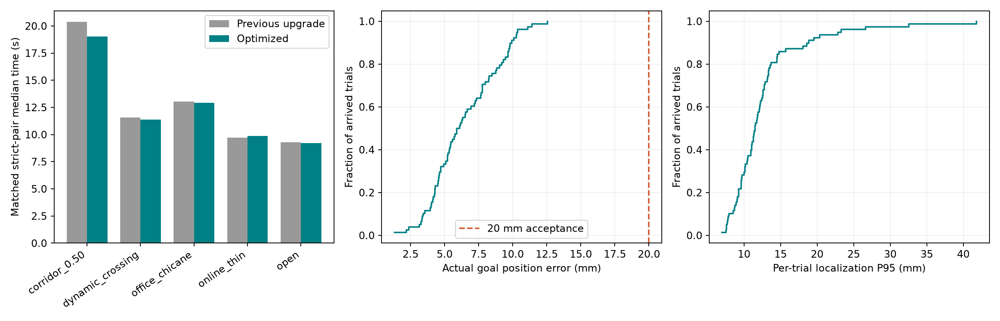
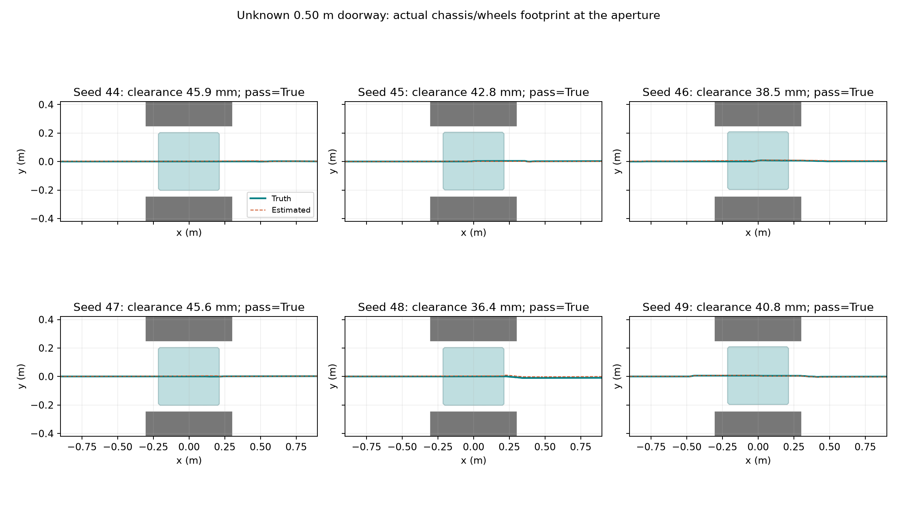
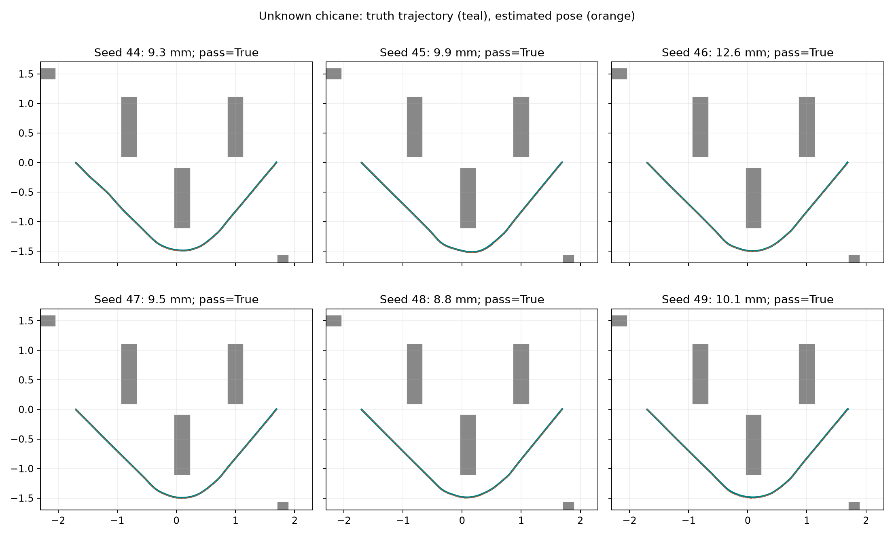

# 二维雷达导航：窄门与精确停靠优化

历史 v7 记录（`377f3ee` / `95a1455` / `9f179c7`）：78/78 属于本次冻结矩阵，不是当前候选的通过率。旧节点与话题仅解释当时链路；当前接口及待验证项见 [文档索引](README.md)。

较快单终点长程版本 main `c621f9c` 的独立结果见 [长程报告](navigation-continuous-review.md)。下文数字仅属于原 v7 冻结版本。

设备为 Jetson Orin Nano 8GB、JetPack 6.2、N10Plus 二维雷达，无相机。碰撞范围继续采用底盘含四轮的 427 × 406 mm 投影。本次先做本机运动学仿真，未连接 Orin。

最终冻结 v7 **78/78 严格到达、0 次碰撞、0 次启动错误**；已知/未知 50 cm 门各 **6/6 / 6/6**，成功最大真实终点误差 **12.6 mm**。本轮有限仿真达到验收目标，历史高并发反例与真机待测项仍保留。

算法提交为 main `377f3ee`（窄处跟踪、在线局部地图与制动校验）、`95a1455`（精确停靠与拒绝诊断）和 `9f179c7`（合成速度取图边界）。本报告保留前次 [v4 结果](navigation-performance-review.md) 以及本轮原型、失败和中断批次。

## 修改与适用范围

仍使用 ROS 2 Humble / Nav2 1.1.20。固定地图由 AMCL 定位；未知地图由固定版本 SLAM Toolbox 在线建图、定位，无 AMCL/map server，不包含自主探索。全局地图未知区域允许尝试规划，实时执行仍经过雷达与制动保护。

| 修改 | 用途与约束 |
| --- | --- |
| 精确直连全局路径 | 距离与角部行程合计不超过 6 m 时，先验证连续 SE2 直线连接，减少格点起点/朝向量化；每 4 mm 检查填充足迹、占据单元外接圆及插值余量。阻塞或更长路径仍走完整 Omni Smac Lattice，补入真实估计起点和精确终点并再次验证 |
| 窄处居中 | 在路径短段两侧尝试最多 ±30 mm 横移，用填充足迹到占据单元的净距排序；整段校验通过才执行，失败可缩短前视或交给 MPPI |
| 平移和转角配合 | 窄处保留小横向修正，角速度按实际平移进度缩放；仅当完整原地旋转安全时才先转后走，避免原路径可行但执行转得太快 |
| 输出速度验证 | 确定性跟踪和原生 MPPI 输出都检查当前测得速度、请求速度以及三个过渡速度的制动轨迹；不通过即减速或停车。后级 velocity_guard 和 Collision Monitor 继续约束所有指令来源 |
| 计算加速 | 碰撞粗筛改用足迹实际边界，保留每个障碍物自身半径、插值与安全余量。10,000 次随机比较与无粗筛结果一致，未减小安全距离 |
| 在线局部地图 | 局部采用实时 scan + 盲区障碍记忆 + inflation，移除在线 SLAM 静态层和实时表面的重复叠加；全局 SLAM 图、保护层的 `/map` 先验仍保留。固定地图局部静态层保留 |
| 恢复 | 两种标准导航 Action 的默认树移除大角度 Spin，采用清图、受保护的慢速后退、等待。不能把未实际触发的恢复变化当作成功原因 |
| 精确停靠 | XY 估计误差阈值从 10 mm 收紧到 4 mm，终点减速零速偏移改为 1 mm；yaw、低速和连续 0.25 s 停稳条件保留。验收仍使用独立真值 20 mm / 0.035 rad / 0.020 m/s，无放宽 |
| 诊断 | 拒绝局部快照或测得制动轨迹时记录具体条件；最终试验保存 Nav2、平滑器、仲裁、保护和底盘五处的速度指令链 |

局部路径参考转换可以用距所需时间不超过 0.20 s 的最新 TF 补偿 AMCL 的前向广播；传感器转换与真值评估继续使用原时间戳，未用最新 TF 替代评估缺失值。Nav2 Humble 在控制发布前调用插件，本项目的额外验证在该插件内部执行。[Humble 控制服务器源码](https://github.com/ros-navigation/navigation2/blob/humble/nav2_controller/src/controller_server.cpp)

常规上限仍为前进 0.50 m/s、横移 0.30 m/s、后退 0.20 m/s；近障跟踪最高 0.10 m/s。足迹 padding 8 mm、硬保护 margin 8 mm、测距误差 15 mm、反应时间 0.20 s、线制动 0.40 m/s²、角制动 0.80 rad/s²、扫描与指令失效停车条件均保留。原有 OPEN_LOOP 平滑器、测得速度制动、盲区记忆、地图索引和 SLAM 参数沿用 v4。

## 原型中的反例

v5 的 12 场景 × 6 新种子（20–25）为 **70/72 严格到达、零碰撞**。其中开阔场景种子 22 在保护层大量报告 clear 时几乎不运动，50 cm 门种子 24 为传感器启动超时；均保留。单独窄门旧种子回归为 5/6，失败种子 1 也几乎零运动。v5 同种子配对两组分别 9/10，旧 v4 失败在门前，新 v5 失败为开阔场景零运动。高并发时同时最多十个试验图，和最终较低并发的运行条件不同。原批次只记录了控制消息时间及真值速度，缺少完整分级指令值，不能据此判断零速出自哪一级。

上述零运动的独立重跑通过，带局部拒绝日志的诊断也通过，未稳定复现；因此没有认定其唯一原因，也没有声称已经根治。另一批 v5 验证在精确停靠问题出现后停止后续排程，已完成的 10/10 与中断说明保留，未将它称为完整矩阵。

未知 50 cm 门的早期在线原型在约 41 mm 真值净距下反复局部优化失败并后退；在线局部图调整后，v5 六次 Action 均到达，但严格验收为 **5/6**：种子 24 的真实终点误差 **22.5 mm**。此反例触发了 4 mm 停靠阈值和 1 mm 零速偏移的 v6；四项烟雾测试通过，但因雷达随机流未固定，重跑不能构成单变量因果证明。

v6 在补齐合成速度检查范围前停止排程，已有主矩阵 29/29 和窄门回归 6/6 完成并保留。代码审查发现，原生 MPPI 的 vx/vy 可同时达到上限；新增真实平移加旋转制动轨迹测试确认，仅用前进上限取图会漏掉可达区域。v7 以合成速度和测得速度中的最大值计算保守取图范围，后级硬保护一直保留。

## 评估边界

独立评估器按底盘填充多边形与障碍几何进行 4 mm 插值碰撞检查；真值样本等待 0.25 s TF 发布延迟，再查询原时间戳。到达同时要求 Action 成功、零碰撞、真实终点误差 ≤20 mm、yaw ≤0.035 rad、真实末速 ≤0.020 m/s。启动失败计入尝试数，安全拒绝与超时不当作到达。

dynamic_crossing 通过已确认的服务在运动前方瞬时放置 22 cm 障碍并保持，评估突然出现后的制动和绕行；它没有测试持续移动物体的轨迹预测。

房间约 6 × 5 m，窄门由横跨房间的 60 cm 深屏障形成，无法绕过。二维雷达 540 束、10 Hz，假设 5 mm 高斯测距噪声；注入 3% 轮速尺度偏差、0.003 m/s 速度噪声及 0.001 rad/s 陀螺偏置。随机种子控制适配器扰动，Gazebo 雷达随机流未固定。真值用于独立评价及合成带误差的速度输入，未将完整真值位姿送给定位或导航。

运动学仿真未覆盖麦轮打滑、真实制动、透明反光物体、雷达平面之外的障碍、整机上部碰撞与长期大地图增长。有限矩阵不能证明真实场景绝对 100% 到达；CPU 限额也不能代替 Orin ARM64 原生测量。

## 复现

在 sim checkout，默认编译相邻 main checkout 的硬件算法，冻结配置及二进制并逐试验核验。最终主矩阵含未知窄门，共 13 场景 × 6 新种子（44–49）。

```bash
DUOJIN_NAV_OUTPUT="$PWD/.cache/navigation-narrow-reproduce" \
  simulation/navigation_narrow_matrix.sh
```

真实设备继续使用 `online_navigation.launch.py`（未知地图）或 `navigation.launch.py map:=...`（固定图）。Orin 可连接后需要原生 Release 构建，并测量轮速/雷达外参、实际刹车距离、控制时限和完整 ROS 图资源；已有 `scripts/profile_navigation.py` 可记录原生运行信息。

## 最终冻结结果

v7 主矩阵 **78/78 严格到达、0 次碰撞、0 次启动错误**；在线无先验 **24/24**。成功试验最大真实终点误差 **12.6 mm**、最大角度误差 **0.33°**、最大真实末速 **0.0065 m/s**。

| 场景 | 严格到达 | 成功最大终点误差 mm | 成功最大角度误差 ° | 成功耗时中位数 s | 最大定位 P95 mm | 最小真值净距 mm | 最低 TF 配对覆盖率 |
| --- | --- | --- | --- | --- | --- | --- | --- |
| corridor_0.50 | 6/6 | 7.4 | 0.06 | 18.7 | 8.5 | 43.1 | 100.0% |
| dynamic_crossing | 6/6 | 9.8 | 0.05 | 11.3 | 15.7 | 36.1 | 100.0% |
| initial_pose_error | 6/6 | 6.3 | 0.06 | 9.5 | 41.8 | 1067.7 | 100.0% |
| office_chicane | 6/6 | 6.1 | 0.14 | 12.9 | 12.9 | 74.8 | 100.0% |
| online_chicane | 6/6 | 12.6 | 0.33 | 12.9 | 14.5 | 76.8 | 100.0% |
| online_corridor_0.50 | 6/6 | 11.1 | 0.23 | 20.0 | 12.6 | 36.4 | 100.0% |
| online_open | 6/6 | 6.5 | 0.30 | 9.8 | 12.6 | 1031.6 | 100.0% |
| online_thin | 6/6 | 10.3 | 0.06 | 9.7 | 13.7 | 106.1 | 100.0% |
| open | 6/6 | 6.7 | 0.20 | 9.3 | 22.8 | 1034.6 | 100.0% |
| reverse_goal | 6/6 | 11.4 | 0.01 | 18.5 | 10.2 | 725.9 | 100.0% |
| s_bend | 6/6 | 8.0 | 0.13 | 10.2 | 11.0 | 78.1 | 100.0% |
| sensor_dropout | 6/6 | 4.9 | 0.04 | 11.5 | 23.3 | 1072.1 | 84.2% |
| thin_obstacles | 6/6 | 4.5 | 0.06 | 9.2 | 18.9 | 99.3 | 100.0% |


已知地图 50 cm 门 **6/6**，未知地图 50 cm 门 **6/6**；真实最小净距分别 **43.1 / 36.4 mm**。这些门无法绕过，成功试验均检查了实际穿越。窄门旧种子回归 **6/6**，开阔零运动旧反例 **2/2**，未知窄门旧反例 **2/2**，NavigateThroughPoses **2/2**；航点测试评价最终目标，不声称每个中间点都停稳。

无主矩阵失败。

主矩阵实际速度 P95 的最大值 **0.500 m/s**，open 成功耗时中位数 **9.30 s**；50 cm 已知/未知门分别 **18.73 / 19.98 s**。窄处自动减速，速度上限不等于全程平均速度。

两组使用同一最终评估器和种子 50/51；旧组为 main `7bc9e10` 的原算法及参数，保留其局部静态层与恢复行为，使用相同 Cyclone DDS 和启动检查。旧版 **9/10**、新版 **10/10**，失败计入分母；耗时仅比较双方均严格到达的相同种子。

旧版 50 cm 门种子 50 实际移动 1.374 m 后在门前未通过，最小净距 34.0 mm，无碰撞；该次有非零控制指令及大量测得速度制动拒绝，和早期几乎零运动的启动反例不同。新版同种子通过。整套修改一同比较，不能将这一差异单独归因于居中跟踪或恢复树，也没有证据表明所有场景的耗时均改善。

| 场景 | v4 严格到达 | v7 严格到达 | 可配对成功数 | v4 耗时中位数 s | v7 耗时中位数 s |
| --- | --- | --- | --- | --- | --- |
| corridor_0.50 | 1/2 | 2/2 | 1 | 20.39 | 19.05 |
| dynamic_crossing | 2/2 | 2/2 | 2 | 11.56 | 11.38 |
| office_chicane | 2/2 | 2/2 | 2 | 13.05 | 12.91 |
| online_thin | 2/2 | 2/2 | 2 | 9.71 | 9.87 |
| open | 2/2 | 2/2 | 2 | 9.29 | 9.21 |







保护计算最坏单次 P95 **3.14 ms**，最大样本 **5.72 ms**；控制指令周期最坏 P95 **53.0 ms**，共 **6** 条控制 deadline 警告。雷达中断到真实速度低于 0.005 m/s 的延迟 **0.301–0.376 s**。

仅统计定位、controller、planner、guard、Collision Monitor 五个进程，RSS 是各进程峰值之和，CPU 为跨试验平均占用之和的中位数，均以一个 x86 核为 100%；不包含完整 ROS 图和 Gazebo，不代表 Orin。

| 模式 | 最大峰值 RSS 之和 MiB | CPU 之和中位数 |
| --- | --- | --- |
| 固定图 | 169.1 | 38.5% |
| 在线图 | 192.1 | 38.8% |

整个 Gazebo + ROS + 评估器容器限为 **2 CPU / 4 GiB** 的最终 v7 为 **5/5**，碰撞 **0** 次。这是桌面资源限额压力证据，不是 Orin 原生验收。

| 边界/故障场景 | 结果 | 真实最小净距 mm |
| --- | --- | --- |
| corridor_0.40 | 未到达，无碰撞 | 495.5 |
| corridor_0.44 | 未到达，无碰撞 | 484.5 |
| corridor_0.46 | 未到达，无碰撞 | 65.2 |
| corridor_0.48 | 未到达，无碰撞 | 33.2 |
| corridor_0.52 | 严格到达 | 54.4 |
| corridor_0.56 | 严格到达 | 74.3 |
| late_initial_pose | 严格到达 | 1080.2 |
| legacy_map_3cm | 严格到达 | 1026.1 |
| unsafe_fast_command | 危险指令安全停车 | 35.4 |

48/46/44 cm 的裸底盘可能仍有通路，当前配置未证明能可靠通过；40 cm 小于 406 mm 车宽。保护不会因为未到达而放宽。本次仍保留历史高并发零运动和启动超时记录，成功诊断重跑不能证明其根因已解决。

## 验证与证据

最终 Release 七个硬件包构建通过，main Python **44/44**、sim/场景 **53/53**、C++ **3/3**、保护层故障/几何 **11/11**、地图索引 **5/5**。随机粗筛对比、噪声门居中、孤立内部柱、几何短段与实际速度不一致的反例，以及对角平移/转动的取图边界均检查。main → sim **61 个文件**哈希相同，原有 **86 个 CAD/模型文件**哈希保留；在线 GUI 健康状态单独存档。

正式最终试验 124 次（78 主矩阵、20 旧新配对、6 窄门回归、2 开阔旧反例、2 在线旧反例、2 连续航点、9 边界/故障、5 限额），原型/失败/中断另列。各工作容器实际生成的参数、缩放原语和场景临时文件也已存档。每个主矩阵试验的四个导航二进制哈希一致，未在试验中改变源码、配置或碰撞标准。新增分级速度记录改变了评估器字节哈希，但碰撞、时间配对与到达计算方法的 AST 核对一致。

[逐试验结果](evidence/navigation-narrow/results.json)、[CSV](evidence/navigation-narrow/results.csv)、[所有批次索引](evidence/navigation-narrow/experiment-index.json)、[最终冻结试验](evidence/navigation-narrow/frozen-trials.tar.gz)、[原型及失败](evidence/navigation-narrow/exploratory-trials.tar.gz)、[源码和评估器](evidence/navigation-narrow/source-and-harness.tar.gz)、[最终构建](evidence/navigation-narrow/final-build.tar.gz)、[运行时参数/场景索引](evidence/navigation-narrow/runtime-parameter-index.json)、[平台元数据](evidence/navigation-narrow/metadata.json)、[同步校验](evidence/navigation-narrow/main-sim-sync.json)、[运行状态](evidence/navigation-narrow/gui-health.json)。复现还依赖 sim 工作区保留的 CAD 描述资产，其哈希已存档。
