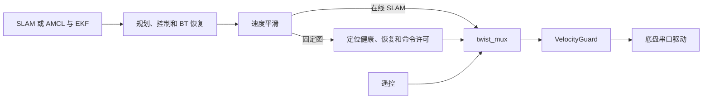

# 导航优化历史记录归档

归档日期：2026-10-09。以下正文完整保留原 `navigation-optimization.md`，包含中间版本、失败、无效候选及逐阶段证据。正文中的“当前”“最新”“未完成”均指对应阶段，不能当作日常操作指令。当前概要见 [优化状态](navigation-optimization.md)，操作入口见 [文档索引](README.md)。

---

# 导航优化与证据边界（2026-10-07–08）

当前没有证据证明 main 的算法或配置为全局最优。已经修复明确实现缺陷；新候选须经过同输入回放、独立几何评价及冻结后的 Gazebo 对照。此文记录证据，不代表已部署、已合并或真机验收。

最新判定：当前架构已完成两轮约35m、34点新鲜在线SLAM长程复测。默认配置与P7联合配置均 **34/34 Action成功、完整采集和正常退出通过**，但严格到达仅 **4/34、6/34**，末端真值误差 **94.988mm、52.249mm**，扫描时刻位置RMSE **58.803mm、40.787mm**。两轮远回环候选全部在粗匹配响应门槛被拒绝，接受数均零。联合配置在本次样本中较好，仍未满足20mm，也未复现历史P7的19/34；旧结果及失败保持不变。固定地图短程和矩形回访的成功不能代替长程精度与回环验证，当前没有整体最优的证据。

P7完整流程与严格精度/几何分别经过独立保存证据复核，报告为`evaluation/p7-full-joint-first-flow-light-independent-v1.json`（6c531e1c…）及`evaluation/p7-strict-and-geometry-first-light-independent-v1.json`（01b2a92f…）。修复工作保留在`codex/navigation-repairs-20261007`，基于main `6a20e6da…`，未提交或合并main。

## 2026-10-08 当前架构34点长程复测

复用原P7的实际世界、起点[-4,-2.8,0]、34个预声明世界目标、传感器压力配置及种子45。每臂从新图开始；不加载保存图、map server、AMCL或几何先验。实际五个导航节点均ACTIVE，原生导航插件、已修正的SIM里程计发布库及当前MAIN补丁c2233b30…的SLAM库映射均核验。两臂唯一参数差别为相关网格/模糊尺度：默认0.005/0.05m，联合0.0025/0.025m；该联合参数合法，未晋级MAIN。

这是34段FollowPath测绘回访，每段从实际融合map→base TF连接到声明目标；不是连续单目标NavigateToPose，也没有验证全局规划器的路线搜索。评价只用声明起点确定固定gauge，未按真值拟合；真值不参与控制。严格判据保持20mm位置、0.035rad朝向、0.02m/s和0.02rad/s停速、连续0.25s不同源帧停稳及双时钟新鲜度。

| 当前架构指标 | MAIN默认 | P7联合 |
|---|---:|---:|
| FollowPath Action成功 | 34/34 | 34/34 |
| 独立严格因果到达 | 4/34 | 6/34 |
| 实际路程 | 34.999m | 35.085m |
| 末端真值XY误差 | 94.988mm | 52.249mm |
| 扫描时刻XY RMSE | 58.803mm | 40.787mm |
| 远回环粗匹配候选/接受 | 38/0 | 35/0 |
| 采集、完整图导出、正常退出 | PASS | PASS |
| 所评分底盘投影碰撞数 | 0 | 0 |
| 条件底盘净空下界 | 33.025mm | 44.770mm |

默认与联合的粗匹配响应最高为0.312及0.322685，低于原0.45门槛；38/38、35/35均因响应被拒绝，方差门槛没有拒绝。未进入远回环精匹配、接受、新约束或增量Ceres求解分支。每臂另有8次nearby-chain约束提交，不能算远回环成功。先前矩形回访的新增回环边正例保持有效，却未推广到本长程。

独立扫描时刻TF与真值匹配数为3,409/3,373，每臂六个启动查询缺项。该TF在至少0.2s延迟后查询，属于回溯可用性，不能冒充控制器当时输入。轨迹前/中/后三分之一位置RMSE默认为38.152/51.875/78.894mm，联合为30.919/41.106/48.421mm。末端回溯估计距目标仅0.665/1.184mm，而真值为94.988/52.249mm，支持优先排查定位漂移的判断，不能单凭此唯一归因。原始/适配IMU分别有34,497/34,140个同源配对，角速度差为声明的+0.001rad/s；这证明压力夹具的偏差注入，不是独立硬件偏置估计。

完整XYZ/四元数几何复算绑定原P7实际SDF的79个非地面静态箱体，其中76个可评分，包含四面外墙。原生CAD全轮相位包络及实际SDF底盘的全部34段均为零碰撞并有源时间端点支撑；净空下界依赖线性XYZ、最短SLERP及2mm角点细分。challenge_11/23/25三个浮点退化箱体仍无证书，排除上部机构、地面接触及未建模帧间动力学；不授全机器人或全世界安全证书。原P7的72障碍评分范围单独保留。

旧容量方案连同余量约6.59GB。本轮先量测完整图大小，再冻结新的有界观察协议：完整图、真值、扫描、IMU、命令、TF和有效参数保留，明确不存高频原始clock及重复全地图，不重建旧缺项。运行期原生与临时输出使用私有1GiB runwork和128MiB tmp限额，主机控制台独立封顶128KiB；每臂导出限320MiB，整轮证据限768MiB，保留主机2GiB余量。两臂完整导出110,699,337/142,605,975B，19/19个文件逐一核对大小和SHA；两份完整原生图均保存，历史资料未删除。

两臂launch及全部子进程正常退出，无升级信号、强制清理或存活残留。源锁复核77个MAIN/SIM共享文件、各101个MAIN/私有后端源及379个安装产物；本轮未改算法、生产参数、硬件DDS或SIM模型。同步回环事件观察和精简采集属于新观察版本；每臂仅同一开发种子的一次运行，历史19/34→本次6/34不是隔离的架构或算法因果对照，也不建立随机可靠性及Orin/真机性能结论。

完整证据见[长程测试记录](/home/th1rt3en/dev/forge/duojin02-sim/.cache/closed-loop-optimization-2026-10-07/diagnostics/current-architecture-long34-v1/README.md)、[独立复算](/home/th1rt3en/dev/forge/duojin02-sim/.cache/closed-loop-optimization-2026-10-07/diagnostics/current-architecture-long34-v1/independent-long34.json)及[机器汇总](/home/th1rt3en/dev/forge/duojin02-sim/.cache/closed-loop-optimization-2026-10-07/diagnostics/current-architecture-long34-v1/summary.json)。以下章节保留各先前轮次当时的结果与证据边界。

## 2026-10-08 当前架构移动、断流与回环测试

本轮未改 MAIN 算法、参数或硬件部署，未增加生产节点或旧版本接口。采用新开发种子62/63，每次启动新图、单个 NavigateToPose，实际五个导航节点 active。声明起点/目标不取自真值，原始全XYZ/四元数及源/接收时间单独保存。

| 固定地图场景 | 完整流程 | XY 真值误差 |
|---|---:|---:|
| 约3.46m斜向移动 | 2/2 | 4.33 / 4.87mm |
| 强制穿越0.50m通道 | 2/2 | 5.47 / 5.70mm |
| 行驶中扫描断流、恢复 | 2/2 | 4.44 / 4.68mm |

结果接收前独立复算均满足20mm位置、0.035rad朝向、0.02速度/角速度及至少0.25s连续不同源时间戳停稳。扫描断流期间原始雷达继续、转换后扫描为零、健康许可撤销、下游命令为零；物理模拟速度进入停稳判据耗时0.221/0.235仿真秒，接收墙钟0.274/0.295秒。恢复后原目标完成，所有进程正常退出，没有升级信号或强制清理。

原六次观察器缺少完整Action源时间端点支撑，虽无采样底盘碰撞，仍不授完整几何证书。单独增加发目标前接收排空及固定返回端点后的接收尾段，两个通道复测完整通过，XY为5.57/5.38mm；完整底盘投影的保守净空下界约45.47/45.37mm。采用原生CAD全轮相位包络与实际SDF包络、全XYZ/四元数、填充SAT及SLERP/2mm角点插值；所有实际非地面静态箱体已绑定。证书依赖记录间插值，排除上部机构、地面接触与未建模帧间动力学；尾段真值未用于改写到达评分。

新鲜在线SLAM用预声明的四个map帧目标形成矩形回访，无保存图、map server、AMCL或几何先验输入；固定评价偏移[-1.7,0,0]，未拟合真值。这是四Action协议，不能替代连续单目标或34点长程。

首次在线预检发现SIM及镜像后端仍为旧补丁10a81991…，而当前MAIN补丁为c2233b30…；未发目标便拒绝。原75个包内文件核验遗漏包外补丁。本轮仅由MAIN向SIM补齐后端补丁及其测试，77个共享文件字节一致；2项补丁准备与21项SIM硬件边界pytest通过。实际在线运行使用已编译的当前补丁私有后端，101个MAIN源、101个私有源及379个安装产物均核验，实际映射库匹配；可选BENCH事件观察及历史标记与MAIN不同，生产求解与地图数学代码未变。同步stderr观察可能改变时序，不作为性能因果对照。

online-v2四个目标严格通过，回到起点误差15.03mm，但采集器的2MiB单文件限制使完整图导出失败，完整流程仍为FAIL。原生序列化成功的完整图已在独立目录恢复，失败前缀保留。online-v3仅更正获准导出阶段的文件上限，保持32MiB单文件、48MiB检查点和96MiB整轮预算，四目标严格通过，实际路程9.37m、末误差11.36mm、停稳0.56s，完整图及数据导出成功；全部子进程正常退出。两次使用同一个开发种子64，不能视为两个独立随机样本。

两次均有完整TryCloseLoop原生事件链：粗/精匹配接受、**新增UID10→UID34边**、约束提交、Ceres Compute返回及**35个节点结果**；与nearby-chain事件区分，源时间间隔21.1s、状态间隔24。粗/精阈值保持0.45/0.55、最小链长度保持15。由此补齐简单场景回环分支正例，不能确定长程召回率或定位收益。

独立逐节点真值复核发现，v2增量求解XY RMSE为3.173→3.952mm，v3为3.521→3.521mm，v3最大位置改变量约9e-16m；没有显示精度改善。“求解前”已含触发节点的匹配器SetSensorPose，仅衡量增量Ceres变化，不能归因完整回环效果。在线两次四段均取得相同范围的条件底盘几何证书，v3物理包络最小保守净空下界约145.3mm。

全部启动、采集与错误测试入口记录保留。历史在线冻结清单中的空文件自哈希行无效，原样保留并排除；实际执行脚本/配置/协议/场景哈希独立验证，最终外部清单覆盖全部保留字节。当前2CPU桌面测试不代表Orin或真机性能，也未新增替代算法的隔离对照。长程P7严格19/34及40.350mm末误差仍未解决；既有完整容量计划含保留余量约6.59GB，本轮未清理历史资料来凑空间。

完整记录与独立报告见[本轮测试索引](/home/th1rt3en/dev/forge/duojin02-sim/.cache/closed-loop-optimization-2026-10-07/diagnostics/current-graph-motion-suite-v1/README.md)及[机器结果](/home/th1rt3en/dev/forge/duojin02-sim/.cache/closed-loop-optimization-2026-10-07/diagnostics/current-graph-motion-suite-v1/summary.json)。以下章节保留各先前轮次当时的结果与证据边界。

## 2026-10-08 上游断流与仿真入口修复

速度平滑器的 `velocity_timeout` 由 1.0 s 改为 0.25 s。原来导航生产者停止发令后，平滑器仍持续发布新命令，下游管理器、VelocityGuard 和串口驱动因持续收到消息而看不到上游断流；现在由平滑器自身结束上游命令有效期并按原减速度制动。没有新增守护进程、兼容入口或备用控制链。

实际 Humble 平滑器 → 定位管理器 → mux → VelocityGuard → PTY 底盘驱动，对同一 0.24 m/s、20 Hz 输入分别测试断流。定位、扫描和 TF 保持有效，候选没有利用其他保护故障提前停车：

| 断流后的模块指标 | 原 1.0 s 配置 | 当前 0.25 s 配置 |
|---|---:|---:|
| 平滑器首次减速 | 1.020 s | 0.273 s |
| 串口首次零速帧 | 1.627 s | 0.829 s |
| 指令速度积分 | 0.311 m | 0.131 m |

指令积分采用完整零阶保持区间，不是物理制动距离；原探针遗漏首个输出间隔的积分，更正单独保存，原始记录未覆盖。两臂均保持 20 Hz 输出、每周期最大 0.02 m/s 降速，闲置释放、手动接管、新请求恢复和显式零速通过；所有五个子进程 exit0。首次两次夹具因跨话题 TF 到达顺序使扫描失效，未取得断流评分；仅给受控恒定位姿 TF 增加 0.1 s 时间覆盖后重测，生产保护条件未修改。110 项 MAIN Python 检查、8 项 CTest、18 项管理器命令链回归和三轴平滑器末段制动检查通过。

MAIN 向 SIM 同步了 28 个共享源码/配置文件，模型资产未改。独立仿真入口复用同一五节点工厂、固定地图定位管理器及唯一 VelocityGuard；移除 Collision Monitor、其生命周期管理器及过期等待/话题。仿真入口补齐 `ParameterFile(..., allow_substs=True)`，实际行为树路径正确展开。资源采样包含全部五个导航节点，避免漏算 BT、行为服务和平滑器。

隔离网络下复现 DDS 默认参与者容量不足，仿真包采用明确的 Cyclone DDS 配置。适配器由自身控制信号、executor 和上下文关闭，先发布零速，再释放通信资源。实际退出栈确认可靠发布者销毁等待；仿真部署把每个发布者关闭时的等待上限从安装版本默认 1 s 改为 200 ms，运行期间仍使用可靠传输。该设置会放弃关闭阶段仍未确认的样本；独立 DDS 探针确认正常及暂停时钟情况下，最终零速消息可收到且进程正常退出。语义依据安装版本 0.10.5 的 `ddsi_cfgelems.h` 和 [Cyclone DDS 配置说明](https://cyclonedds.io/docs/cyclonedds/latest/config/config_file_reference.html)。硬件 DDS 默认配置未改变。

当前短程固定地图 Gazebo 流程 **完整通过**：真实底盘从声明起点移动约 0.4 m，单次 `NavigateToPose` accepted/SUCCEEDED，五节点全部 active，六段实际命令流均观测到非零输出。结果接收前的独立真值 XY **7.490 mm**、yaw **0.000925 rad**、速度 **0.002741 m/s**、角速度绝对值 **0.001164 rad/s**，不同真值帧连续停稳 **0.66 s**；真值源/接收年龄约 **11 ms**。所有 launch 子进程正常结束，没有升级信号、强制清理或存活进程组成员。26 项 SIM 硬件边界/场景检查通过。实际安装的 41 个 Python、launch、配置和行为树文件与最终源码哈希一致，九次生成世界与最终生效参数均保存。

早期 DDS 启动、夹具数值类型/生命周期等待、参数序列化和正常退出失败全部保留；此前已有两次短程 Action 成功但退出升级，均仍为完整流程 FAIL。最终短程只验证当前架构集成及该终点的因果位置/速度/停稳条件，**没有独立完整碰撞证书，也没有当前架构的 34 点长程复测**。最新长程仍是前述 P7 严格到达 19/34；共同角速度偏差、晚程漂移和远回环正例缺失尚未解决。

本轮证据位于 SIM `.cache/closed-loop-optimization-2026-10-07/diagnostics/upstream-command-and-sim-graph-v1/`，索引为 `README.md`、`summary.json`，独立复算为 `saved-stream-independent-review.json`。全部源码、日志及失败记录有界保存，没有删除历史数据；修改仍未合并 main。

## 2026-10-08 架构收敛与模块实测

本轮按单一职责收敛运行图，净减少 **5 个常驻进程**：定位监测和导航闸门合为 `localization_manager`；删除重复静态足迹检查的 Collision Monitor 及其生命周期进程；当前行为树未调用的 `smoother_server` 和 `waypoint_follower` 不再启动。BT 动态库由 47 个减为实际树使用的 12 个，恢复行为只加载 BackUp/Wait。保留速度平滑负责执行器速度变化、mux 负责来源优先级、VelocityGuard 负责填充足迹/制动/输入有效期、串口驱动负责传输与独立命令超时。PreciseLattice、PreciseMPPI、SLAM/AMCL 和 EKF 的算法选择未因这次进程精简而替换。

管理器直接使用内部健康状态，不再经 JSON 消息交给第二进程。诊断 JSON 保留给观察和启动就绪检测。命令使用当前 Humble 的 DDS 源时间，闭锁期间或放行前的旧请求不能续租；不保留旧节点可执行入口或 `/cmd_vel_guarded` 话题。健康评分与发令两个 20 Hz 工作在一个 steady timer 中错开发生，避免评分开销周期性延后发令。多目标行为树显式使用 `base_footprint`；修复的是 `RemovePassedGoals` 自身的 `base_link` 默认值，未增加 TF 别名或兼容节点。

两次串行 ABBA 模块对照均保留。首次合并的 CPU 已下降，但命令周期 P95 从约 50.22 ms 增至 58.78 ms；该版本未作为最终结果。最终每臂两次 10 秒窗口、2 CPU 桌面容器，每个窗口实际发布 10,001 个 clock、100 帧扫描、198 条导航请求，接收 200 条正确速度输出，健康状态全程有效：

| 定位模块指标 | 双进程基线 | 最终单管理器 |
|---|---:|---:|
| CPU，占一个核 | 47.446% | 31.298% |
| 发令周期 P95，两次均值 | 50.161 ms | 50.163 ms |
| 发令周期最大值 | 50.375 ms | 51.139 ms |
| 两次末时 RSS 均值 | 94.924 MiB | 50.715 MiB |

这里的 **34.04% CPU 降幅只对应定位模块**；没有整机速度、总 CPU 或 Orin 性能结论。110 项 Python 检查（含键盘遥控）、8 项 C++ CTest、18 个实际 DDS → mux → VelocityGuard → PTY 串口用例和 11 个制动/扫描/地图故障用例通过。18 个用例包含启动闭锁、命令过期、闲置释放、手动接管、扫描缺失、时钟暂停、坏帧闭锁、明确恢复、管理器暂停及排队旧指令拒绝。独立底盘探针测得断流后实际串口零帧延迟 254.9 ms，编码、校准参数、坏校验帧和静默重连均通过。

当前五个 Nav2 生命周期节点在实际原生进程中全部 active，`NavigateToPose` 与 `NavigateThroughPoses` 的原地目标均 accepted/SUCCEEDED；这验证装载、行为树和 Action 接口，不是移动轨迹或精度测试。最终链路、CPU 对照和导航进程均正常退出，未强制杀进程。首次原生图探针遗漏真实 guard 的障碍记忆流，造成 costmap 不 current、Action 无结果并由 launch 升级杀 planner；第二次暴露 BT 默认坐标系，旧失败与清理判定更正单独保留。编译环境的权限、并行编译内存和 tmpfs noexec 失败也保留，未计作算法检查通过。

全部原始记录在 SIM 工作区 `.cache/closed-loop-optimization-2026-10-07/diagnostics/localization-owner-consolidation-v1/`，包含三个源码冻结、编译产物、对照数据、失败记录及 `summary.json`。最终运行包的管理器、导航图、配置及多目标树哈希与当前 MAIN 一致。现有预览和模型资产未改动。

**完整 Gazebo 路线尚未针对这次架构重跑。** 当前可用约 5.27 GB，既有完整单臂容量计划连同保留余量需要约 6.59 GB；本轮只执行有界原生模块检查，没有清理历史数据来凑空间。因此前述 P7 的严格到达 19/34、40.350 mm 末误差和远回环正例缺失仍是最新路线证据，不能用模块成功宣称整体最优或满足 20 mm。未来改变角速度偏置处理时，先确认反馈是否独立；现有驱动已有显式 IMU 偏置配置，本轮没有新增静态校准进程或依据真值拟合硬件偏置。

## 已落地的机制修复

- PreciseMPPI 的前进、后退、横移和转动四类速度约束贯穿各输出分支；规划器的占据判断、缓存和生命周期，以及 Ceres 锚点/残差清理和地图未知格保存均已有公开 API 或实际构建测试。
- 在线入口对扫描精确时间的 odom TF 作有界等待，源年龄及 wall 等待均须小于 0.3 秒，并要求 3 个不同源时间戳和新鲜 map TF；固定图入口等待持久健康许可。
- 单纯扫描缺失撤销许可并重新取得连续有效证据；已确认的几何失配、错误时间戳及失败恢复继续硬闭锁。高帧率不会缩短 0.5 秒正常确认或 1.4 秒恢复窗口。
- 恢复响应前的扫描即使稍后取得 TF，也不参与响应后的确认。
- 当前 N10 发布链将近距离删点、缺角度和远处无回波都编码为 `+Inf`。健康检查将其视为缺测，不用它证明自由空间。超过传感器声明范围的值也不提供证据；合法有限回波超过 8 米策略上限，仍保留截断范围内的射线矛盾。真实有限回波穿墙、最低 45 个有限命中及其他原门槛保持。

此前对应源码在隔离 ROS Humble 环境 **102 项通过**。这覆盖 Python 逻辑及 ROS 方法/launch 依赖接口；新候选 Gazebo 六场景开发首执行均通过严格到达评分，进程收尾仍有一次异常。完整原生修复和验证见 [navigation-repairs.md](navigation-repairs.md)，健康契约见 [localization-health.md](localization-health.md)。

## 现有 Gazebo 判定

同一显式 Gazebo/适配器种子 61、桌面 2 CPU 配额的 v3-seeded 开发对照在三个场景后停止：原 main **3/3**，候选 **2/3**。候选开放场景及传感器中断均到达并停稳；0.50 米通道穿过入口后因缺测被误作穿墙而停下，未到目标。原始失败保留，不用离线预测替换导航分数。

| v3-seeded 首执行，开发 seed61 | 原 main 最终 XY | 候选最终 XY | 判定 |
| --- | ---: | ---: | --- |
| 开放场景 | 6.53 mm | 4.95 mm | 双方通过 |
| 传感器中断 | 4.88 mm | 5.05 mm | 双方通过；候选闭锁期间，健康闸门下游至底盘的命令为零 |
| 0.50 m 通道 | 4.70 mm | 1.530 m | 候选误拒绝、失败；双方无独立几何碰撞 |

候选版本已据驱动源码纠正缺测语义并冻结为 v4-seeded；共同仿真插件另冻结到 `optimized-v4-seeded-smallangle-v2`，两臂使用同一个新插件，该冻结版本的硬件运行源码与 v4 相同。新版本开发 seed61 的 0.50 m 通道首执行：原 main 在生命周期 `/controller_server/change_state` 响应超时后未进入导航，保留为启动失败（没有精度/碰撞评分）；候选到达且停稳，XY **6.357 mm**、yaw **0.000019 rad**、连续真值停稳 **0.46 s**，后续完整姿态独立几何评价也通过。原 v3 的 1.530 m 失败不能与此不同共同仿真版本拼成单参数因果改善幅度。

新版本六场景开发首执行已经完成，评分代码、扫描记录器和种子设置保持：原 main **4/6** 严格到达、另两次启动失败；候选 **6/6** 严格到达。十次具备完整运动真值的试验均无独立足迹碰撞；两次无真值的启动失败没有碰撞评分。候选初始位姿偏差场景虽完成严格评分，但随后 Python 解释器没有退出，保留进程/线程记录并停止该自建容器，外层返回 143；因此完整运行流程仅 **5/6**，不能称部署流程 6/6 成功。

| 新共同仿真版本，开发 seed61 | 原 main XY | 候选 XY | 候选真值停稳 |
| --- | ---: | ---: | ---: |
| 开放场景 | 启动失败，NA | 4.874 mm | 0.80 s |
| 0.50 m 通道 | 启动失败，NA | 6.357 mm | 0.46 s |
| 动态穿越 | 8.838 mm | 7.290 mm | 0.54 s |
| 扫描断流 | 6.857 mm | 4.762 mm | 0.64 s |
| S 弯 | 7.716 mm | 6.417 mm | 0.46 s |
| 初始位姿偏差 | 4.172 mm | 5.430 mm | 0.76 s；评分后退出异常 |

扫描断流是适配器主动屏蔽二十帧，原激光记录持续存在；候选关闭健康许可后，观测到的闸门下游命令全部为零，并取得六帧连续证据后恢复。原始物理停速延迟为候选 0.227 s 模拟时间 / 0.394 s wall，原 main 0.334 / 0.461 s。动态物体放置命令在观察器内同步阻塞，造成其接收扫描、真值、健康消息排队；不能把观察器最大间隔直接称为健康节点内部超时漏判。

这些是两 CPU、显式 Fast DDS 覆盖的桌面开发成绩，未代表默认 DDS 或正式留出。候选导航节点共同测量窗口 CPU 约 84–92% 单核，原 main 约 58–62%；候选 RTF 约 0.54–0.59，原 main 已评分运行约 0.71–0.75，当前新增检查带来开销，不能宣称更高效或推断 Orin 成本。正式留出 seed71/72 尚未执行，留出不参与调参。

为检查项目默认 Cyclone DDS，另冻结四次独立首试：在 network-none/loopback/ROS_LOCALHOST_ONLY 的原隔离环境中均因自动 participant index 不足在启动阶段失败，无扫描或 Action 成绩。另一个独立诊断仅将隔离 DDS 的 MaxAutoParticipantIndex 设为 99，四次首执行均严格到达且外层正常退出：0.50 m 通道原 main/候选 XY 为 3.981/5.793 mm，开放场景为 6.656/4.787 mm。候选仍有较高 CPU 开销；这个配置仅针对当前隔离网络，没有修改硬件默认，也不是六场景正式验收。旧 Fast 和 Cyclone 失败全部保留，不被成功诊断替换。新的构建准备误调用也单列保存：简写环境变量未转发导致源码预检/未构建退出，未启动 Gazebo；后续版本已核实实际长变量与编译产物，替代插件只校验后复用，避免被默认旧源码重新编译覆盖。

针对评分后退出异常，新采集器在 Node 销毁前显式销毁 ActionClient。实际双进程 ActionServer/Client 验证覆盖 Fast/Cyclone 与 NavigateToPose/FollowPath 四组，均真实接收目标、返回成功结果，并正常销毁与退出，无强制信号。这只验证清理 API 和该测试的退出行为，尚未证明旧挂起的唯一根因，也不替换旧 143 记录。评分逻辑保持原样；新的长程采集冻结到独立清理版本，fresh-r3 实际输出及诊断缺项如下。

新的清理版、Cyclone 隔离容量 99 及完整 XYZ 真值观察器共同冻结后，固定几何地图 seed44 的长距离单目标首对照已完成。原 main Action 成功并严格停稳，路径 **29.206 m**、终点 XY **11.543 mm**、连续停稳 **.34 s**、外层退出 0；修复版 Action **ABORTED**，仅运动 **.153 m**、终点距离 **5.849 m**，外层正常退出但导航失败。修复版的健康许可持续有效，不能归为健康闭锁。日志对应原生规划返回后的完整路径填充检查；最初的独立起终点合法性检查已经通过。新的路径处理回归须先定位修复，不将短场景成功推广为长路线成功。两臂新 XYZ 流无截断或关闭错误。修复版 host 启动曾记录一次读取尚未完整 cidfile 的错误，后续真实 ID 与装载产物已捕获、无强制结束，原错误保留。

独立公开 API 复现使用原生 MapIO、InflationLayer 和同一地图/实际配置快照，两个新进程分别调用 native Smac 与冻结修复 wrapper。原生 3,023 点路径与膨胀 costmap 字节完全相同，起终点都合法；native SE2 路径在中间第 52 段与 lethal 格相交，保留相同 XY 路线的恒定朝向候选却通过 **12,465 个完整足迹样本**。该安全候选仍在起点被 `allFREE` 规则拒绝，接触的是成本 **176** 的膨胀格。wrapper 实际抛出与长路线相同的后置检查异常。这是静态重构下的明确反例，未恢复当时动态 obstacle layer，不声称完整 live costmap 相同。后续修复需保留障碍、未知格、边界和软成本约束，再验证新实际长路线；两次构建准备错误及全部反例输出均保留。

第二次实际 API 诊断进一步使用同 XY、共同角运动细分及填充足迹整数软代价：所有正平移样本的候选代价都不高于原路径，积分为 **123.363/123.397 cost·m**；原路径 lethal/unknown 不提供代价预算。终点纯旋转仍独立完整检查，不用零平移积分放行碰撞。该最大格代价约 99.5% 路长处于 253 饱和平台，不能证明全部足迹面积代价、原生 lattice 搜索目标或全局最优。MAIN 新修复仅在完整硬检查通过、保留原路径所有 XY 且逐样本软代价不增加时允许恒定朝向处理；直线捷径、缓存新连接和删环连接仍要求 allFREE。三文件源码已独立审查，在新 `optimized-v5-heading-soft-dominance-cyclone99` 版本实际 Release 编译成功，**8/8 CTest 通过**（断言未禁用）、外层退出 0；后续实际长路线仍失败，见下文。编译产物与实际源清单逐项一致，共同仿真插件只核验后复用；Python health 缓存候选和 SLAM 默认未一起修改。

复用原 fresh-r3 serialized graph、继续在线 SLAM 的 baseline 长单目标 seed44 首试也已完成：初期多次后置路径拒绝后仍实际走了 **29.574 m**，Action 成功、外层退出 0，但终点真值误差 **39.791 mm**，因此严格到达失败，不能用 Action 覆盖定位偏差。相同路径修复版的该场景尚未执行，等待规划回归修复后的独立版本；固定图两臂和在线图 baseline 的分母保持分开。

上述三次长路线的独立完整 XYZ/四元数 CAD 与实际 SDF 底盘几何复算已完成，均无该范围的填充碰撞。固定图 baseline 的原生底盘最小采样余量 **34.902 mm**、声明插值下保守下界 **33.902 mm**；在线图 baseline 为 **37.651/36.651 mm**。仅运动 .153 m 的中止修复版也无碰撞，但不属于路线完成。严格到达仍只有固定图 baseline 通过，几何通过不替代导航成功或 20 mm 精度。

新 v5 规划器 Release 构建后，在新共同版本的固定长图 seed44 两臂首仿真也已完成。baseline 实际路径 **29.176 m**、XY **10.719 mm**、真值停稳 **.26 s**，严格通过；v5 实际走过 **26.955 m**，最终 Action **ABORTED**、距目标 **2.711 m**，严格失败。v5 不再仅运动 .153 m，但路线仍未完成，不能晋级为长程通过。两臂外层退出 0、无强制结束或 host 错误、XYZ 无截断；独立原始完整姿态 CAD/SDF 底盘复算两臂均为零碰撞，只有 baseline 通过因果到达。v5 导航窗口 **176.432 sim / 438.668 wall s**、RTF **.4022**，命名算法节点 CPU 约 **109.3% 单核**，开销问题仍存在。

v5 全部 8,772 条健康状态为 HEALTHY，终局 guard clear，未出现 controller progress/error。后置路径拒绝多次发生，终局另有 FollowPath 取消及结果等待超时；当前源配置 default_server_timeout 为 **20 ms**，实际镜像的 BtActionNode::halt 对两个 future 分别按此预算等待。20 Hz 控制循环、DDS/执行器时序可能超过它，但取消日志也可能发生在行为树已经失败后的清理阶段，不能单凭日志顺序称其为规划失败的唯一原因。Action 结果收到时真值仍约 **.200 m/s**；首个结果后速度合格帧晚约 **.706 wall s**，后续尾流停止不能补为 Action 时停稳。

此次仅有 44 条已发布 Path 的 Probe 缓存时钟记录，没有拒绝时的实际 costmap、native 原路径或分支见证；静态 PGM 不能代填 live costmap。下一诊断将分别验证有延迟的真实 Action 取消 API，以及在原锁/原规则下保存路径拒绝的 costmap/硬碰撞/软代价见证。旧 v5 首失败和所有冻结文件保留，不追改等待预算、评分或失败分母。

源码独审进一步排除了“仅延长取消等待即可修复路径”的推断：PipelineSequence/RecoveryNode 可在既有子节点失败时先 halt；BtActionServer 在 run 已取得结果后还会 haltAllActions；halt 的 future 超时只记录日志，不能改变原返回结果。因此下一候选若验证等待预算，只在两个 FollowPath XML 端口设 1000 ms，比全局修改默认等待更窄。正常 tick 单次等待仍受 5 ms 限制，halt 两次等待为名义 wall 预算；执行中的 callback 不可抢占，不能把约 2 s 写成无条件严格上界。取消响应、CANCELED 以及零命令都分别记录，不等于物理停稳。[Nav2 动作实现](https://raw.githubusercontent.com/ros-navigation/navigation2/1.1.20/nav2_behavior_tree/include/nav2_behavior_tree/bt_action_node.hpp)、[动作服务结束顺序](https://raw.githubusercontent.com/ros-navigation/navigation2/1.1.20/nav2_behavior_tree/include/nav2_behavior_tree/bt_action_server_impl.hpp)。

这五种真实双进程取消 API 首试已完成，客户端使用实际镜像的 BtActionNode::halt，只增加等待完成后的只读见证。延迟响应样本在原 20 ms 预算下两次原生 TIMEOUT；仅 FollowPath 叶端口为 1000 ms 时，取消等待 **81.040 ms**、结果等待 **100.701 ms**，响应包含同一 goal UUID，随后取得该 UUID 的 CANCELED 结果。及时响应在 20 ms 下两次成功；无响应在 1000 ms 下两次超时，样本实际 halt **2.0004 s**。拒绝样本虽然 cancel future 成功、响应 return_code=0，却没有 goals_canceling UUID，终止结果超时，仍判通信不完整。五组外层及双进程均正常退出、无强制清理，通信完整仅 **2/5**；没有 Gazebo 或物理停稳数据。拒绝组另有 Cyclone discovery 端口 warning，保留为环境观察，未认定为拒绝原因。结果见 BENCH `diagnostics/bt-halt-delayed-cancel-v3/api-first-results.json`。

拒绝见证已准备为独立 BENCH 观察版本，MAIN 与 v5 数学代码不变。它在原锁下保存真实 costmap 和分支所用路径、实际硬检查失败姿态及首个整数软代价增加；在锁释放后落盘。预先固定只保留前 3 次及末 2 次符合范围的拒绝，统计遗漏及写入失败；不称全量捕获。同步复制和写盘可能影响响应时间，不能与旧 v5 拼作性能对照。下一次 fixed44 只启用这项观察，保持原 20 ms 预算，以真实拒绝输入决定后续算法修改。

观察版本已经实际 Release 编译（8/8 CTest），启用记录的公开配置/规划 API 检查也通过，随后于 2026-10-08 00:45 上海时间启动一次 fixed44。实际 planner 装载新库 `557391e8…`、Cyclone99 和 a110 仿真插件，启动参数文件确认仍为 20 ms；文件证据不冒充 live 原子参数服务快照。首个稳定 payload 的前后 map 字节完全相同，实际 980×770、分辨率约 .010 m、parameter epoch=0；参考和固定候选均为 3,083 点，XY 全部相同。固定候选 **12,893 次硬检查通过**，原 native/selected 在第 356 段的填充 cell 检查失败。实际 Q 首个增加位于第 3,080 段、接近目标的同一 XY：原朝向约 −π 的 Q=181，固定初始朝向约 −.003766 rad 的 Q=187。采集阶段尚未完成原生重放，这份见证先确立实际拒绝分支和冻结格字节；它不证明仅更换朝向即可通过完整路线。独立记录为 BENCH `evaluation/rejection-witness-prefix1-live-independent.json`。

该观察首试最终仍为 Action ABORTED，行驶 **26.561 m**、剩余 **3.016 m**，结果接收时约 **.200 m/s**、dwell=0；外层退出 0、无强制结束。15 次符合范围的拒绝与原始日志计数一致，保留的序号恰为 **1、2、3、14、15**，捕获遗漏、写盘失败和历史淘汰均为 0；中间被替换的十份 payload 不存在，不把五份内容推广为全部十五次的数学分支。XYZ 保存 **8,784/8,784** 帧；原完整四元数外部底盘评价两范围均为零碰撞、证据有效，原生 CAD/SDF 最小采样余量 **34.276/32.152 mm**，到达判定仍失败。

五份保留输入现已在实际同镜像的公共 Costmap2D API 下完整重放，五次均 exit0，原硬失败姿态、采样计数、首个 Q 违反及 contact 格被精确复现；前后源码/fixture SHA 不变，实际映射 Costmap2D DSO 为 `60e615d2…`。原生初始精确朝向的恒定内部候选在序号 1、2、3、14 满足原完整硬与严格 Q 条件，但序号 15 仍 **Q224→226**，对应参考朝向约 −2.999 rad 的最后平移过渡。因此不将“原生初始朝向”单独晋升为完整修复。原生报告为 BENCH `diagnostics/precise-lattice-capture-replay-v1/final-five-native-replay.json`。

有限朝向序列的五次原生首试也已完成，全部 exit0，原完整 helper 复验为 true；仍保持同 XY、精确端点、4 mm/2 mm 硬检查与整数逐样本 Q 约束。最难序号 15 的 317 点在末段改用原生航向，计算 **352.374 ms**；序号 14 为 **254.132 ms**，三份约 3,000 点长路径则需 **6.994/6.601/6.538 s**。没有选中半周变换专属候选，不依赖底盘 π 对称性假设。该报告只验证捕获地图上的 double-yaw 路径，不能覆盖中间十份未保留拒绝、实际四元数消息、控制器执行或全局最优性；报告为 BENCH `diagnostics/precise-lattice-capture-replay-v2/final-five-native-dp.json`。随后 v6 已采用先完整验证简单原生初始航向候选、必要时再做有限搜索的策略；实际消息路径及长仿真进度见下文。

v6 有限朝向修复现已写入 MAIN 的规划器及新 `finite_heading.hpp`，保持旧完整几何 helper 字节不变。先检查原有简单候选和原生路径，再检查完整原生初始四元数的恒定候选，必要时才运行最多四个实际四元数状态的有预算序列搜索；端点、全部有序 XY、填充硬检查及原逐样本整数 Q 条件保持。搜索状态使用实际消息四元数提取的 tf2 yaw，返回路径再次完整验证；预算从 createPlan 入口开始，并检查查询之后和最终返回前的剩余时间。预算属于协作检查，不能中断已开始的原生调用，也不构成全局最优证明。

新纯 C++ 断言测试首试通过；实际 Humble 插件 Release 完整构建也已完成，**8/8 CTest 通过**，实际产物 `ef7978e8…` 与冻结 MAIN 三文件修改一致。构建、纯测试与五份现场消息回放分别记账。消息 harness 的首试编译通过，但七个 tiny 检查有一个失败，未开始任何现场回放：测试误认为默认 Quaternion 为全零，实际镜像的定义是 `(0,0,0,1)`。原 6/7 失败保留，随后仅显式初始化无效输入夹具并另行冻结，修正后的每个二进制均通过 8/8 tiny 检查。五份现场消息回放已全部 exit0、实际四元数完整 helper 复验通过，端点与全部有序 XYZ 完全一致；前四份采用原生初始恒定朝向，末份采用有限 DP。回放入口耗时依次 **306.689/303.956/297.022/80.507/456.571 ms**，各含 30 ms 映射观察等待及夹具构造/复验，不能当作完整线上 Smac 规划时延。实际 Costmap/二进制映射及源码前后锁一致；五份保留输入不覆盖中间十份未保存拒绝。v6 的候选单次长路线已完成，成绩与流程限制见下文；不与 F 不同观察开销拼作性能对照。

v6 单目标长路线首仿真现已实际完成：Action **SUCCEEDED**，真实行驶 **29.332 m**、终点 XY **11.044 mm**、yaw **.003174 rad**、线速度 **.000076 m/s**、角速度 **.007711 rad/s**、连续停稳 **.32 s**，原因果到达条件通过。途中曾有一次有限集合无可行路径的拒绝，随后恢复，不能称零规划异常。完整 XYZ **7,948/7,948**，收到的 Path **81/81** 成功解码、无记录遗漏；收到数不能推导全部 DDS 发布均收到，也不是控制器接受 ACK。

独立原始 XYZ/完整四元数复算已完成：原生 CAD 底盘与保守全相位轮包络、实际 SDF 底盘范围均为 **零碰撞**、证据有效、原因果到达通过；最小采样余量 **33.152/31.117 mm**，声明插值模型的保守下界 **32.152/30.117 mm**。不覆盖完整上部机构、接触求解器或真机碰撞。

该首试导航 core 与 XYZ 流程均 exit0，但完整外层为 **exit1**：新增 Path 包装器提前 reap 了 trial leader，随后发现仍存活的继承进程组时，原身份校验因 `/proc` 文件已消失而拒绝清理。实际 Path 观察器自身正常关闭、exit0、capture_valid=true；这仍不能补为完整流程 PASS。原首试和冻结源保留。随后仅修改观察包装器，使用公开 `waitid(..., WNOWAIT)` 保留原 leader 身份，待同组活进程结束后才 reap。四组实际 POSIX 检查覆盖退出 leader 的存活子进程、正常退出、无响应强制结束及拒绝错误身份发信号，全部符合预定分类；强制结束故障样本不算正常流程通过。

清理修复后的独立长路线重试已完成，复用相同导航产物与输入配置，没有新算法构建。Action **SUCCEEDED**，实际路径 **29.294 m**、XY **11.185 mm**、yaw **.003629 rad**、线速度 **.0000746 m/s**、角速度 **.007319 rad/s**、连续停稳 **.34 s**；导航、XYZ、Path 记录器及外层均 **exit0**，无强制清理。实际原 leader 为 zombie 时，同 SID/PGID 的子进程仍存活；身份校验后仅发 SIGINT，确认组内没有活进程再 reap。XYZ **7,680/7,680**、Path **82/82** 正常记录，独立因果窗口复算通过。第二次完整 XYZ/四元数碰撞复算也通过：CAD 底盘与全相位轮包络、实际 SDF 底盘均 **零碰撞**；最小采样余量 **31.372/30.145 mm**，声明插值模型下保守下界 **30.372/29.145 mm**。报告为 BENCH `evaluation/finite-heading-v6-lifecycle2-actual-arrival-flow-independent-v1.json` 与 `evaluation/v6-lifecycle2-fixed44-full-rpy-actual-001.json`。该重试单列为生命周期修复验证，不覆盖首试错误，也不作为性能配对。

资源成本仍未达到最优：首试 2 CPU 下导航 **146.064 sim / 372.230 wall s**、RTF **.3924**、命名算法 CPU 约 **108.94% 单核**，健康记录包含 28 条 PERCEPTION_STALE。相同算法重试为 **140.016 sim / 351.458 wall s**、RTF **.3984**、算法 CPU **108.31% 单核**，健康收集窗口为 7,029 条 HEALTHY；guard 计算墙时 P95 仍约 **75.67 ms**。原始 launch 日志的控制周期超时条数确为首试 **2,199**、重试 **13**，但评分器统计的是整份已关闭日志，未限定导航 Action 窗口；健康、guard 和节点资源也各有声明采样范围。这些是两次真实观察，不能归为算法优化带来的超时减少，或相对 F 的公平性能提升。

旋转进展判断也完成了实际插件公共 API 检查：Simple/Pose 两插件共 **26/26** 预定运行、920 次判断吻合，包含时间边界、角度跨 π、reset 和动态参数。以控制 ROS 时钟的声明姿态序列测试时，.15 rad/s 原地转 π 的 Simple 在 20.1 s 首次判定无平移进展，Pose 能按角进展刷新；这只是有条件的配置风险，不是一次真实原地旋转或旧长路线失败归因。既有 baseline 的同目标 π 导航曾通过，当前 MAIN 的 progress 配置没有修改；Pose 会把摆动也视为角进展，后续只有实际控制失败证据才决定是否采用。

到达判据包含实际真值 XY≤20 mm、yaw≤0.035 rad、线速度/角速度≤0.02、不同真值帧连续停稳至少 0.25 秒以及独立填充 CAD 足迹无碰撞。Action 的成功本身不足以通过；其完成时间仅能以结果接收前的新鲜真值代理评价，不能当作服务端精确完成时间。

早期独立 SAT 使用填充 CAD 的平面 yaw 投影；原轨迹虽保存 roll/pitch，该版几何评价没有应用这两项。现已补齐真实 XYZ/四元数、SLERP 与≤2 mm 表面位移采样：7 个哈希匹配的原生底盘网格形成三维凸包及保守全相位轮包络，另独立评价实际 SDF 底盘 box/cylinder 包络。Fast 的十次可评分执行、Cyclone 容量诊断的四次及 fresh-r3 均无这两种底盘范围的碰撞。fresh-r3 最小采样余量约 44.570 mm，声明插值模型下保守下界约 43.570 mm。该评价不覆盖完整上部机构或接触求解器，也不推断未记录的真实轮相位；旧 JSON 与哈希保留，几何范围由新评价更正。

## 长程 SLAM 当前发现

修正仿真姿态发布后采集的 fresh-r2 是手动给定路线的 FollowPath 建图诊断，不是单目标自主导航或自主探索成绩。预定 31 段，实际执行至第 22 段：前 21 段 Action 成功，第 22 段进展失败，仅取得部分地图。已保存原始扫描、滤波里程计、TF、首次发布位姿和部分图。

320 个图节点的固定初始 gauge RMSE **57.0 mm**，P95 **87.4 mm**；图坐标与相同源时间的首次发布位姿相同。这不支持把已见误差归咎于后续图优化的假回环变形。319 条相邻边及 16 条短跨度额外边不能算作 16 个全局回环事件。

第 21 段 Action 结果接收时的真值代理终点误差 **79.4 mm**、估计残差仅约 0.36 mm。21 个成功段只有 4 个满足 20 mm 的终点距离，尚未合并停稳要求。独立连续足迹检查无碰撞；失败段存在控制来回摆动。部分日志中的 14/19 mm 警告来自控制器本地 costmap 制动检查，不能混称下游 guard 错误。缺少当时完整 costmap/命令链见证，不能将责任单独归给某个模块。

相同传感器输入的异步 Toolbox 两次基线严格复现全部 320 个节点；关闭回环后的节点和边仍完全相同。关键帧距离门槛 .15→.075 m 后，共同 262 个图节点的 RMSE 仅 57.973→57.828 mm，共同 2,426 个扫描 TF 的 RMSE 仅 56.867→56.679 mm，末端 70.554→75.240 mm、墙面误差反而变差，未晋级。网格 .005→.0025 m 的单参数候选在首次扫描触发库配置约束并退出：原 smear=.05 超过新网格允许的 .025 上限；这是不合法配置，不能算作算法性能排名。所有原始失败保留。Cartographer 原 5 cm/1 cm 配置各一次同输入重测也已完成：在同一 2,426 扫描 TF 支持上，RMSE 为 105.629/91.123 mm，末端 219.978/162.837 mm，均差于 Toolbox 的 56.867/70.554 mm，未晋级。图优化后的稀疏节点及离线栅格与在线定位另列，不能拿它遮盖在线末端误差；Cartographer 在线地图栅格节点没有运行，CPU 不能作整套地图成本排名。消息校验、启动权限及离线地图路径的准备失败均单列保存，不能把两个完成的传感器回放称为整个测试程序首次尝试 2/2 成功。

进一步发现共同仿真输入的位姿/角速度不一致及数值风险：当前 Gazebo math 的 AxisAngle 对四元数向量平方≤1e-12返回零，而发布器每 1 ms 物理步更新角速度，隔离函数调用下约 .002 rad/s 以下的小转动可能消失。尾部 222.5→243.1 s 的原 /odom 位姿转了 -1.700350°，角速度扣除声明的 .001 rad/s 偏差后仅积分 -0.119301°；IMU 当时未记录，不能推断其真实测量。原记录保留为含已知位姿/角速度不一致的压力对照，不据此晋级硬件 SLAM 参数，也不能把全部 57 mm 误差归给发布器。

仿真修复采用归一化最短四元数的 atan2 对数映射，不修改发布位姿、估计器真值反馈或传感器偏差。实际新旧动态库静态方法的 8,640 组正负角速度、不同时间步、三维轴与四元数符号检查：新库零失败，最大绝对误差 1.4503e-12 rad/s；旧库 4,128 项未满足数值合同。真实 Gazebo 八段纯转动一致性实验中新旧两臂均满足预先固定门槛；该场景没有复现旧库整段小角丢失。与实际版本对应的 DART 源码会积累微小模型姿态变化后再更新，不能只靠孤立函数或纯转动成绩判断真实平移时的输入行为。首版观察器因 Humble 不存在 qos_profile_clock 在两臂启动时失败，源时间动作未执行；原失败保留，第二版只改 Clock 的显式 QoS。

随后预先冻结的平移加小角实验仅将八段命令的前进速度设为 0.05 m/s，原转角/角速度/IMU判据保持，并另要求真实平移证据。每段 3.98 s 源时间窗口均实际走过 0.199 m；旧库在 ±0.001、±0.0019 rad/s 四段的位姿分别转了 ±0.00398、±0.007562 rad，IMU积分吻合，但里程计角速度一直为零。新库八段全部通过，位姿与角速度积分最大差约 1.034e-15 rad。独立原始数据复算及冻结差异审查通过，这支持仿真发布器修复，仍不证明它解释了全部 SLAM 误差。

已将该修复落到 `duojin02-sim/simulation/odometry_plugin/OdometryPublisher.cc`；其完整源字节与实际测试候选相同（b37b0004…）。仅修改仿真专属函数及所需 cmath 引入，不修改继承的硬件实现。所有旧冻结输入保留；原仿真工作区“源完全未变”的早期记录从这一次有意修改后不能继续当作当前状态证明。既有预览容器未重启，也不声称正在运行的新源码。

双方共同使用的新 fixture 已用于六场景开发对照。fresh-r3 使用原 SLAM 配置重新采图，并增加实际 IMU、六段速度链及 costmap 记录。实际 31/31 段 FollowPath Action 成功，Collector 与 launch 正常退出、无强制清理，完整图和栅格已保存；3079 个扫描中取得 3073 个精确时间 TF，6 个缺失。路线采集、精度和停稳分开评价；完整姿态碰撞、地图边界及图复用长路线单个 NavigateToPose 均已独立评价，但仍有下面的精度和诊断完整性失败。

首轮固定 gauge 评价已完成：441 个图节点/首次发布位姿 RMSE **39.824 mm**、P95 **58.804 mm**；3073 个完整扫描时刻 TF RMSE **39.323 mm**、P95 **59.160 mm**，末端 **35.978 mm**。按因果结果接收窗口、原 20 mm 与 0.25 s 真值停稳判据，仅前 **5/31** 段通过；独立真实姿态底盘碰撞检查也通过，但仍不满足严格长程精度目标。末腿真值误差 **34.999 mm**，严格停稳窗口为零（XY 条件不满足）。441 个节点与各自首次发布 XY 完全相同、yaw 最大差约 1.33e-15；455 条边中 440 条相邻、15 条仅跨 2 个 ID（最大 7.1 s），没有远跨度回访正例。不能把当前误差归给已观察到的历史全局回环变形，也不能据此证明回环机制最优。

新记录中的原始 odom 与 IMU 在同端点均跟随真实 yaw；适配器两者均逐帧增加声明的 +0.001 rad/s，307.83 s 窗口对应约 17.637° 积分偏差，融合 odom 跟随该带偏差角速度。该诊断未用真值估计或减去 bias。同一 corrected-r3 传感器输入下的原配置、合法联合网格候选及更细角度搜索三臂首回放均已完成；原 SLAM 配置尚未直接修改或晋级。

新的原配置 sensor-only 首回放已实际完成、正常退出：33,863 个事件（3079 扫描、15,392 融合 odom、15,392 odom→base TF）全部发布，441 节点/455 边与 fresh-r3 每个源时间的图 XY/yaw 完全一致，全扫描 TF 也保持 3073 有效/6 个启动缺失。算法未读取真值、几何或原 map→odom；回放时钟按原传感器源戳以≤1倍速生成，不声称恢复被截断的原时钟流。三个实际首输出的成绩和成本如下，静态合法性和消息构造测试不代替结果。

合法联合网格候选的首回放也已正常退出，扫描、位姿及 TF 覆盖与基线相同。441 个共同源时间图节点 RMSE **39.824→17.992 mm**、P95 **58.804→26.952 mm**，最后节点 299.8 s 误差 **36.164→14.067 mm**；这是 resolution .0025 与 smear .025 的联合变化，不能分拆单字段贡献。448 条边仍只有短跨度局部证据，没有全局回环正例。该结果支持进入新物理采图和导航对照，尚未晋级硬件默认。

| corrected-r3 首回放，相同 3,073 个扫描 TF | XY RMSE | P95 | 最后扫描 TF XY |
| --- | ---: | ---: | ---: |
| 原配置 | 39.323 mm | 59.160 mm | 35.978 mm |
| 网格 .0025 + smear .025 | **18.600 mm** | **30.661 mm** | **6.464 mm** |
| 角步长 .0008725 | 81.383 mm | 125.639 mm | 108.201 mm |

联合配置全扫描 RMSE 降低约 52.7%，P95 仍超过 20 mm。最后扫描 TF 位于 307.8 s，不能替代 299.8 s 最后图节点或物理终点成绩；尾段融合 odom 传播使三臂 yaw 偏差都增加约 .4606°。联合配置的单侧 Karto 墙面误差均值/P95 为 **8.819/23.215 mm**，原配置为 **18.485/53.123 mm**，仍不代表完整地图覆盖或通道净空。

改善伴随成本：后端保留资源窗口 source .002–307.0 s 的 CPU 差值为联合 **35.41 s**、原配置 **21.29 s**，观测 HWM 为 **109,144/76,068 KiB**；首次位姿的调用至接收延迟代理 P95 为 **23.049/16.385 ms**。尾段、序列化与退出资源未补造，也不能将桌面回放推断为 Orin 时延。三臂均一次实际执行、进程正常退出、输入覆盖一致；外部评测实现文书晚于联合运行开始的真实时间和一次调用模式错误均保留，不宣称整个新评价器都在运行前冻结。

更细角度搜索（fine_search_angle_offset .001745→.0008725）的首回放正常退出但精度退化：同 441 节点 RMSE **82.967 mm**、P95 **127.955 mm**、最后节点 **112.496 mm**。该参数在实际源码中是角度搜索步长，也可作用于回环细化，不能按名字当作仅前端搜索范围。增加假设数量未提高此数据的真实精度，保留该候选并拒绝晋级，不通过追加重试挑选成功成绩。

新图栅格为 867×682、1 cm。按原 Karto 索引语义，对 13,497 个占据轮廓样本作单侧墙面评价，均值 **18.485 mm**、P95 **53.123 mm**；ROS 半格中心只另列代理值，不用真值拟合半格补偿。该指标包括未知边界，不证明所有几何已观测完整。后续图复用的长试验实际使用 serialized graph 并继续在线 SLAM；它是已观察图上的单目标导航，不是冻结 AMCL 图或从未知场景自主采图。

新速度链中第 22 段也有短暂制动：315 条 guard 回调为 309 clear、4 slowdown、2 measured-braking-collision；接收时钟代理窗口约 217.589–217.880 s，guard 输出为零时上游请求仍非零。同窗控制器也发布短暂零命令，随后恢复并完成。记录定位到实际限制层和恢复，不能称全程 clear，不能把旧 r2 停滞的唯一原因据此倒推；没有内部碰撞点见证的字段仍不补造。

该次采集的外层退出码为 1，诊断完整性不通过：时钟记录在源时间 223.758 s 达到预先固定的每 topic 128 MiB 上限，此后 85,174 个时钟消息标为 suppressed；其他 19 个流无此截断。接收器仍更新后续 clock context，不能据此补造被截断的逐帧记录。实际参数首次读取 18/19 成功，EKF 服务 6 s 超时，原缺项保留，未重启进程伪造后验值。采集器额外 CPU 成本约 29.38% 单核，不能与无该观察器的旧路线成本混合排名。已有完整图可作独立地图检查，但不能把该次整体流程称为通过。算法不读真值、几何先验或旧图；真值只在输出之后评价，不做拟合对齐。

回环源码审核还发现，当前 Karto 的自动回环 listener 没有接入日志；单开 debug_logging 也没有完整候选身份和门限输出。near-chain 链接与 TryCloseLoop 的来源、实际新边和优化修正必须分别观测，不能仅凭大跨度图边判定全局回环。共同单文件观测补丁的隔离后端已实际编译成功，保留默认关闭和原算法源文件。实际公共 Mapper 的新进程开关小样本均正常退出，各接受 8 个声明扫描，关闭为零日志、启用为 24 条 entry/search_return/exit，实际加载 Karto 库为 `da4a37d9…`，两组返回位姿差为零。这个小样本没有触发阳性回环、候选门限、链接或优化分支，不宣称这些分支已得到运行验证；MAIN 尚未采用。源码中候选搜索末尾可直接返回未再次检查最小长度的剩余链，当前只记录此边界行为，未未经验证修改算法。

新 34 段物理回访采用原 31 段加三段回访、seed45，两臂共同使用已编译 v6 导航、Q 观察后端、a110 仿真姿态发布器及相同限额。11 个首次实际限额/归档/进程组件测试及独立审核均通过，负向归档拒绝不计为完整路线成功。原 SLAM 配置首试于 2026-10-08 03:45–03:54 上海时间完成：**34/34 Action 成功**，源时间跨度 **334.898 s**、采集 wall **504.262 s**、RTF **.6641**；3,350 个独立扫描有 3,344 个保存的精确时刻 TF，另六个为启动缺项。独立因果到位复算只通过 **6/34**（第 1、3、4、5、16、17 段），其余 28 段在原结果接收边界的真实位置误差均超过 20 mm。末段为 **63.560 mm**、yaw **.000629 rad**、dwell **0**；速度已低也不能补偿位置不合格。评分采用原阈值、双时钟 freshness 和原 Action 接收窗口，不借随后停稳补分。完整姿态碰撞仍待独立复算。

首试整流程仍为 **host 1 / entry 2，FAIL**，完整归档 227,512,320 B、219 个成员已停写并取得 SHA；`.partial` 文件名不替代最终 complete ledger。失败有两项：Gazebo/Ruby 将命令重写成单个进程标题，原始记录明确含 `--seed 45`，而冻结谓词只寻找独立 argv 元素，三次均误报未证明；退出时还发现 PID467、PGID/SID84 的存活子孙，命名空间备份 SIGINT 清理被记为 forced，因此 entry 失败。没有保存其 cmdline，角色仍未知，不先归因某个节点。原始首试和 FAIL 保留；新观察器候选只修种子识别与自己启动进程的生命周期，不能后验改分。回环解析共 **1,579** 个事件、原生接受分支 **0**；候选和粗匹配拒绝分支已执行，接受与优化修正正例仍为 **not_exercised**，不能证明回环有效或最优。

原配置完整图导出和固定 gauge 后评估随后一次执行通过，实际导出进程装载 Q Karto 已核对，没有重跑 solver 或拟合真值。3,344 个保存扫描 TF 的 RMSE/P95 为 **39.588/58.036 mm**，最后 334.9 s 为 **63.340 mm**；451 个最终图节点及各自首次发布位姿均为 RMSE **38.674 mm**，不把稀疏图指标代替在线定位。回环事件的 UID/state/time/sensor 图关联与序列均零错误，接受仍为零。原输入 odometry 末端为 **1.026 m**、yaw 偏差 **19.145°**，与已知共模角速度偏差的累积相符；这不能唯一归因全部 SLAM 残余误差。新观察器的五个实际进程组件测试通过，但尚不代表下一轮 ROS 整流程通过。联合参数的闭环诊断与完整姿态几何仍待完成。

联合配置 P6 首次启动于 04:21 上海时间在 runc 阶段返回 **125**：只读协议父目录缺少 `acquisition-freeze.json` 的嵌套挂载占位，没有进入 entry、启动 Gazebo 或提交 Action，不能计为导航失败率或精度结果。原冻结和失败记录保留；独立 mount-v2 只补原占位，运行代码及算法字节保持。其首次轻量真实容器启动正常退出，但预检报告重复记录源清单导致 64 KiB 报告上限失败，整份预检仍判 FAIL；Docker 正常退出不覆盖报告失败。独立精简报告预检随后实际通过：外层及 tiny 容器均 exit0，完整报告 **5,836 B**，123 个运行源锁及观察器自身前后完全相同。

联合34段于 **04:35:36–04:44:33** 上海时间完成，**34/34 Action 成功**，三次实际输入/装载检查全部合格；源时间跨度 **341.098 s**、采集 wall **519.146 s**、RTF **.6570**。3,412个扫描有3,406个保存的精确时刻TF，另六个启动缺项；回环事件1,627个、接受分支仍零。导航采集、参数读取、记录器及launch进程组均正常关闭，但 entry 发现独立 PGID/SID84 的 ROS 2 CLI daemon，备用SIGINT清理被记为 forced，因此 **host1/entry2，完整流程FAIL**。本次保存了149字节完整cmdline及同代身份，确认它是私有domain217的`ros2-daemon`；不能将此身份倒填到未保存cmdline的P5 PID467。新私有getter只追加当前安装版支持的`--no-daemon --spin-time 0.5`，原6秒外层超时及所有算法保持，实际组件和新完整流程仍待验证。旧失败不改分，也不能把两个观察器版本拼为正式全指标性能配对。

联合图 `.posegraph` 完整为 **53,196,597 B**（原配置 **20,871,558 B**），`.data`为9,292,485 B（原9,250,336 B）；这是序列化文件成本，不等同峰值内存。首次后处理按原13文件复制策略因总65,691,904 B超过40MiB提取上限而停止，严格/原生导出均未执行，无截断复制。新的小文件选择与有限额临时图导出需独立验证，持续保存的数据仍限64MiB/臂。原配置几何首试因四个未评分传感器frame被工具拒绝；窄修后的v3已通过frame与底盘部件绑定，但又发现scene72与实际challenge75的范围差异，仍无几何数值。这两次工具失败保留；原scene评分与实际SDF补充评分必须分列，不声称遗漏物体无碰撞。

后处理的小文件方案已实际通过：仅复制11个完整常规评分文件3,202,822 B，两份序列化图62,489,082 B保持原归档引用和完整成员SHA。原生导出在80MiB内核限额临时空间暂存完整图，实际同一导出PID15装载2420二进制及Q Karto已核对，正常exit0、无强制清理；主机不保存重复图。导出当时旧失败及新叶合计6,239,707 B，后续评价继续计入同一64MiB预算。独立原地归档评分与原评分器均得到 **严格12/34**（第1–6、13–18段），末段 **58.009 mm**、yaw **.001436 rad**、速度约.0000267 m/s、dwell0；其余22段不合格，不以晚停稳或更宽容差补分。

两轮闭环成绩如下，属于不同观察器版本的探索性对照，没有正式全指标配对或留出结论。相同输入回放曾得到18.600mm RMSE，不能用来替代本次真实闭环32.525mm。

| 指标 | 原SLAM配置 | 联合`.0025/.025`配置 |
|---|---:|---:|
| FollowPath Action成功 | 34/34 | 34/34 |
| 原严格因果到达 | 6/34 | 12/34 |
| 保存扫描TF RMSE/P95 | 39.588/58.036 mm | 32.525/53.665 mm |
| 末段原因果真实XY误差 | 63.560 mm | 58.009 mm |
| 首次发布/最终图节点RMSE | 38.674 mm（451节点） | 31.071 mm（454节点） |
| 原生全局回环接受分支 | 0，未覆盖阳性 | 0，未覆盖阳性 |
| 完整流程 | FAIL | FAIL，独立ROS 2 CLI daemon需要备用清理 |

联合图454节点/476边，事件1,627个、71个粗匹配候选，事件序列及UID/state/time/sensor图关联均零错误。最大边跨度39个ID/59.5秒是近邻图边代理，不能直接称全局回环或solver修正；首次发布与最终图一致。原配置59个候选全部粗匹配失败，最高response.336111未过strict>.45；每帧实际点计分上限都>.612963，无返回点数量不能单独解释低响应。当前仍缺接受/Compute正例及参考链可见性、峰值和搜索alias诊断，不直接降低门槛。联合配置有改善，但未达到20mm目标且图存储增加，因此MAIN的默认SLAM YAML保持，继续作为隔离候选。

几何工具v4先分别通过两臂完整数据绑定的实际轻量检查：实际75个challenge box与原尺寸逐项相同，其中72个可用XY投影与原scene完全一致，11/23/25三个浮点退化投影不授证书。两臂随后实际完成完整XYZ/四元数扫描，Docker均正常exit0、无强制清理，原配置98.756s、联合93.539s；三种底盘范围的全部34段与全路线均可评价、零碰撞。保守净空下界如下，这些扫描用时属于评价工具，不是导航性能。

| 原冻结72障碍范围，完整姿态底盘投影 | 原配置 | 联合配置 |
|---|---:|---:|
| 原生CAD及全轮相位包络 | 47.231 mm | 36.161 mm |
| 实际SDF底盘 | 47.231 mm | 36.161 mm |
| 导航平面足迹 | 46.367 mm | 36.548 mm |

结果分别为`actual-original-first/geometry-v4.json`（159947d7…）和`actual-joint-P6-mount-v2-small-selection-v2-first/geometry-v4.json`（4a249b5d…），全部源锁前后相同，原source窗口保持。证书只覆盖冻结的72个障碍与所列底盘投影；退化物体、上部机构、外墙/地面及物理接触仍不在该证书范围。正常清理记录只涵盖分析容器CLI正常退出及`--rm`，没有独立命名空间全进程普查。几何插值可使用原结果源时间两侧的完整真值，严格到达仍只用因果接收数据，未改变任何到达分数或旧整流程FAIL。联合配置的净空较小，不能仅凭定位RMSE改善称全面优胜。

P7参数getter的首次真实组件试验内部通过8次实际类型和值读取，缺失节点按预期失败，所有所属进程正常退出，采样未见私有daemon；外层错误地拒绝Docker实际小写`error: no such object: <ownCID>`，整份仍保留FAIL。独立caller-v2仅窄修该固定消息的前缀大小写，完整匹配自身64位CID，权限、连接、错误CID及额外输出均拒绝；16个纯正反例和独立审查通过。新的真实组件于05:27上海时间一次完成全流程PASS，8次读取完整匹配类型和值，缺失节点实际CLI1且`Node not found`，9个worker和参数node均在原身份下确认进程组空后正常reap，所属容器不存在且零强制清理。279次ownUID采样未见daemon，只证明该采样范围，不宣称所有UID或采样间隔永无新进程；当前安装7个CLI源及外围13源锁前后不变。结果为`diagnostics/p6-no-daemon-cli-fixture-v1/first-v2-r0-report.json`（51d1aa55…），独立审核6388c5a4…。P7新精简挂载预检实际CLI0、完整PASS，报告有效5980B、127源锁前后相同；随后独立执行完整34段集成，结果如下。

P7联合34段于 **05:31:16–05:40:06** 上海时间实际完成：**host/Docker/entry均0，完整采集流程PASS**。19/19份参数读取成功且均使用no-daemon；launch组及entry子组在原身份下确认空后正常reap，两次命名空间退出检查均无存活残留，零强制清理、零错误，127源锁前后相同，三次固定运行检查全部合格。完整归档261,734,400B、238成员，SHA `de852eae47fa15b9dffef91097069d95350d6f15513d7adce71db76c9d5ca487`；559,732条接收回调均落盘，suppressed0，不宣称DDS无丢包。源时间338.198s、采集wall513.812s、RTF约.658；3,383个扫描有3,377个精确TF，六个启动缺项，最新全扫描RMSE和原生图拓扑未复算，不能套用P6数值。

新鲜小文件提取与原严格评分函数随后一次完成：两stage均exit0/unforced，完整归档SHA与两个序列化成员EOF/hash核对，11小文件3,182,396B，完整图62,415,218B仅保留原归档引用。严格 **19/34**（第1–6、10–16、19–20、29–32段），末段因果XY **40.350mm**、yaw.007210rad、速度约.0000355m/s、角速度.001115rad/s、dwell0；source年龄9ms、receipt年龄9.481ms，fresh但位置不合格。结果`actual-joint-P7-no-daemon-small-selection-v1-first/independent-strict-actions.json`（fd7ccd36…）。回环1552事件、48个candidate/coarse，accepted/Compute/corrections均0，仍not_exercised。算法参数保持，19/34属于新观察器/不同闭环轨迹的探索性复试，不能将变化归因于daemon修复。

P7新轨迹还独立执行了相同v4完整底盘几何：先通过新SDF/元数据binding0164d598…，再完成95.830s实际扫描、Docker0/unforced/source0diff。全部34腿与全路线三oracle均available/certificate true、碰撞0；原生CAD及全轮相位包络下界 **37.801mm**、实际SDF底盘 **37.801mm**、导航平面足迹 **37.376mm**。完整真值16,989行被校验，原source终点337.209s未扩张、插值最大源gap20ms。结果`actual-joint-P7-no-daemon-small-selection-v1-first/geometry-v4.json`（35eaa6ec…）；75补充中的11/23/25仍无证书，全部范围限制与前两轮相同。此臂含最终汇总的新后处理3,964,867B，小于64MiB限额（外部独审报告另列）；严格到达不因几何通过而改分。采集结束后的空闲约5.25GB不满足再运行一臂按最大预算预留的6.59GB要求，原数据没有删除。

融合参数也不能靠增加重复陀螺权重解决偏差：当前源配置同时融合带相同 +.001 rad/s 的 odom 与 IMU yaw rate，没有可独立识别共同 bias 的 yaw 观测。仿真 odom pose 和 IMU orientation 含理想姿态，启用这些字段会改变可用测量信息，不能当作硬件可复现的无真值修复。独立轮速/静止证据及可识别 bias 的方案仍为隔离提案，未修改 EKF 默认。

保存数据的独立诊断进一步定位下一优化优先级：两臂34个Action边界的观察者估计目标代理误差均仅 **0.11–1.22 mm**，但原配置28个与联合22个严格失败段真实XY都超过20mm，末yaw及速度未越界，dwell仍按真实位置条件判定。该TF代理不是控制器内部实际读取姿态，尚需补采其完成判定与共同时间的TF。240s后的扫描TF RMSE原 **46.130 mm**、联合 **46.159 mm**，晚程首次节点yaw RMSE联合约.006174rad、原.003105rad；整体RMSE改善没有消除晚程漂移。实际raw odom-wz与真值之差逐帧为声明+.001rad/s，融合yaw误差趋势约.000998/.000997rad/s；这是该压力输入的共同偏差证据，不足以唯一解释全部SLAM XY误差。报告`evaluation/p4-saved-precision-causal-diagnostic-v1/README.md`（e5a69fcb…）。下一候选应先验证受控静止与独立角速度观测支持的偏差校准，加入低速真转动、外力和旧帧反例；补偿后XY不改善应否定其为主要瓶颈，不用理想orientation或事后真值拟合制造改善。

## 替代模块判定

现有独立汇总在仿真工作区 `evaluation/module-selection.md/json`，其中旧记录的 Cartographer、Beluga 和 NMPC 是模块回放或解析动力学，不能拼成整车通过率。

- Beluga 值得继续闭环对照，但其旧回放优势很大部分与地图栅格消费者语义有关，暂不直接替换。
- 已测试的 Cartographer 和 NMPC 具体配置未达到替换基线的成绩；Cartographer 两个长输入压力对照也已完成，但新仿真输入的闭环结果尚缺，不能据此作整体算法排名。
- 自定义全局搜索在两正例中改善恢复，但实证存在 **17.583 m 错误 HEALTHY** 别名反例，拒绝自动生产接管。多帧几何一致性不能证明完全重复环境中的全局身份。
- Nav2 的任务框架和其中具体算法分层判断。对框架外方案开放，但没有实测的方案不以功能数量或文献声誉排名。

Cartographer 1 cm 现已完成 corrected-r3 同输入首回放，全部 **33,863** 事件发布、进程和外层正常退出。在与 Toolbox 严格相同的 **3,073** 个扫描时间戳及原固定 gauge 下，Cartographer 全扫描 TF RMSE/P95 为 **120.847/200.324 mm**、末端 **152.504 mm**；原 Toolbox 为 **39.323/59.160 mm**，联合配置为 **18.600/30.661 mm**。Cartographer 3,078 个首次在线位姿及 3,077 个严格源时间过去的接收代理也保持约 120.8 mm RMSE；最终稀疏图 447 个节点中 446 个有真值支撑，RMSE 105.168 mm，不能替代在线误差。该具体配置不晋级，新输入结果也不能推广为 Cartographer 整个算法家族较差。它使用已冻结旧 audit 镜像、没有运行 full online grid，CPU 成本仅按原 replay 范围另列；不同镜像、接口及地图输出口径不拼成整套成本排名。

## 完成前仍需补齐

当前六场景开发对照、Cyclone隔离容量诊断、活动Action清理、fresh-r3采集、三臂Toolbox/新输入Cartographer回放、长路线完整姿态复核及五组原生取消API已完成。v5长路线失败保留；v6有限航向方案已通过完整构建、五份现场四元数回放及实际长路线到达，修复观察器后的完整流程与完整姿态复核通过。新34段原配置严格6/34、联合12/34，两者Action均34/34、采集流程均FAIL；P7无daemon复试Action34/34、采集流程PASS，严格仍19/34。三条新鲜轨迹的所声明底盘几何均完成；P7全扫描误差与原生图拓扑仍未复算。回环接受正例、默认DDS全场景、冻结后的留出、不可通行通道拒绝及独立偏差校准候选还需实际验证。旧启动失败、旧语义误拒绝、部分图失败与不同资源条件诊断均保留，不混入新候选成绩。桌面2CPU仿真和回放不能给出Jetson Orin时延、N10真机标定或车辆制动能力结论。
