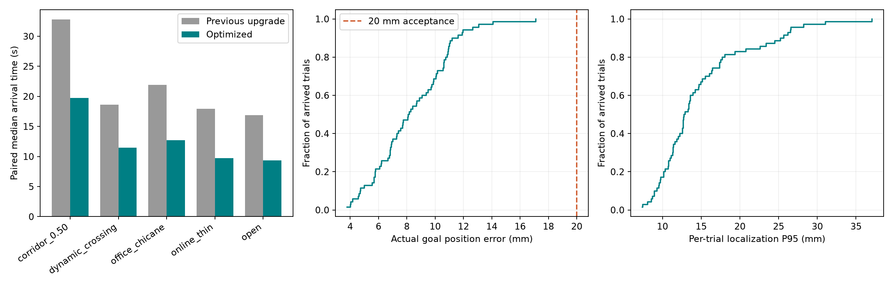
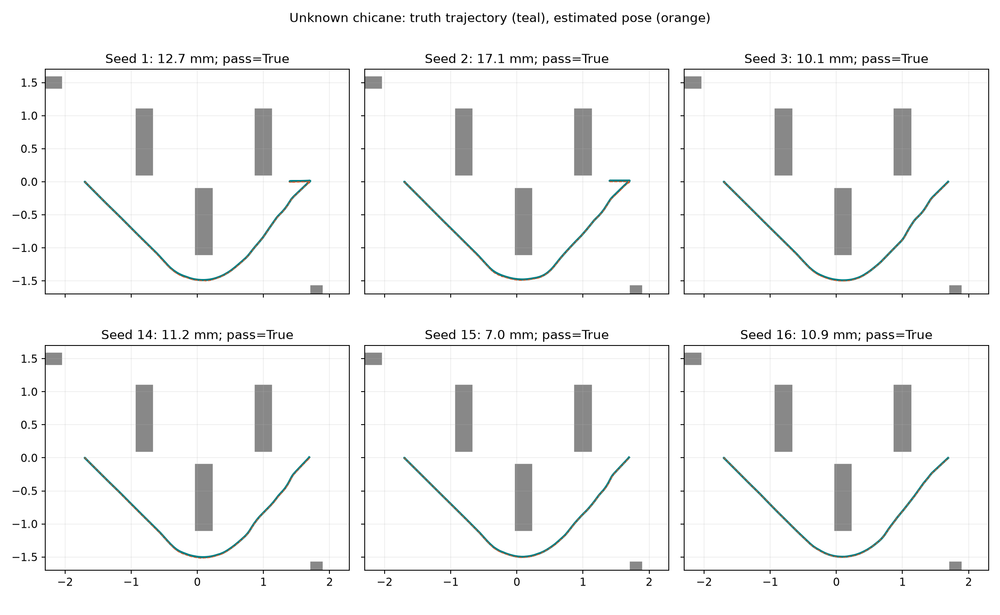

# Orin Nano 8GB 导航速度与到达精度升级

设备约束：JetPack 6.2、N10Plus 二维雷达，无深度/双目相机；碰撞范围继续采用底盘及四轮投影，长约 427 mm、宽约 406 mm。此次按用户要求先完成本机仿真；Orin 暂不可访问，原生运行时与制动距离尚未实测。

算法已在 **main 7bc9e10** 提交并逐文件同步到 sim；本机冻结 v4 矩阵 **70/72 严格到达（97.2%）、0 次碰撞、0 次启动失败**。除 50 cm 窄门外，其余 11 场景合计 **66/66**，包括在线无先验导航 **18/18**；50 cm 窄门 **4/6**，仍有停滞问题。开阔段实际速度约 **0.50 m/s**，成功到达最大真实位置误差 **17.1 mm**。这是有限仿真中的结果，不能承诺真实环境绝对 100%。

## 当前算法与此次修改

导航仍以 ROS 2 Humble / Nav2 为框架。固定地图使用 AMCL；未知地图使用 SLAM Toolbox 在线建图与定位，不启动 AMCL 或 map server。选择保留这条成熟的二维雷达路线，相关传感器适配和第一次升级调研见[前次报告](navigation-upgrade-review.md)。[SLAM Toolbox 官方说明](https://github.com/SteveMacenski/slam_toolbox/blob/ros2/README.md)

| 组件 | 本次实现及目的 |
| --- | --- |
| 全局规划 | 延续完整 Omni Smac State Lattice 原语及填充多边形验证；软代价 cost_penalty 从 2 调至 3 |
| 局部控制 | PreciseMPPI 中增加常规路径短段的确定性 Omni 跟踪；短段必须通过填充 footprint 扫掠验证，阻塞时交给原生 MPPI。常规平移保持朝向，进入窄区前按路径朝向对齐并提前降速，避免斜入消耗边界余量 |
| 速度 | 常规前进上限 0.50 m/s、横移 0.30 m/s、后退 0.20 m/s；近障跟踪最多 0.10 m/s，终点按剩余距离减速 |
| 精确到达 | 无位置记忆的 StableStoppedGoalChecker：XY 10 mm、yaw 0.020 rad，要求实际反馈速度足够低并持续满足 0.25 s，间断检查会重置等待；仿真验收另以真值位置/朝向/速度判断 |
| 平滑器 | 保持 20 Hz 和原加减速限制，改为 OPEN_LOOP 指令递推；后级制动保护继续使用测得的真实运动速度 |
| 安全保护 | 现有扫掠、盲区障碍记忆、测距误差、反应时间和失联停车条件保留；地图先验改为固定地图坐标中的 0.5 m 空间索引，避免每次控制遍历整张地图 |
| SLAM 前端 | 5 mm 相关匹配网格，细化角搜索；最小处理位移 0.15 m、转角 0.04 rad；邻域参考采用扫描位姿，Ceres 保持 2 线程 |
| 未知空间 | 仅在线导航的全局搜索采用乐观未知空间假设；SLAM 地图仍保留 unknown，执行阶段由局部地图和实时雷达制动保护约束 |
| 启动 | 先启动定位，等新鲜 scan、精确时间 odom TF 和 map TF 就绪后启动导航。客户端还须确认导航生命周期 ACTIVE，才能发送 Action 目标 |
| 通信 | 默认 Cyclone DDS，保留显式 RMW_IMPLEMENTATION 选择；native source.sh、硬件镜像和仿真镜像均设置相同默认，依赖写入 package.xml |

这一版常规运动主要由碰撞检查后的直接跟踪完成，不能将性能变化简单归为“MPPI 参数调优”。MPPI 继续承担短段受阻后的局部采样控制，所有输出统一经过 velocity_guard → Collision Monitor → 底盘。

## 为什么原来提速后会过冲和停滞

在注入 +3% 编码器尺度误差的仿真中，CLOSED_LOOP 平滑器不断从偏高的里程计速度重新开始减速。0.50 m/s 时，尺度偏差约 0.015 m/s，而 0.4 m/s²、20 Hz 的单周期减速量只有 0.020 m/s，偏差会抵消大量预期减速。原型出现绕行过长和终点过冲；切换 OPEN_LOOP 后，再由使用实际速度的独立保护层约束制动。这个修正不替代真机轮速标定。[Nav2 平滑器配置](https://docs.nav2.org/rolling/configuration_and_development/configuration_guide/core_servers/configuring_velocity_smoother/)、[Humble 平滑器源码](https://github.com/ros-navigation/navigation2/blob/humble/nav2_velocity_smoother/src/velocity_smoother.cpp)

未知折返场景还出现全局搜索耗尽。Humble Lattice 的 unknown 单元会参与较高的遍历代价计算；仅启用 allow_unknown 并不等于其搜索代价与自由空间相同。因此在线模式单独采用乐观全局地图，真实运动仍接受局部验证；这种设定能向未知目标尝试规划，也可能在发现封闭区域后停车或重规划，不能推断所有未知目标都可达。[Humble NodeLattice 源码](https://github.com/ros-navigation/navigation2/blob/humble/nav2_smac_planner/src/node_lattice.cpp)

小位移处理候选中，未知折返场景的实际落点误差为约 24–37 mm。0.05 m 的运动在 3% 尺度误差下只有约 1.5 mm 偏差，小于 5 mm 匹配网格的步长；据此调整处理间隔并改变邻域参考，探索种子 4/5/6 的落点改进到约 7–14 mm。两项设置同时改变，这只是与匹配量化有关的解释，尚不能认定任一参数是唯一原因；最终应以冻结的其它种子衡量。[固定版本 Karto 匹配源码](https://github.com/SteveMacenski/slam_toolbox/blob/8293d21fe5c816d0405e0cc1f3eb46c70659c267/lib/karto_sdk/src/Mapper.cpp)

启动可靠性独立于路径控制。首先解决了“AMCL 未生成 map TF、控制器配置等待 TF”的启动顺序问题；随后保留了 Action 接口已发现但 BT 仍 INACTIVE 的目标拒绝记录，并加入生命周期状态检查。再一次完整回归出现 Fast DDS 生命周期响应丢失，日志与上游已报告的服务发现竞态相符，因此替换默认 DDS。替换后的 6 次启动复测全部通过，旧批次和没有启动成功的安装前调用都保留在实验记录中。[Fast DDS 上游问题 #842](https://github.com/ros2/rmw_fastrtps/issues/842)

冻结候选 v3 暴露两项问题：50 cm 门种子 2 斜入后发生安全停滞；未知折返种子 11 的位置误差约 13.5 mm，但成功返回时真值速度仍为 0.0217 m/s。因此 v4 增加前方窄区的朝向对齐与减速，并新增持续停稳的到达插件；保留原 v3 失败记录，保持原安全 margin 和制动约束。

## 验收定义与结果

严格到达必须同时满足：Nav2 成功返回、独立真值评估无碰撞、终点位置误差 ≤20 mm、角度误差 ≤0.035 rad（约 2°）、末端真实速度 ≤0.020 m/s。位置误差和定位误差是连续量，不称为“定位准确率 100%”。

dynamic_crossing 通过服务将 22 cm 障碍放到运动前方后保持固定，衡量突然出现后的制动与绕行，不代表持续移动物体的横穿预测。

本次同种子配对比较的旧版采用 main 99b1066 的导航 C++ 和导航/SLAM 参数，仅补充两个启动兼容入口，以便两组使用同一仿真启动流程、Cyclone DDS 和 ACTIVE 状态检查；原 Fast DDS 对照另存，不混入正式速度比较。

最终冻结矩阵为 12 场景 × 6 种子（1/2/3 回归，14/15/16 验证），共 72 次；固定地图 54 次，在线无先验 18 次。探索与故障排查种子 4–13 单列。安全强制指令、不可通过的窄门与 CPU 限额测试不混入正常导航到达率。

| 场景 | 严格到达 | 成功最大终点误差 mm | 成功最大角度误差 ° | 成功耗时中位数 s | 最大定位 P95 mm | 最小真值净距 mm | 最低 TF 配对覆盖率 |
| --- | --- | --- | --- | --- | --- | --- | --- |
| corridor_0.50 | 4/6 | 10.2 | 0.07 | 20.2 | 31.0 | 36.2 | 100.0% |
| dynamic_crossing | 6/6 | 12.0 | 0.07 | 10.9 | 22.6 | 67.6 | 100.0% |
| initial_pose_error | 6/6 | 8.7 | 0.14 | 16.8 | 37.1 | 1007.9 | 100.0% |
| office_chicane | 6/6 | 5.8 | 0.14 | 12.8 | 13.4 | 76.3 | 100.0% |
| online_chicane | 6/6 | 17.1 | 0.31 | 12.9 | 18.1 | 53.3 | 100.0% |
| online_open | 6/6 | 9.4 | 0.29 | 9.4 | 13.6 | 1038.9 | 100.0% |
| online_thin | 6/6 | 14.1 | 0.13 | 9.7 | 16.4 | 107.7 | 100.0% |
| open | 6/6 | 8.4 | 0.25 | 9.4 | 26.2 | 1038.0 | 100.0% |
| reverse_goal | 6/6 | 10.6 | 0.04 | 21.9 | 23.4 | 724.5 | 100.0% |
| s_bend | 6/6 | 11.1 | 0.12 | 10.1 | 25.7 | 74.7 | 100.0% |
| sensor_dropout | 6/6 | 11.9 | 0.21 | 18.9 | 26.6 | 1084.5 | 84.0% |
| thin_obstacles | 6/6 | 7.6 | 0.07 | 9.1 | 24.5 | 96.3 | 100.0% |

终点两列只统计严格成功到达；定位 P95、净距和覆盖率统计该行全部试验。成功到达最大朝向误差 0.31°，最大末端真值速度 0.0076 m/s。sensor_dropout 的精确时间 TF 配对覆盖率为 84.0–90.8%，中断时出现 ExtrapolationException；其它试验均为 100%，缺失样本未补零。

50 cm 原始失败保留：种子 3 在门前局部优化失败、恢复后触发制动/扫掠保护，55 s 墙钟预算内未完成；种子 16 规划产生路径但底盘几乎未运动，保护大部分为 clear，具体起始控制原因仍未确定。后续单独重跑种子 16 于 19.0 s 到达，种子 3 于 43.5 s 恢复到达，新种子 17 再次超时；这些诊断不替换原始矩阵。无旋转恢复候选在 3/16/17 三次到达，但日志中未发生该恢复动作，不能把通过归因于它，因此未纳入默认版本。

两组均 **10/10 严格到达、无碰撞**；同种子比较的到达耗时降低 **38.3–45.7%**。耗时为仿真时间，包含降速和精确停稳，不能将设定上限误当全程平均速度。

| 场景（种子 4/5） | 前次升级耗时中位数 s | 本次 s | 耗时减少 |
| --- | --- | --- | --- |
| corridor_0.50 | 32.81 | 19.77 | 39.7% |
| dynamic_crossing | 18.61 | 11.48 | 38.3% |
| office_chicane | 21.95 | 12.72 | 42.1% |
| online_thin | 17.92 | 9.73 | 45.7% |
| open | 16.87 | 9.34 | 44.6% |





72 次中，保护计算耗时的最坏单次 P95 为 **5.80 ms**、全部样本最大 **12.43 ms**；控制指令周期的最坏单次 P95 为 **59.0 ms**，20 Hz 控制仍有 **9 条 deadline 警告**。雷达中断到真值速度低于 0.005 m/s 的延迟为 **0.255–0.367 s**，这些是运动学模拟量。

仅统计定位、controller、planner、guard、Collision Monitor 五个进程：固定图的各进程峰值 RSS 之和最高 **221.2 MiB**、平均 CPU 之和的跨试验中位数为一个 x86 核的 **44.9%**；在线分别为 **199.4 MiB / 46.5%**。这不是整机或完整 ROS 图资源（未含 EKF、BT、平滑器、Gazebo），也不是同一时刻的峰值。

另以整个 Gazebo+ROS+评估器容器 **2 CPU / 4 GiB** 限额运行 5 次，**4/5** 严格到达，无碰撞；50 cm 门墙钟超时，55 s 只推进约 30.3 s 仿真时间。四个非窄门场景正常，但低配压力试验仍暴露窄门失败；不能称为 Orin 通过。

| 补充场景（种子 1） | 结果 | 最小真值净距 mm |
| --- | --- | --- |
| corridor_0.40 | 未通过，安全拒绝/恢复后中止 | 1010.6 |
| corridor_0.44 | 未通过，安全拒绝/恢复后中止 | 1010.6 |
| corridor_0.46 | 未通过，安全拒绝/恢复后中止 | 107.4 |
| corridor_0.48 | 未通过，安全拒绝/恢复后中止 | 32.4 |
| corridor_0.56 | 严格到达 | 75.8 |
| late_initial_pose | 严格到达 | 1084.5 |
| legacy_map_3cm | 严格到达 | 1031.8 |
| unsafe_fast_command | 强制 0.50 m/s 危险指令被保护停车 | 35.4 |

8 次补充试验均无碰撞。48/46/44 cm 在底盘裸几何上仍可能有通路，但在本配置、扰动和姿态下未通过；40 cm 小于约 40.6 cm 车宽，本就不可直行通过。不能通过继续减小膨胀或放松制动来宣称极限通行已解决。56 cm 只做了这次补充种子验证，不能外推其可靠性为 100%。

## 证据和复现边界

真值评估独立于导航：以底盘含四轮的填充多边形及步长 4 mm 的扫掠检查碰撞和净距；TF 延迟样本进入队列，再按原真值时间戳查找估计位姿。在线 SLAM 只补偿已声明的任意地图平移原点，不做真值轨迹对齐，也不使用真值修正导航。每次启动独立进程图、ROS domain 与 Gazebo partition。

速度测量有 1.03 尺度误差、0.003 m/s 噪声和 0.001 rad/s 陀螺偏置，雷达为 540 束 / 10 Hz，测距噪声设为 5 mm。仿真真值用于设备适配器合成带误差的速度输入；EKF 掩码排除真值位置，Nav2/保护层读取 filtered odom。固定图由已声明的场景几何生成；在线图不注入几何先验。同种子复用扰动设置，Gazebo 雷达随机流未固定，不是逐点一致的传感器重放。

这里使用 x86 桌面、RTX 5070 和运动学 Gazebo 底盘；没有模拟麦轮打滑、真实惯性制动、反光/透明障碍、雷达扫描平面之外的障碍或上部机械臂碰撞。地图约 6×5 m，CPU/RSS 结果不能外推到大仓库、长期增长的 SLAM 图或 Orin 原生时延。测试通过的有限矩阵不构成所有实际常规环境的绝对 100% 保证。

[完整结果 JSON](evidence/navigation-performance/results.json)、[逐试验 CSV](evidence/navigation-performance/results.csv)、[全部批次索引](evidence/navigation-performance/experiment-index.json)、[冻结正式试验](evidence/navigation-performance/frozen-trials.tar.gz)、[探索与失败批次](evidence/navigation-performance/exploratory-trials.tar.gz)、[源码和评估器快照](evidence/navigation-performance/source-and-harness.tar.gz)、[新版编译二进制](evidence/navigation-performance/optimized-binaries.tar.gz)、[平台与边界元数据](evidence/navigation-performance/metadata.json)。

72 次主矩阵的四个导航二进制哈希完全一致。正式试验为 72 次主矩阵 + 10 次旧版配对 + 10 次新版配对 + 8 次边界/故障 + 5 次限额压力；探索、诊断和安装/启动错误单列。早期探索原型仅部分保存完整源码，不能称其全部可重建；最终候选的源码、配置、二进制和评估器均保存。

硬件 Release **7 包构建成功**，main Python **42/42**、sim Python/场景 **51/51**、C++ 几何与连续停稳 **2/2**、保护故障/几何 **11/11**、地图索引旋转平移 **5/5**，10 个硬件 launch 入口参数检查通过。主算法、bringup 和驱动 **56 个文件** main/sim SHA 相同，仿真既有 **86 个 CAD/模型文件** 哈希保留。同步记录见 [main-sim-sync.json](evidence/navigation-performance/main-sim-sync.json)，运行中的在线仿真状态见 [gui-health.json](evidence/navigation-performance/gui-health.json)。

复现最终矩阵（在 sim checkout，硬件源码来自相邻 main checkout）：

```bash
DUOJIN_NAV_OUTPUT="$PWD/.cache/navigation-performance-reproduce" \
  simulation/navigation_performance_matrix.sh
```

脚本启动新容器、编译 Release、记录源码与二进制哈希。每次试验验证编译来源，保存原参数、SLAM 参数、完整轨迹、路径、刺激确认和启动日志。调参失败、启动失败和中断批次均留存；不覆盖此前 navigation-upgrade 的证据。

## 上板时继续做的验证

JetPack 6.2 对 Orin Nano 提供新的功耗模式，但更高模式需要相应 SUPER 刷机配置、电源和散热条件；本次不假定设备已满足，也不写入功耗配置。[NVIDIA JetPack 6.2 发布说明](https://docs.nvidia.com/jetson/jetpack/6.2/release-notes/index.html)

Orin 可访问后，以同一 main 源码原生 ARM64 Release 构建，先测雷达外参、轮速尺度、最大速度与实际制动，再复测地图。现有只读脚本会记录 CPU online、频率、功耗查询、DDS、各节点 CPU/RSS、控制间隔和保护计算耗时：

```bash
source ./source.sh
python3 scripts/profile_navigation.py --seconds 120 --output orin-navigation-profile.json
```

需在外部已启动导航运动时测量。当前的 0.50 m/s 是已验证的仿真目标配置，真机速度必须同时满足实测刹车距离、传感器延迟和控制 deadline；设备不可访问期间，这部分仍明确待测。
