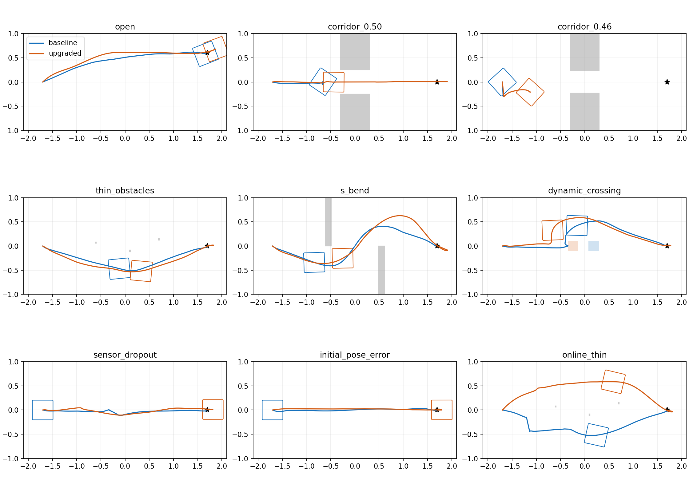
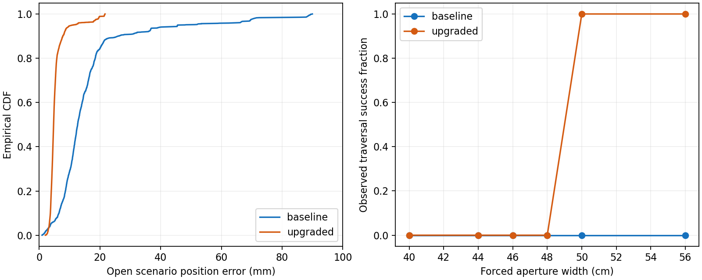
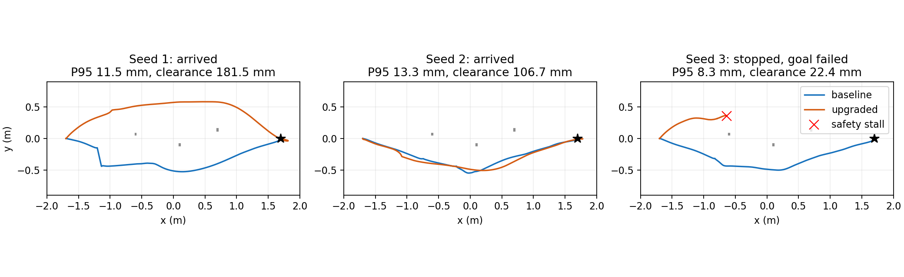

# 定位与避障升级研究及验证（2026-10-06）

冻结研究记录（2026-10-06）：下文的参数、节点、GUI 与验证结果均属于这次升级，不是当前默认配置或设备运行状态。日常入口见 [文档索引](README.md)，当前接口见 [开发接口](../README_DEVELOPMENT.md)。

本报告只使用最终配置的对照试验；调参过程和被最终到达判定修正替代的版本另行保留，不混入最终统计。

## 平台、范围与原有状态

用户确认：Jetson Orin Nano **8GB / JetPack 6.2**，仅有 N10Plus 二维雷达；碰撞范围沿用**底盘含四轮的八边形投影**，外包络约 40.6 cm × 42.7 cm。先修改 duojin02 的 main，再单向同步 duojin02-sim；不覆盖仿真已有 CAD 改动。

原来的预览容器运行在线 SLAM Toolbox 建图，未启用 Nav2 导航。仓库已有固定地图导航入口，使用 AMCL + NavFn + MPPI Omni。SLAM Toolbox 负责建图/定位，Nav2 负责规划、路径跟踪和行为；Nav2 本身不是 SLAM 算法。固定地图导航同样实时读取雷达避障，“固定地图”不等于离线运行。录包回放建图才属于离线工作流。

本次增加无先验地图的在线 SLAM + Nav2 入口，同时保留固定地图 AMCL 导航。

## 选择什么算法

| 组件 | 方案 | 选择理由 |
|---|---|---|
| 在线定位与建图 | 已修补、固定版本的 SLAM Toolbox，异步模式 | 成熟的二维雷达扫描匹配、回环与位姿图；与现有传感器/ROS 契约吻合 |
| 已有地图定位 | AMCL Omni，120 束、700–3000 粒子、sigma_hit 2.5 cm | 用实际位姿误差和重定位试验验收；不靠减小协方差伪造准确度 |
| 全局规划 | Smac State Lattice + 完整足迹验证及精确终点 | 支持麦克纳姆平移和朝向，能判断矩形底盘能否穿过窄门 |
| 局部控制 | MPPI Omni；窄处使用验证后的低速 SE2 跟踪 | MPPI 处理一般绕行，确定性短段跟踪减少狭窄可行区域内随机采样失败 |
| 最终速度保护 | 独立 C++ 制动扫掠 + Collision Monitor | 验证实际/请求速度、延迟、制动与旋转角部；所有速度来源均经过保护 |
| 时钟与坐标 | 真机系统时钟；sim 独立覆盖仿真时钟 | 保持驱动与真实部署一致，避免拿仿真真值充当定位 |

JetPack 6.2 属于 Ubuntu 22.04 平台，本次保留 ROS 2 Humble 的部署基础。NVIDIA 官方已有 JetPack 6.2.2 维护版本，可单独升级 BSP；这不等于二维雷达导航会因 CUDA 升级自动变好。[JetPack 6.2.2 官方说明](https://developer.nvidia.com/embedded/jetpack-sdk-622)

SLAM Toolbox 是适合这组传感器的成熟现成方案。Isaac ROS Visual SLAM / nvblox、ORB-SLAM、RTAB-Map 的视觉路线需要相机输入；FAST-LIO 等三维雷达路线也不适合当前单平面扫描仪。本次没有为了“更新”而引入没有输入数据的组件。[SLAM Toolbox 官方项目](https://github.com/SteveMacenski/slam_toolbox)、[Isaac ROS Visual SLAM 相机要求](https://nvidia-isaac-ros.github.io/v/release-4.6/repositories_and_packages/isaac_ros_visual_slam/index.html)

较新 Nav2 有 MPPI 最优轨迹验证器；本机 Humble 1.1.20 的接口没有该能力，也不支持新版 ax/ay/az 加速度参数。因此在兼容平台实现独立的最终速度验证，未将不生效的 Rolling 参数写入配置。[新版本 MPPI 配置](https://docs.nav2.org/rolling/configuration_and_development/configuration_guide/controller_plugins/mppi_controller/configuring_mppic/)

## 为什么膨胀了仍可能碰撞

膨胀提供软代价，无法单独保证最终控制不碰撞。中心点/圆形规划不能准确处理矩形角部；只检查足迹边缘会漏掉内部细杆；离散轨迹点可能越过薄障碍；MPPI 的加权控制还需要最终验证。扫描盲区、坐标外参、反馈延迟和真实停车距离也不会随膨胀增大而消失。

此次处理了这些具体环节：

1. 填充八边形检测，包含完全落在足迹内部的薄障碍；障碍栅格按完整尺寸计算，平移/旋转以最多 4 mm 角部行程采样，并计入采样余量。
2. 验证当前反馈速度及请求速度的反应延迟和制动过程；实际制动轨迹危险时直接停车。核心余量 8 mm，雷达测距误差预算 15 mm，反应时间 0.20 s，平移/角向制动参数 0.4 m/s² / 0.8 rad/s²。额外 5 mm 余量不足时只允许通过完整核心验证的低速爬行，避免安全的横移脱离也被初始余量拒绝。全局/局部几何足迹 padding 均为 8 mm；最终速度保护额外考虑雷达、栅格和制动误差。增大 padding 的探索试验会损失窄门可行路径，因此保留 MPPI CostCritic 权重 2，并由独立硬保护决定最终速度；扩大软代价的完整回归没有提高未知环境到达率。
3. 已观测障碍进入 30 cm 雷达盲区后继续保留；新的有效回波可以更新同一表面，明确的远处回波才清除旧障碍。定位修正用于补偿障碍记忆的里程计漂移；固定地图坐标的 5 mm 分桶避免反复变换造成误差半径累加。
4. 保留的障碍点云同时进入全局/局部代价地图，使规划器也看到保护层正在阻止的障碍，避免规划向前而保护层持续停车。
5. AMCL 的二维最大协方差特征值和角度协方差用于未重新观测的地图先验。雷达直接观测按自身测量误差检查，避免把全局定位误差重复加到局部观测上。协方差余量是模型假设，不是确定性的安全证明。
6. 指令、雷达、TF、里程计或已接入的局部代价地图过期时停车；底盘驱动独立在 0.25 s 未收到命令后发送串口零速帧。

速度链为：输入 → twist_mux → velocity_guard → Collision Monitor → 底盘。真机上的下位机通信超时仍须独立存在，以覆盖主机断电/进程全部死亡。

## 精度、窄通道与计算量

新地图与在线 SLAM 输出采用 1 cm；局部代价地图也是 1 cm。全局规划遵循已保存地图的实际分辨率，自动生成相应 Omni 原语；原有 2/3 cm 地图不会被改写，也不能因插值自动获得真实新精度。新地图细化会增加全局规划 CPU/内存，不能据此推断大仓库也能保持相同实时性。

MPPI 控制 20 Hz、model_dt 50 ms、1600 条候选、2.8 s 预测；速度上限 0.35 m/s、横移 0.20 m/s、转速 0.65 rad/s。窄处验证后的短段跟踪与末端收敛以最高 0.08 m/s 工作；目标容差为 1.5 cm / 0.025 rad。使用无位置记忆的 StoppedGoalChecker，同时检查当前位置、朝向、平移速度 ≤ 0.01 m/s 和转速 ≤ 0.02 rad/s。实际真值误差另行统计，目标容差不等于定位精度。

## 实测方法与证据

旧配置和提交 fd3c05a 已保存。两组均使用相同几何场景、固定地图或无先验在线 SLAM 条件、同一组扰动种子。固定地图试验的先验图由几何生成；在线试验不启动 map server / AMCL、不将先验图送入 SLAM。仿真真值还用于设备适配器合成带尺度误差和噪声的速度测量；EKF 仅融合速度/IMU，原始 `/odom` 中的真值位置被配置掩码排除。Nav2 和保护层使用 `/odometry/filtered`，不使用真值位姿；完整真值只作为独立评估的位姿依据。

baseline 指旧 Nav2 参数、原生 NavFn/MPPI、关闭新增速度保护；upgraded 指新 Nav2 参数及插件和速度保护。两组使用同一仿真传感器、SLAM 后端及地图分辨率（常规 1 cm、兼容场景 3 cm），便于比较导航算法。这不是原有 3 cm 建图全栈与新全栈的端到端对照，不能把所有差异归因于 SLAM 升级。

配置扰动：5 mm 雷达距离噪声、里程计速度尺度 1.03、速度噪声 3 mm/s、gyro bias 0.001 rad/s，以及初始位置/航向扰动。里程计与初值随机种子固定；Gazebo 雷达噪声随机流未固定。定位 TF 与真值使用同一时间戳，等待发布延迟后查询，并报告匹配覆盖率。参数在这些挑战场景中调试后冻结复测；这是工程回归矩阵，不是独立留出评测集，也不是所有未知环境的可靠性保证。

碰撞评估用真实底盘填充多边形对实际场景几何求交；相邻真值采样间再按不超过 4 mm 角部行程插值。统计最小实际间距、接触/碰撞事件、标准 Nav2 Action 到达结果和是否穿过指定孔口。窄门横跨整个房间，无法绕过去冒充通过。强制危险速度命令属于独立的“应停车”试验，不能计作导航到达失败。

挑战场景涵盖 56/50/48/46/44/40 cm 强制窄门、15–20 mm 薄障碍、S 弯、突然移入的障碍、扫描掉线、20 cm 初值误差、无先验在线导航、危险命令和旧 3 cm 地图兼容性。40 cm 小于车宽，正确行为是拒绝；其他通道也必须保留传感器、几何和定位误差余量。

最终结果、完整轨迹、原始 JSON/CSV、编译二进制/源码哈希和复现脚本在本报告末尾引用。调参失败包括高束数 beam skipping 版本在动态遮挡下发生大幅定位跳变，以及盲区记忆与规划未贯通时的安全停滞。最终收尾发现 stateful 的到达检查会记住已进入的位置容差，随后只检查朝向；在线场景在闭环减速期间出现最高 69 mm 落点误差。因此改为无位置记忆且要求停稳的检查，并重测全部新版场景。旧的 26 组新版轨迹保留为 superseded_config；修正到达判定后的独立回归又暴露一次在线薄障碍安全停滞，日志显示保护包络与规划代价存在近障停滞风险。23/30 mm 全局 padding、仅局部 23 mm 的探索版本均未通过 50 cm 窄门，因此不采用。CostCritic 权重 4 的完整回归仍为 19/20，且一次在线 SLAM 定位 P95 达 0.645 m，故不采用。这个结果不能证明软代价是定位跳变的唯一原因，但说明该候选没有通过综合验收。最终选择权重 2、8 mm 几何 padding 和新停稳判定的冻结矩阵，**保留其在线薄障碍失败**，到达率为 19/20；被舍弃的候选不混入正式统计。[Humble SimpleGoalChecker 源码](https://github.com/ros-navigation/navigation2/blob/humble/nav2_controller/plugins/simple_goal_checker.cpp)、[StoppedGoalChecker 源码](https://github.com/ros-navigation/navigation2/blob/humble/nav2_controller/plugins/stopped_goal_checker.cpp)

## 已验证的代码检查

硬件七包 Release 构建；48 项 Python 检查；独立几何 CTest；伪串口反馈/标定/编码/重连与实际零速帧检查；保护节点的传感器故障、内部细杆、协方差来源区分、盲区记忆和明确空闲射线清除检查。仿真场景生成与旧地图原语缩放另有检查。

## 物理边界和上板验收

本机为 x86_64 + RTX 5070；Gazebo 底盘采用 kinematic 速度伺服，不包含真实滚子接触、打滑和停车动力学。这里的 CPU/RSS、间距和停车时间不能冒充 Orin 原生性能或真机保证。

仅有二维雷达时，扫描平面之外的矮障碍、悬空物体、未曾观测的近距盲区障碍、落在远距离扫描射线之间的细杆、玻璃/黑色物体漏检不能由导航算法保证检出。障碍记忆解决“看见后靠近进入盲区”，不能创造从未见过的障碍。机械臂不在此次碰撞范围内。

上板运行同一 main 源码的 ARM64 构建，先低速标定雷达外参、里程计尺度/IMU 偏置和实际制动参数，再运行脚本测原生 20 Hz 指令间隔、最坏验证耗时和 RSS。以 CPU deadline 和真实制动测试验收，而非按桌面 CPU 倍率估计：

```bash
source source.sh
ros2 launch duojin01_bringup online_navigation.launch.py
# 在另外终端，已有导航目标运行期间读取，不发送运动命令
python3 scripts/profile_navigation.py --seconds 60 --output orin-navigation-profile.json
```

固定地图使用 `ros2 launch duojin01_bringup navigation.launch.py map:=...`。

## 核心技术来源

- [Smac Lattice / SE2 足迹](https://github.com/ros-navigation/navigation2/blob/humble/nav2_smac_planner/README.md)
- [Humble MPPI 机制与调参](https://github.com/ros-navigation/navigation2/blob/humble/nav2_mppi_controller/README.md)
- [Humble CostCritic](https://github.com/ros-navigation/navigation2/blob/humble/nav2_mppi_controller/src/critics/cost_critic.cpp)
- [Collision Monitor](https://github.com/ros-navigation/navigation2/blob/humble/nav2_collision_monitor/README.md)
- [Nav2 调参指南](https://docs.nav2.org/jazzy/configuration_and_development/tuning_guide/)


## 最终选择与实测结果

交付 Nav2 配置 SHA256：`45f5ac618fe4291a65933e2dd41edde3bcc4d2123911bcbf692b50cafcfbb3ad`。52 组正式对照均记录编译来源和二进制哈希；26 组 baseline、26 组 upgraded。20 组常规可行场景、5 组更窄/不可行挑战和 1 组强制危险命令分别统计，不把安全停车冒充导航到达。

| 指标 | 旧 Nav2 配置 | 交付配置 |
|---|---:|---:|
| 常规场景到达 | 16/20 | **19/20** |
| 其中固定地图到达 | 13/17 | **17/17** |
| 无先验在线薄障碍到达 | 3/3 | **2/3；一次保护性停滞** |
| 50 cm 强制窄门 | 0/3 | **3/3，最小真实间距 38.1 mm** |
| 56 cm 强制窄门 | 0/1 | 1/1，最小间距 70.1 mm |
| 开阔场景定位 P95（三次中位数） | 54.7 mm | **10.6 mm** |
| 开阔场景最终真实目标误差 | 28.8–41.2 mm | **11.0–12.2 mm** |
| 突然出现障碍 | 3/3 到达 | 3/3，到达最小间距 59.0 mm |
| 扫描掉线至速度低于 5 mm/s | 1.164 s | **0.370 s** |
| 强制危险前进命令 | 逼近至 0.85 mm，最终仍约 75 mm/s | **32.5 mm 间距停稳** |
| 几何碰撞/相交事件 | 0/26 | **0/26** |
| ≤ 2 mm 近接触事件（事后统一阈值） | 1 | 0 |

48 cm、46 cm、44 cm、40 cm 与额外 46 cm 精细栅格门均未通过，最终未碰撞。48 cm 最近实际间距约 36 mm；这说明**当前已验证的通过边界是 50 cm，不能宣称 48 cm 物理上不可能通过**，也不能承诺比它更窄的实机间距。

17 组固定地图常规试验全部到达。1 cm 地图的成功试验最终真实位置误差最大 13.4 mm；旧 3 cm 图兼容试验为 18.8 mm。成功到达时真实速度最大约 11.6 mm/s，反馈噪声使它略高于配置的 10 mm/s 停稳阈值；不能把配置阈值当作实际严格上界。精确终点与窄门采用低速收敛；开阔场景耗时中位数从 10.7 s 增至 17.3 s，精度提高有时间开销。各场景耗时见完整逐场景表。

**未知环境仍有明确短板。** 在线薄障碍种子 3 在约 22.4 mm 真实间距处触发硬保护，此后全局路径验证/恢复行为未能找到可执行脱困路径，Nav2 返回失败，未发生碰撞。该次定位 P95 为 8.3 mm，因此这次失败主要表现为导航与安全包络之间的停滞，而不是“定位很准就一定能完成”。另外两个在线试验最终落点为 6.6 / 9.6 mm。仅凭这三次试验，当前方案不能称为所有未知环境下都具备很高自动完成率；后续重点是安全包络约束下的脱困规划，以及稀疏/遮挡环境的 SLAM 稳定性。

原先 stateful 到达检查导致的最高 69 mm 在线落点误差已经通过每次重查位置、朝向、反馈速度的方式修正。扩大 padding 会让 50 cm 通道失去有效路径；将 CostCritic 权重改为 4 的候选仍只有 19/20，且一次在线定位 P95 达 0.645 m。因此选择较均衡的权重 2 配置，保留失败数据和限制，**没有削弱硬碰撞验证来换取成功率**。

匹配定位 TF 的覆盖率：除掉线场景外为 100%；掉线场景旧版 88.45%、新版 92.08%。未匹配样本不参与 RMSE/P95，也不填零。图中的九个轨迹面板是种子 1，全部种子的轨迹见原始档案。

桌面测试中，各新版试验保护计算 P95 的最大值为 2.834 ms；指令间隔 P95 最大 52.2 ms，控制器 deadline 警告 1 次（旧版 8 次，原控制频率也不同，不能直接解释成等比例实时性提升）。规划节点峰值 RSS 123.3 MiB、MPPI 63.4 MiB、保护层 34.3 MiB；各试验平均 CPU 的最大值约为单核的 69.4% / 24.0% / 12.5%。这些是在小地图、桌面 CPU 和多仿真实例下的实测，**不构成 Orin 板端性能验收**。

硬件七包 Release 构建、48 项 Python 检查、11 项保护故障/盲区检查、几何 CTest、伪串口实际停车帧、10 个 bringup 启动入口均通过；仿真场景与原语另有 13 项检查通过。完整传感器/运动/近距过滤验收通过，GPU 日志确认 NVIDIA RTX 5070 渲染。最终 GUI 运行在线 SLAM + Nav2，导航与保护生命周期节点 active，1 cm 地图和实时雷达正常，无 map server / AMCL。

## 数据、轨迹与复现

- [逐场景结果表](evidence/navigation-upgrade/results-table.md)
- [JSON 原始统计](evidence/navigation-upgrade/results.json) / [CSV](evidence/navigation-upgrade/results.csv)
- [完整试验与编译来源档案](evidence/navigation-upgrade/final-trials.tar.gz)
- [证据目录、探索失败与复现命令](evidence/navigation-upgrade/README.md)
- [源码/数据文件哈希](evidence/navigation-upgrade/artifact-sha256.json)






