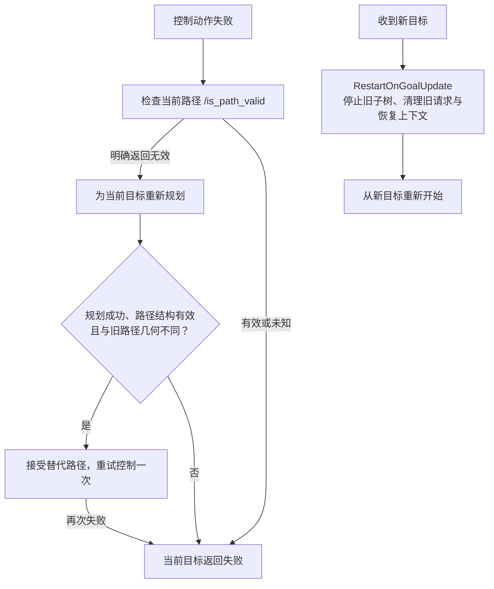

# 当前运行机制与精简边界

本页描述当前源码的速度仲裁、导航恢复、启动就绪和数据保存契约。规划、控制、碰撞与制动的原有数学保持不变；冻结实验仍按原版本解释。它不证明真机已部署或已完成物理制动标定。

## 按住遥控接管，结束交回导航

导航、键盘和手柄都经 `twist_mux → VelocityGuard → 串口底盘驱动`。导航独占平滑器输出 `/cmd_vel`，键盘使用 `/cmd_vel_keyboard`，手柄正常 / 慢速档使用 `/cmd_vel_normal`、`/cmd_vel_slow`。优先级依次是键盘、手柄正常档、手柄慢速档、导航。

手柄按住使能键接管，键盘依靠每个运动键的重复时间判断是否仍在输入。相反方向键同时按住时，键盘持续输出零速度并保留接管。输入结束经过原有减速后只发一次零速度，随后停止发布；键盘闲置及普通闲置退出不发零速度心跳。`X` 只归零本键盘来源，立即退出也会保留这次明确的零速度请求，不能锁存所有来源。

所有 mux 来源租期、Guard 的命令有效期及底盘输出看门狗统一来自 [safety.yaml](../src/duojin02_bringup/config/safety.yaml) 的 `command_timeout_s`。话题与优先级维护在 [twist_mux.yaml](../src/duojin02_bringup/config/twist_mux.yaml)，实际租期由项目启动层派生。沿用底盘 launch，不能把只含话题与优先级的 YAML 当作完整仲裁参数。

遥控租期结束后接受新的导航速度，只有仍在运行的导航目标能继续。仲裁不暂停 Nav2 的进度检查、不缓存 Action，也不重放失败、取消或完成的目标；介入期间目标失败时，需要重新发送目标。

键盘的重复超时、发布频率及轮询时间必须为正有限值，速度、步长和上限必须有限且非负。非法配置在创建速度发布器之前失败；运行时非法过期时间不能让旧非零按键无限续期。默认值只在 [keyboard_teleop_defaults.py](../src/duojin02_teleop/duojin02_teleop/keyboard_teleop_defaults.py) 维护。

## 有路径失效证据才恢复一次

Nav2 服务节点为 `planner_server`、`controller_server`、`bt_navigator`、`velocity_smoother`；生命周期管理器、定位与硬件节点另计。当前不启动 `behavior_server`，不自动后退、Wait 或无条件清空 costmap。周期规划与原控制算法继续使用。

`PathNeedsReplan` 只接受路径检查服务对当前仍在使用的路径返回的明确 `is_valid=false`。服务不可用、超时、异常、路径已改变或响应有效均不能视为障碍证据。随后只有规划成功、替代路径结构有效且几何不同，`AcceptChangedPath` 才接受替换；只改时间戳或四元数符号不算新路径。未知结果、原样路径或重试失败会使本次恢复返回失败，当前目标不能靠重复旧请求继续；后续新目标单独处理，不另设等待状态。

`RestartOnGoalUpdate` 在外部目标更新时停止旧执行子树，移除未完成的路径验证请求并重置恢复上下文。旧响应不能为新目标继续触发恢复。行为树入口见 [navigate_to_pose.xml](../src/duojin02_bringup/behavior_trees/navigate_to_pose.xml) 与 [navigate_through_poses.xml](../src/duojin02_bringup/behavior_trees/navigate_through_poses.xml)。路径结构有效与规划成功不保证未来障碍不会变化，运行时碰撞和制动保护继续负责当前数据。

## 就绪只等待必要的新鲜数据

固定图需人工提供真实初值。就绪节点保留一个有效的新鲜扫描候选，等待其时间戳对应的 scan → odom TF，并检查新鲜 map → base_footprint TF。候选仍有效时不被后续扫描不断替换；候选过期或出现无效输入时清除，重复时间戳不会延长有效期。

该等待用于启动导航，不是持续的质量许可状态机。扫描 / 地图一致性与协方差等质量指标只报警，不直接停车；运行时无效几何、传感器断流和碰撞仍由保护链处理。相关期限从同一 [safety.yaml](../src/duojin02_bringup/config/safety.yaml) 读取，操作见 [定位质量](localization-health.md) 与 [停车保护](safety.md)。

## 一份保存预算，元信息缺失只报警

在线 `save_timeout` 与离线 `--save-timeout` 共用保存工具的默认值。从导出开始，快照锁等待、地图刷新 / 保存、位姿图序列化及运行时 SLAM 参数查询使用一个单调时钟等待预算。后端保存回调不再固定等待一秒。

栅格像素、阈值和必需文件必须有效、完整，且 YAML 最后发布。参数元信息取不到时记录警告并保留有效完整的地图与位姿图；文件缺失、无效地图和保存服务失败仍是导出失败。手柄重复保存不会重启正在运行的保存进程。预算限制客户端等待，不能抢占后端处理或文件写入；在线各次服务调用也不保证严格同一时刻的快照。

录包先启动传感器记录，再并行采集各节点参数；参数查询缺失不会推迟记录或迫使有效录包停止。正常结束仍等待 rosbag2 完成数据库与 `metadata.yaml` 写入，不能用强制杀进程替代收尾。具体路径、离线排空与续建要求见 [SLAM 工作流](slam-workflow.md)。

软件零速度与串口完整写入均不等于物理停稳。主机或串口整体失效仍需要下位机独立看门狗或硬件停机覆盖；冻结桌面、PTY、CUDA 与回放证据不能替代实物验收。

## 本轮验证

2026-10-14 当前源码通过 217 项 Python 检查、12 个 launch 入口解析、62 项实际速度链检查及 19 个真实 Nav2 恢复场景。CPU 的 19 项 CTest 中 18 项通过、1 项 GPU 专项预期跳过；真实 GPU 的 21 项全部通过。新构建的两种运行镜像各完成 14,472 次安装版几何对照，49 份安装文件与源码一致；录包、两种离线回放、保存和续建验证通过。

完整计数、版本、哈希与适用边界见 [验证记录](evidence/runtime-cleanup/validation.json)，数学与参数保留范围见 [算法保留证明](evidence/runtime-cleanup/algorithm-preservation.json)。
