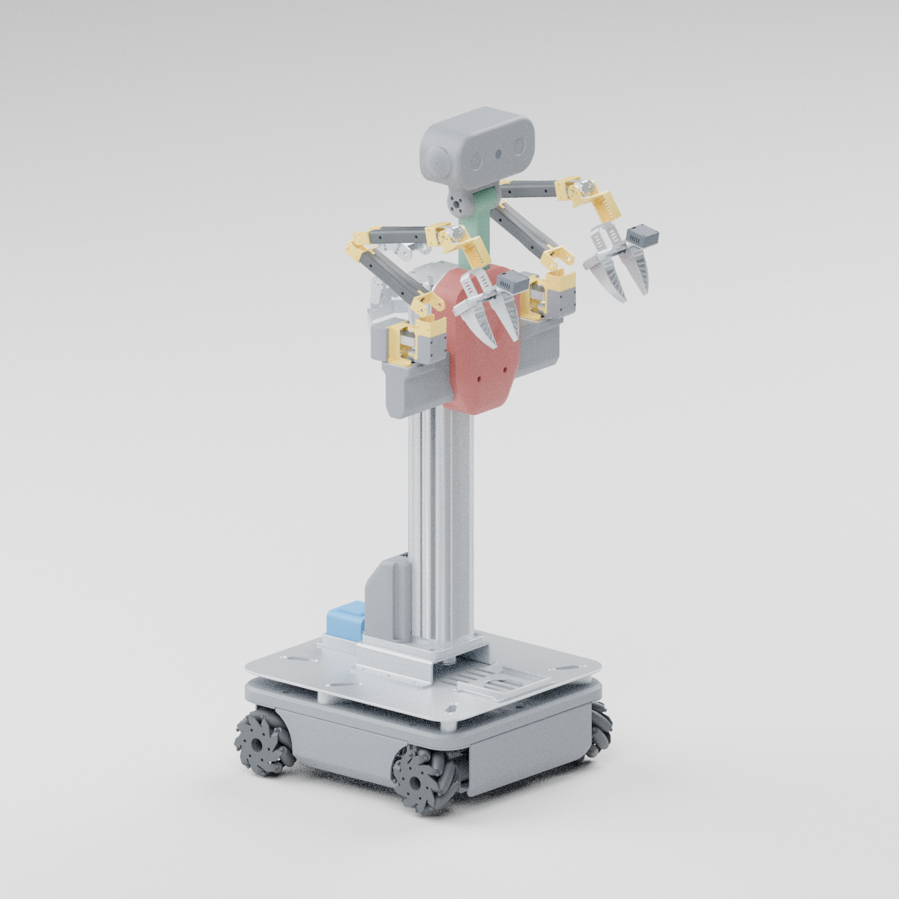

# 双臂移动机器人模型

从 `PackAndGo 0000 双臂移动机器人-2026-09-21.zip` 的原生 SolidWorks 缓存三角网格和装配变换转换。此处保存提高精度后的 `high` 版本，适配 Gazebo Harmonic / Gazebo Sim 8。模型已布置到 `duojin02` 的 `sim` 分支，作为后续仿真接入的独立资产。



## 文件

| 文件 | 用途 |
| --- | --- |
| `model.sdf` / `model.config` | Gazebo 模型、关节、简化碰撞体和现有模型插件配置 |
| `meshes/*.dae` | 45 个按刚体与材质合并的显示网格 |
| [dual_arm_mobile.urdf](../../urdf/dual_arm_mobile.urdf) | 同步的 URDF，使用 `package://duojin01_description/` 引用网格 |
| `preview.glb` / `preview.png` | 带颜色的静态整机预览与实际网格渲染图 |
| `conversion_report.json` | 保留/移除部件、网格统计、装配信息及转换质量记录 |
| `asset_manifest.json` | 原始压缩包摘要、转换来源与每个导入资产的 SHA-256 |
| `hardware_alignment.json` | 同步的 main 提交、底盘测量摘要、原装配坐标与保留网格哈希 |

SDF / URDF 使用米、弧度及 Z 向上的机器人坐标系；GLB 按 glTF 约定使用 Y 向上。GLB 是静态外观预览，运动关节以 SDF / URDF 为准。45 个显示网格保持原导入文件一致，未再次减面；SDF、URDF 和 GLB 的坐标基准已按 main 的底盘测算对齐。

## 精度与结构

| 项目 | 当前版本 |
| --- | ---: |
| 原装配展开三角面 | 1,918,229 |
| 去除内部细节后、减面前 | 939,467 |
| 最终显示三角面 | **516,650** |
| 物理刚体 | 25 |
| 整机外形约 | 0.540 × 0.407 × 1.040 m |

保留外壳轮廓、麦轮滚子、双臂、安装板、夹爪和传感器外形，去除紧固件、舵机内部齿轮、PCB 等细节。双臂每侧五轴，另有升降、两只双指夹爪和四个轮轴。配色按部件类别重建。显示网格与碰撞体分开，碰撞体采用盒体和圆柱，以降低实时仿真开销。

质量、惯量、关节轴/限位、力矩与控制参数来自几何推定或先前仿真整定，尚需硬件参数校准。未恢复 CAD 配合约束；夹爪传动简化为两指平移，自碰撞关闭。轮胎接触采用整体圆柱，底盘的 `VelocityControl` 与 `MecanumDrive` 配置用于运动演示，不能据此评估真实麦轮摩擦、牵引力或打滑。

## 与 main 的底盘同步

2026-10-06 同步 `main` 的 `fd3c05a`，继承的真机描述与 Nav2 配置使用最新底盘测算，导航足迹仅包含底盘及四轮，外包约 **426.0 × 405.4 mm**。详细来源见 [底盘测算报告](../../../../docs/chassis/README.md)。

独立整机资产的基座原点也改为四轮拟合轴心的地面投影。上部装配、主体显示网格及其估算质心随坐标基准平移；轮子网格增加相对新轴心的补偿偏移，保持 CAD 零姿态的外形和装配位置。

- 四轮轴心与 main 的拟合结果一致，轴距 **312.756 mm**、平均轮距 **355.082 mm**，碰撞圆柱厚度 **50.000 mm**。最大滚子包络半径约 **50.367 mm**，作为仿真名义轮半径参数，仍不是实测有效滚动半径。
- 主体碰撞盒使用 main 的主体包围盒；所有显示网格与 GLB 二进制几何数据保持原样。
- 雷达扫描原点相对基座为 `(0.092472, -0.000009, 0.130233)` m，零度朝车头。保留内部 `lidar_link`，新增与 main 一致的 `laser` 坐标系并用于扫描消息的 frame ID。光学高度仍是明确标记的壳体中面代理，待实测标定。

在仓库根目录执行 `python3 scripts/sync_model_geometry.py` 可按继承的测量清单重新对齐。脚本保留原装配参考坐标，重复执行不会累积偏移；每次运行更新资产清单哈希。原转换报告中的 bounds 与误差统计保留原转换坐标，当前基座变换记录在 `hardware_alignment.json`。

## 资产安装与加载

description 包的安装规则会同时安装完整模型目录和 URDF。现有真机启动入口仍使用原先的 `duojin01.xacro`。本阶段范围为模型资产和安装打包；Gazebo 场景、ROS 桥接与启动入口在后续接入时配置。

在已有 ROS 2 Humble 开发环境中，从仓库根目录构建资产包：

```bash
colcon build --packages-select duojin01_description
source install/setup.bash
```

供以后独立 Gazebo 场景引用时，把包含 `dual_arm_mobile` 的父目录加入资源路径：

```bash
model_root="$(ros2 pkg prefix --share duojin01_description)/models"
export GZ_SIM_RESOURCE_PATH="${model_root}${GZ_SIM_RESOURCE_PATH:+:${GZ_SIM_RESOURCE_PATH}}"
```

场景中的模型引用为：

```xml
<include>
  <uri>model://dual_arm_mobile</uri>
</include>
```

直接使用源码资产时，父目录是 `src/duojin01_description/models`。模型名称和目录层级须保持一致，以解析 SDF 内的 `model://dual_arm_mobile/meshes/...` 引用。

## 来源与验证范围

原导入核对了源资产摘要、网格面数、SDF / URDF 结构与网格路径，并在本地容器中验证 SDF 和 description 包的安装结果。本次底盘同步额外检查硬件边界、SDF / URDF 轴心一致性、原装配显示位置保留、GLB 几何与 45 个网格哈希、重复同步一致性，以及两个 costmap 的底盘足迹。

本次 24 项测试、两包构建、URDF / SDF 解析和安装目录校验通过，记录见 [同步验证](../../../../docs/evidence/sim-chassis-sync-2026-10-06.json)。验证范围为模型几何与安装，新的 ROS 桥接、控制接入和真机验证仍留待后续阶段。

`asset_manifest.json` 中 Gazebo 8.12.0、ROS 2 Humble 及转换工具版本记录来自原模型转换阶段；此前的运动与传感器测试不代表本分支已完成系统接入。原 CAD 与派生外形的权利归原权利人。原生文件格式解析参考 [cadmpeg 格式研究文档](https://github.com/cadmpeg/cadmpeg/blob/52c8b0a4ceb9c5fbcdf2a8c21aecced98e6bceed/docs/formats/sldprt.md)，作者 cadmpeg，文档许可 CC-BY-4.0。
